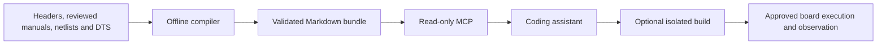

# Project Praxis

**From hardware references to AI-assisted firmware development.**

[](docs/experimental-release.md)
[](LICENSE)
[](pyproject.toml)
[](docs/docker.md)

[Quick start](#quick-start) · [Documentation](docs/README.md) · [Examples](#examples) · [Contribute](CONTRIBUTING.md) · [Roadmap](docs/experimental-release.md)

Praxis gives coding assistants source-backed hardware context through the Model Context
Protocol. It compiles engineering sources into indexed Markdown bundles, retrieves complete
register tables and board connections, and checks documentation dependencies before peripheral
bring-up. **Local, vectorless retrieval: no embeddings or vector database.**

**Experimental alpha · STM32F407 / Cortex-M4 first.** Useful for supported prototypes,
experiments and contributions. Universal MCU support and production qualification remain open.

## Why Praxis?

- **Hardware context with provenance:** canonical peripheral documents, exact pin/net lookup,
  and explicit source references.
- **Dependency-aware retrieval:** clocks, pins, peripheral control and interrupts follow the
  selected bundle's Hardware Execution Dependency Graph (HEDG).
- **Portable knowledge MCP:** three read-only tools, Docker packaging, and OpenCode / Claude
  Desktop configuration examples.
- **A path to the board:** optional F407 sandbox builds, ELF checks, approved ST-LINK flashing
  and scoped telemetry.

## How it works



The assistant generates the firmware. Praxis supplies knowledge and scoped verification tools.
Imported documents require review; reading them and compiling code do not prove hardware correctness.

## Quick start

**Requirements:** Docker with Linux containers, a source checkout, and an MCP client.
No board or host Python installation is needed for knowledge retrieval.

1. Build the knowledge image from the repository root:

   ```bash
   docker build -t project-praxis:0.1.0 .
   ```

2. Copy the [OpenCode](examples/opencode.docker.example.json) or
   [Claude Desktop](examples/claude-desktop.docker.example.json) configuration into your client.
   Replace the Docker executable and bundle placeholders with absolute paths. Select
   `bundles/stm32f407g-disc1-e01-arm-core-v2` for the current F407 baseline.
3. Restart the client and try:

   > Use Project Praxis to read the wiki index and confirm the target and board reference.
   > Query LED_A and USER_BUTTON, then retrieve their required peripheral documents.
   > Explain the connections and list any missing facts. Do not flash hardware.

The client launches Docker over stdio; no HTTP port or manually started server is needed.
See [Docker setup](docs/docker.md) for launch commands and permissions, or the
[detailed guide](README_DETAILED.md) for native installation and ingestion.

## Alpha scope and evidence

The primary reference board is **STM32F407G-DISC1, MB997-E-01**, using STM32F407VGT6.
The bundle has **22 reviewed peripheral/core subsets and 32 operating-mode contracts**;
these counts do not imply complete MCU coverage.

| Layer | Current evidence |
| --- | --- |
| Knowledge MCP in Docker | Linux amd64; 110 real tool calls across three sessions passed |
| Software regression | 861 tests passed; four native KiCad checks skipped |
| Physical demonstrations | LED/button, UART loopback and scoped CAN internal-loopback observations |
| Latest ARM-core example | Modeled and target-compiled; unflashed |

F401/AVR and synthetic inputs are labeled fixtures. Other targets need explicit profiles and
review. USB, Ethernet, SDIO, bootloader handoff and several peripheral modes remain incomplete.
The Docker image packages retrieval; ingestion, Linux/Podman builds and USB access require
separate setup. No registry image has been published yet. See [release scope](docs/experimental-release.md),
[test evidence](docs/STATUS.md) and [remaining qualification work](docs/PUBLICATION_READINESS.md).

## Examples

- [LED blink and USER button](examples/stm32f407g-disc1-led-button/README.md)
- [UART loopback, timer and interrupts](examples/stm32f407g-disc1-uart-loopback/README.md)
- [CAN internal loopback](examples/stm32f407g-disc1-can/README.md)
- [Cortex-M4 / SysTick contracts](examples/stm32f407g-disc1-arm-core/README.md)

## Contributing and roadmap

Help add reviewed peripheral modes, exact board mappings, reproducible tests, or clearer docs.
Hardware is optional for source and software contributions. Start with
[CONTRIBUTING.md](CONTRIBUTING.md); use the repository's issue and pull-request templates.

Next priorities are clean alpha onboarding, a versioned container release, scalable provenance,
and timer PWM/capture and SPI routing. See the [roadmap](docs/experimental-release.md),
[architecture](docs/system-design.md) and [sequence diagrams](docs/sequences.md).

## License

Praxis is [MIT licensed](LICENSE). Third-party headers, firmware assets and source-derived
material retain their respective notices; see the [detailed guide](README_DETAILED.md).

