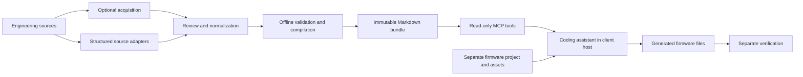

# Project Praxis documentation

- [Independent projects, portable setup and compatible bundle reuse](project-workspaces.md).
- [Reliability stabilization and remaining acceptance gates](reliability-plan.md).
- [Current supported baseline: generated scope and revision-bound evidence](CURRENT_STATUS.md).

- [Project bundle handoff: publish, adopt and continue without reconnecting MCP](bundle-handoff.md).

- [Requested-project reporting: HTML, connectivity SVG, design explanations and evidence boundaries](project-reporting.md).

- [TIM5 capture interrupts: source contracts, failure models, fixed telemetry and MCP replay](timer-irq.md).

- [Physical paired-timer trial: wired success, no-edge timeout and recovery status](reports/timer-route-results.md).

- [Artifact-bound timer observations, raw-period qualification and physical-test procedure](timer-observations.md).

- [Routed timer PWM/capture, per-mode instance scopes and verification](timer-routes.md).

- [F407 timer operating contracts, internal examples and verification](timer-modes.md).

- [Alternative register interpretations and timer ingestion](register-field-views.md).

- [F407 applicability, package constraints and source-backed extraction repairs](inventory-reconciliation.md).

- [Manufacturer capability inventory, source scope and reconciliation](manufacturer-inventory.md).

- [Full F407 acceptance audit, remaining gaps and closure sequence](f407-full-acceptance.md).

- [Complete document retrieval, native KiCad compatibility and zero-skip acceptance](document-scale.md).

- [Declarative compiler contracts, algorithms and sequence diagrams](compiler-contracts.md).

Praxis is a local hardware knowledge compiler and a read-only MCP retrieval server. A coding
assistant consumes its evidence and creates firmware in a separate workspace. This documentation
describes the implemented development baseline, the reasoning behind it, and the evidence needed
to assess its results. It does not claim a hardware-qualified release or measured superiority over
another retrieval system.

The complete product objective is model-driven firmware development: the evaluation board becomes
a tool the model can program, execute and debug through Praxis. Knowledge retrieval is implemented;
the isolated F407 build/link/ELF-check bridge is implemented in the optional
[build service](build-service.md). Optional [read-only probe inspection](hardware-inspection.md)
is implemented in that same service, along with opt-in [target-bound programming/control](hardware-programming.md).
The first physical write was separately confirmed by exact readback after a late reporting error;
see [failure analysis and recovery](hardware-recovery.md). A later approved
[physical flash demonstration](flash-demo.md) passed erase/program/readback/halted reporting and
reset/run, with user-confirmed LED/button behavior. Standalone halt/resume, broader programming
qualification and automated physical-test support remain open in [hardware verification](hardware-verification.md).
Execution-only reset/run and a human LED/button check subsequently passed; see
[the actual execution evidence](hardware-execution-evidence.json).

## Reading paths

| Reader or task | Start here | Continue with |
| --- | --- | --- |
| Understand the project | [System design and theory](system-design.md) | [Sequence diagrams](sequences.md) |
| Prepare the experimental launch | [Alpha launch checklist and announcement](alpha-launch.md) | [Changelog](../CHANGELOG.md) |
| Host the public documentation | [Vercel setup](vercel-hosting.md) | [Website source and build](../website/README.md) |
| Read the original setup/reference guide | [Detailed README](../README_DETAILED.md) | [Experimental scope](experimental-release.md) |
| Understand what the assistant receives | [Knowledge and firmware assets](asset-contract.md) | [Agent instructions](AGENT_INSTRUCTIONS.md) |
| Run the server | [Repository README](../README.md) | [Board ingestion](board-ingestion.md) |
| Run the knowledge MCP in Docker | [Docker setup and client configurations](docker.md) | [Experimental release scope](experimental-release.md) |
| Add a board | [Board ingestion](board-ingestion.md) | [Source format and modules](architecture.md) |
| Add a Cortex-M knowledge target | [Reusable target adapters](target-adapters.md) | [Contribution guide](../CONTRIBUTING.md) |
| Explore STM32F1/G0/H7 knowledge | [Experimental multi-family compiler](stm32-family-expansion.md) | [Offline target matrix](../sources/stm32-experimental/catalog.json) |
| Contribute a mode, board or MCU | [Contribution guide](../CONTRIBUTING.md) | [Scoped capability assessment](capability-support.md) |
| Understand the STM32/ARM experimental baseline | [Experimental release scope](experimental-release.md) | [ARM core contracts and sequence](arm-core-support.md) |
| Acquire web documents | [Web ingestion](web-ingestion.md) | [F407 header ingestion](f407-ingestion.md) |
| Prepare manual facts for review | [Configurable evidence compiler](manual-review-compiler.md) | [Actual MCP extraction evidence](manual-review-evidence.json) |
| Review/acquire/publish through MCP | [Ingestion service and sequence](ingestion-mcp.md) | [UART example](../examples/stm32f407g-disc1-uart-loopback/README.md) |
| Expand MCU coverage | [Configurable discovery and coverage](peripheral-discovery.md) | [Expanded F407 index](../bundles/stm32f407g-disc1-e01-discovery-v2/wiki/index.md) |
| Assess the implementation | [Evaluation and claims](evaluation.md) | [Milestone evidence](STATUS.md) |
| Prepare a public release | [Publication readiness](PUBLICATION_READINESS.md) | [Portable MCP test prompts](mcp-test-prompts.md) |
| Cite external concepts and board sources | [BibTeX references](references.bib) | [System design](system-design.md) |
| Reproduce Milestone 1 checks | [Acceptance gate](milestone1.md) | [Recorded results](milestone1-evidence.json) |
| Provision isolated compilation | [Verification](verification.md) | [Release checker](../tools/release_check.py) |
| Build a complete F407 image through MCP | [Build service](build-service.md) | [Reference application](../examples/stm32f407g-disc1-led-button/README.md) |
| Inspect a connected ST-LINK target | [Hardware inspection](hardware-inspection.md) | [Inspection scenario](mcp-test-prompts.md#read-only-inspection) |
| Review programming and execution scope | [Programming/control](hardware-programming.md) | [Authorized scenario](mcp-test-prompts.md#approved-programming) |
| Observe firmware counters through MCP | [Artifact-bound telemetry](firmware-telemetry.md) | [UART physical results](reports/uart-loopback-results.md) |
| Qualify UART failure and recovery | [Telemetry failure/recovery procedure](scenarios/telemetry-failure-recovery.md) | [Publication readiness](PUBLICATION_READINESS.md) |
| Review feature modes and offline qualification | [Mode contracts and sequences](peripheral-modes.md) | [Expansion evidence](feature-expansion-evidence.json) |
| Configure dependent clock modes | [Clock-mode graph and sequences](clock-modes.md) | [Compile-only clock example](../examples/stm32f407g-disc1-clock/README.md) |
| Expand a blocked peripheral request | [Workflow review and ADC extension](adc-expansion.md) | [ADC example and test prompt](../examples/stm32f407g-disc1-adc/README.md) |
| Compose successive MCU extensions | [I²C composition and sequences](i2c-expansion.md) | [I²C scope and MCP prompt](../examples/stm32f407g-disc1-i2c/README.md) |
| Review DAC digital completion | [DAC extension and sequences](dac-expansion.md) | [DAC example and MCP prompt](../examples/stm32f407g-disc1-dac/README.md) |
| Review CAN loopback and interrupts | [CAN contracts and sequences](can-expansion.md) | [CAN example and MCP prompt](../examples/stm32f407g-disc1-can/README.md) |
| Observe and qualify CAN through MCP | [CAN telemetry ABI and sequence](can-telemetry.md) | [Explicit CAN client launch](../examples/opencode.can-telemetry.example.json) |
| Investigate CAN initialization through MCP | [RX source/model/build follow-up](can-rx-followup.md) | [Approved physical result](reports/can-rx-results.md) |
| Review the failed physical CAN attempt | [CAN results and initialization diagnosis](reports/can-loopback-results.md) | [Sanitized observation evidence](can-telemetry-evidence.json) |
| Follow a physical flashing demonstration | [LED/button flash sequence](flash-demo.md) | [Current demonstration evidence](flash-demo-evidence.json) |
| Test the already-programmed candidate | [Recovery procedure](hardware-recovery.md) | [Execution-only scenario](mcp-test-prompts.md#execution-only) |
| Assess the actual execution test | [Execution evidence](hardware-execution-evidence.json) | [Reviewed report](hardware-execution-evidence.json) |
| Specify a protocol/timer/interrupt test | [UART loopback scenario](scenarios/uart-loopback-timer-interrupts.md) | [Readiness-aware prompt](mcp-test-prompts.md#uart-loopback) |
| Understand intended flash/test support | [Planned hardware verification](hardware-verification.md) | [Evaluation](evaluation.md) |

Known publication defects are recorded in [bundle advisories](bundle-advisories.md).

## End-to-end contract

The compiler and server contain no model calls. The host decides which tools to call and which
files to write. The retrieval server neither generates firmware nor runs a build. The optional
verification CLI compiles C separately. The optional build MCP/CLI adds full F407 linking and
image validation, optional read-only target diagnostics and separately authorized programming/control.
A first physical programming attempt and separate matching readback are recorded in
[recovery evidence](hardware-recovery-evidence.json). Execution-only reset/run and the human
basic LED/button scenario are recorded separately in [execution evidence](hardware-execution-evidence.json).
Full flash reporting subsequently passed in [the physical demonstration](flash-demo.md);
standalone halt/resume and measured timing remain unqualified.

The Discovery references cover the MB997 E-01 LED/button subset and a separately selected
UART/timer/EXTI subset. An MCU datasheet establishes
pin capabilities; a board schematic establishes which board components reach those pins. Neither
establishes the current clock configuration or modifications on an unknown physical card.

## Documentation conventions

- **Implemented:** backed by the current code and the named tests.
- **Observed:** a recorded execution or reported client interaction, with its limits stated.
- **Proposed:** an extension or experiment; not an existing tool or guarantee.
- **Reference revision:** the source-defined board revision, distinct from a user's physical PCB.

Mermaid diagrams are stored directly in Markdown and render in compatible viewers, including
GitHub. They describe logical interactions; they are not captured execution traces. Reference
links support external concepts, while implementation links point to this repository. For a
publication, record the exact source revision, dependency lock and bundle revisions used rather
than treating these living documents as an immutable experiment record.
