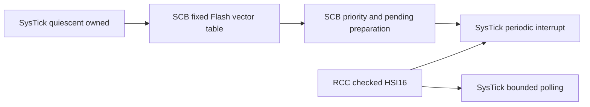

# STM32F407 ARM core support

The ARM core extension adds source-reviewed SysTick timing and SCB exception preparation
to the existing STM32F407G-DISC1 knowledge bundle. It uses the existing configurable compiler,
definition extensions, mode dependency graph and three-tool retrieval MCP. A small generic
compiler addition publishes **reviewed write-value masks**, including device constraints that
are narrower than a shared CMSIS declaration.

Use [arm-core-v2](../bundles/stm32f407g-disc1-e01-arm-core-v2/wiki/index.md),
[its source profile](../sources/stm32f407g-disc1/profile-arm-core-v2.json),
[the example](../examples/stm32f407g-disc1-arm-core/README.md) and
[the client configuration](../examples/opencode.arm-core.example.json).
The earlier local arm-core-v1 revision is superseded for SysTick retrieval by
[PRAXIS-2026-002](bundle-advisories.md#praxis-2026-002-polling-pending-systick-state).

## Added operating contracts

| Contract | Supported subset | Boundary |
| --- | --- | --- |
| `rcc/hsi16_core_checked` | Read-only confirmation of nominal HSI16, selected source, bus divisors and updated clock variable | Does not switch live clocks or measure oscillator frequency |
| `systick/quiescent_owned` | Inspect an exclusively owned disabled counter under privileged Thread mode and global configurable-interrupt masking | CTRL inspection consumes COUNTFLAG; not a passive ownership probe |
| `scb/flash_vector_table` | Select the pinned 98-entry table at `0x08000000`; check stack/handler, alignment, barriers and readback | No arbitrary relocation, MSP change, image handoff or bootloader |
| `scb/systick_exception_setup` | SysTick priority at SHP byte 11, four implemented high bits, exact pending-clear action | No external NVIC enable bit; preserve PendSV, NMI and grouping |
| `systick/core_clock_polling` | Integer periodic reload, stale-flag drain and bounded later-event polling | Reject an already pending exception; flags coalesce and do not measure complete elapsed intervals |
| `systick/core_clock_interrupt` | Source enable after vector/priority/handler preparation; 1 kHz example at nominal HSI16 | Delayed exceptions can coalesce; not a qualified RTOS or real-time clock |

The bundle now publishes **41 register blocks, 22 reviewed subsets, 32 mode contracts and
20 ready authored workflows out of 33**. Register rows remain 523 and extracted fields remain
2,131: these changes review previously extracted core declarations rather than inventing another
register map. These are scoped counts, not a percentage of all STM32 or ARM capabilities.

## Why the source review matters

The ingestion MCP acquired ST PM0214 Rev10, prepared header-checked candidates, returned complete
source pages and rendered register diagrams. The implementing author reviewed those responses
and recorded exact-source editorial decisions. Independent engineering review remains pending.

The automated packet identified three SCB conflicts: the shared VECTPENDING mask, the broader
VTOR envelope and SHPR word views versus the CMSIS byte array. Reset/calibration contradictions
also appear across the SysTick summary, detailed text and rotated register-map figure; those
were not all detectable by the text candidate extractor. The rendered diagrams were necessary
evidence. [The resolution record](../sources/stm32f407g-disc1/reviewed/arm-core-v2/resolutions.md)
preserves these issues rather than silently choosing a convenient value.

For F407 VTOR, the supported write-value mask is `0x3FFFFE00` with 512-byte alignment,
while the common header declares `SCB_VTOR_TBLOFF_Msk=0xFFFFFF80`. Both facts are retained
with different roles. All four SysTick reset values remain unasserted; the implementation
programs LOAD, VAL and CTRL explicitly and never relies on CALIB to establish timing.

The new optional `Register.write_mask` constrains values used by a reviewed operating subset.
It must fit the register and declared field envelope, have known access, and carry semantic
provenance. A zero mask permits a zero action write only on a writable register; RO remains
non-writable. A mask does not authorize RMW or override action/side-effect rules. Older records
omit this optional field on serialization, preserving their composed-definition hashes.

## Two graphs and one actual implementation

The document route is `index → RCC and SCB → SysTick`. It does not force unrelated UART or
external NVIC retrieval. The separate mode graph can express startup phases without a document
cycle:



Reading these contracts proves retrieval compliance. The actual firmware sequence is checked
separately: [the same controller](../examples/stm32f407g-disc1-arm-core/application/core_controller.h)
executes in both the ARM example and the synthetic register-effect model. The model implements
read-to-clear COUNTFLAG, VAL clear actions, independent pending state, unknown clear-bit reads,
write failures and ordering requirements. The example supplies real volatile MMIO and DSB/ISB.

```mermaid
sequenceDiagram
    participant A as Implementing author / coding assistant
    participant I as Ingestion MCP
    participant C as Offline compiler
    participant K as Knowledge MCP
    participant B as Isolated build MCP
    A->>I: Acquire PM0214; read full text and rendered pages
    A->>I: Discover SCB/SysTick and prepare manual candidates
    I-->>A: Exact source hashes, conflicts, fields and review gaps
    A->>A: Review device constraints and author scoped records
    A->>I: Record editorial review and publish new profile
    I->>C: Validate sources, write masks, graphs, links and document limits
    C-->>I: New immutable bundle
    A->>A: Run the shared controller in synthetic effect tests
    Note over A,I: Pending-state correction becomes a separate revision; older facts stay immutable
    A->>K: Index, LED mapping, RCC, SCB and SysTick
    K-->>A: Complete documents and dependency gates
    A->>B: Read matching build profile; build application; revalidate artifact
    B-->>A: Rootless ARM linking and ELF checks
    Note over A,B: Physical execution requires a separate exact-image operation and observations
```

## Validation and limits

The final full regression passed **861 tests with four native KiCad skips**; Ruff and the
dependency lock check passed. An earlier focused run passed107 tests. Repeated publication
through the ingestion MCP produced49 byte-identical files at revision
`edb8249ce849c59e6642f2edab2b58e036bc0105925897d8a61c04449b00f7e5`.

The actual ten-call knowledge/build MCP replay passed dependency gates, LED mapping, matching
revisions, isolated ARM compilation/linking and artifact revalidation. The 1,736-byte image has
a strong `SysTick_Handler` at vector slot 15, distinct from Default_Handler, and initial SP
`0x20020000` in the contiguous main SRAM bank. It has **not been flashed or physically tested**.
Earlier LED/UART/CAN observations belong to their own images and do not qualify this example.

The shared effect tests exercise reload endpoints/fractional periods, invalid context/ownership,
wrong clock state, old pending exceptions, incorrect stack/handler addresses, write/readback
failures, finite waits, cleanup reporting and terminal failure without automatic reinitialization.
See [recorded evidence](arm-core-evidence.json) for the final regression and artifact identifiers.

Repeated MCP publication must produce identical bytes. Every served document stays within 64 KiB;
the source catalog is currently 65,460 bytes, leaving little expansion room. The next compiler
work must partition provenance losslessly rather than truncate facts or split peripheral tables.

The first experimental release remains scoped to the documented F407/Cortex-M4 baseline.
New STM32 parts can now use explicit knowledge adapters under the `stm32` family without
overriding existing builtin identities; each still needs exact source/package review. Such a
knowledge profile does not inherit F407 build assets or flashing support.

**Next:** remove the provenance-catalog growth bottleneck, then extend timer PWM/capture and
reviewed SPI board routing. USB, Ethernet, SDIO, RTC, full flash programming and bootloader
handoff remain separate evidence-driven work, not implied by ARM core support.
