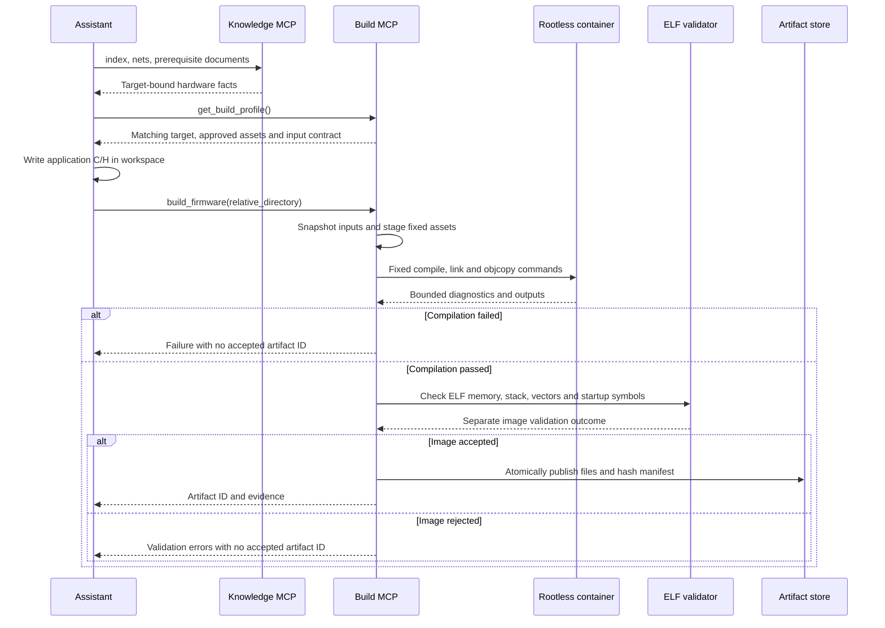

# Isolated F407 build service

Praxis now has two independent stdio MCP processes. `project-praxis` supplies reviewed
hardware knowledge and enforces prerequisite retrieval. The optional `project-praxis-build`
supplies pinned integration assets, compiles application C, links an image, validates its
structure and publishes a content-addressed artifact. Optional target-bound programming/control
requires an explicit operator grant; the knowledge server remains read-only.

## Supported contract

The first full-link profile targets STM32F407VGT6, LQFP100, C11, Cortex-M4 Thumb soft-float,
flash boot. It is explicitly paired with the selected knowledge bundle. Pin semantics still
come from that bundle; the MCU build profile cannot identify a physical board revision.

| Tool | Result |
| --- | --- |
| `get_build_profile()` | Target and bundle revision; asset revision/inventory; memory and clock contract; application workspace; image/compiler identity |
| `build_firmware(source_directory)` | Relative-workspace C/H snapshot compiled in rootless Podman; diagnostics, separate compile/image outcomes and accepted artifact ID |
| `validate_firmware(artifact_id)` | Registered artifact hashes and ELF checks repeated; no arbitrary ELF path exposed over MCP |

With `--hardware-profile`, this same server additionally exposes `list_debug_probes()`,
`inspect_target(probe_serial)`, `inspect_execution(connection_id)` and read-only
`plan_firmware(artifact_id, connection_id)`. No third MCP process is needed. See
[inspection](hardware-inspection.md) and [programming/control](hardware-programming.md).
Only an explicit `--hardware-authorization` additionally enables `flash_firmware` and
`control_execution`. Without a hardware profile the server retains only its three build tools.
With a hardware profile and `--telemetry-artifact ARTIFACT_ID`, it also exposes the bounded
[firmware telemetry tool](firmware-telemetry.md), without enabling write operations.

The original knowledge server still exposes exactly its three read-only tools. The build
server does not share HEDG session state: instructions require knowledge retrieval first,
but the build process cannot mechanically prove the model read another server's documents.

Only application `.c`/`.h` files are accepted. No Makefiles, scripts, custom assembly,
linker scripts, compiler flags, plugins or response files are accepted. Source paths stay
under an explicit workspace; symlinks, special files, traversal and pinned-header shadowing
are rejected. Snapshot limits are 128 files/2 MiB. Approved includes remain restricted.

Pinned ST startup/system code, Arm/ST CMSIS headers, a minimal C runtime and the Praxis
linker come from [the asset registry](../assets/stm32f407vg/manifest.json). All bytes are
hash-checked at server startup. The profile reserves 4 KiB of stack in 128 KiB main SRAM;
64 KiB CCM is separate and unused. The initial SP is `0x20020000`. The vendor startup's
98 vectors are cross-checked against the exact device header, including naming aliases.

The reference application explicitly establishes HSI 16 MHz/AHB /1, then updates
SystemCoreClock. This is distinct from the knowledge bundle's optional 168 MHz PLL recipe.
The upstream SystemInit does not silently configure that PLL recipe. Arbitrary application
clock logic and electrical conditions still require review and measurement.

## Build and validation sequence



Generated source is compiled only in a rootless Podman container with network disabled,
read-only root and input mounts, dropped capabilities, no added devices, one CPU, 1 GiB RAM,
64 processes and a 30-second command budget. Individual output files are limited to 8 MiB;
combined compiler output artifacts to 16 MiB; diagnostics to 64 KiB. Timeout/output-limit
cleanup removes the container. This is not execution of the generated firmware.

ELF validation checks ARM executable format, load/section bounds, writable/executable
separation, main-SRAM stack placement/reservation, vector location/size/handler slots,
reset entry and startup copy/zero symbols. It does not prove arbitrary startup instruction
behavior, pin choices, application register ordering or physical operation. Inactive weak
handlers share the same default address; address checks cannot distinguish equivalent aliases.

Accepted artifact IDs bind source fingerprint, bundle/asset revision, immutable image,
fixed flags, build report and ELF/bin/hex/map hashes. A staging directory is atomically
renamed into the artifact store. Existing IDs are revalidated before reuse; modified
payloads fail integrity checks. This supplies local integrity, not cryptographic signing
or protection against an administrator replacing the service and all its trust inputs.

## Commands

Install dependencies once, then use the already installed executable for offline runtime:

```bash
uv sync --locked --extra build
# Development machine only: select the project-local Podman installation.
source .praxis-output/podman-env.sh
.venv/bin/praxis build --bundle bundles/stm32f407g-disc1-e01-m1 \
  --assets assets/stm32f407vg --workspace examples \
  --source stm32f407g-disc1-led-button/application \
  --artifacts .praxis-output/firmware-artifacts --lock toolchain-f407.lock.json
```

On other machines install normal rootless Podman and provision the image using
[the sandbox procedure](verification.md). The recorded image ID must exist locally;
runtime never pulls or installs packages. `sandbox-build` uses network access only while
provisioning packages from the fixed Debian snapshot and records actual compiler versions.

Existing images can be checked without compiling or changing them:

```bash
.venv/bin/praxis validate-elf --assets assets/stm32f407vg \
  --elf /absolute/path/to/your/firmware.elf
```

Invalid images return exit 1 and structured errors. Input/environment errors return exit 2.
The original OpenCode image is expected to fail: `0x20030000` initial SP and 97-entry/misaligned
IRQ layout. It remains untouched. The checked-in reference passes the supported static contract;
physical behavior is separately recorded in [the flash demonstration](flash-demo.md).

## OpenCode integration

The [public OpenCode example](../examples/opencode.example.json) registers both servers. Replace
absolute path placeholders and provision the compiler image first. OpenCode launches each stdio
child itself; a separate terminal server is unnecessary. Exit the old client and start a fresh
instance after configuration changes. Development-only launchers and `temp/` sessions are omitted
from the public source archive; use the CLI/configuration example for portable setup.

Use [the build scenario prompt](mcp-test-prompts.md#build-and-validate). Confirm discovery of
both servers before running the scenario. Local MCP configuration uses OpenCode's `mcp`,
`type: local`, command array, and documented `timeout` option, rather than Claude's schema.
See [OpenCode's MCP documentation](https://opencode.ai/docs/mcp-servers/).

Direct stdio client tests establish server protocol behavior without OpenCode. OpenCode
testing establishes whether the chosen model follows the workflow and uses returned evidence.
Read-only probe inspection and target-bound programming/control are implemented separately from
building. Programming/control remain disabled in the default launcher. Explicitly authorized
LED/button and UART images have passed physical programming/readback/reset-run; see
[UART results](reports/uart-loopback-results.md). Automated stimulus/measurement and bounded hardware repair remain later
stages described in [hardware verification](hardware-verification.md).
