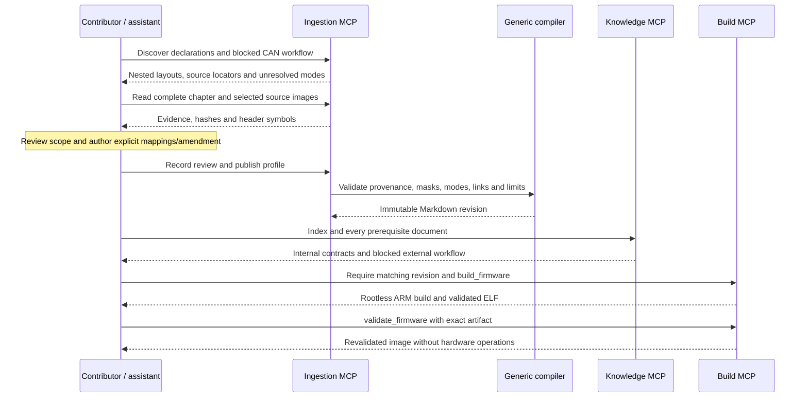
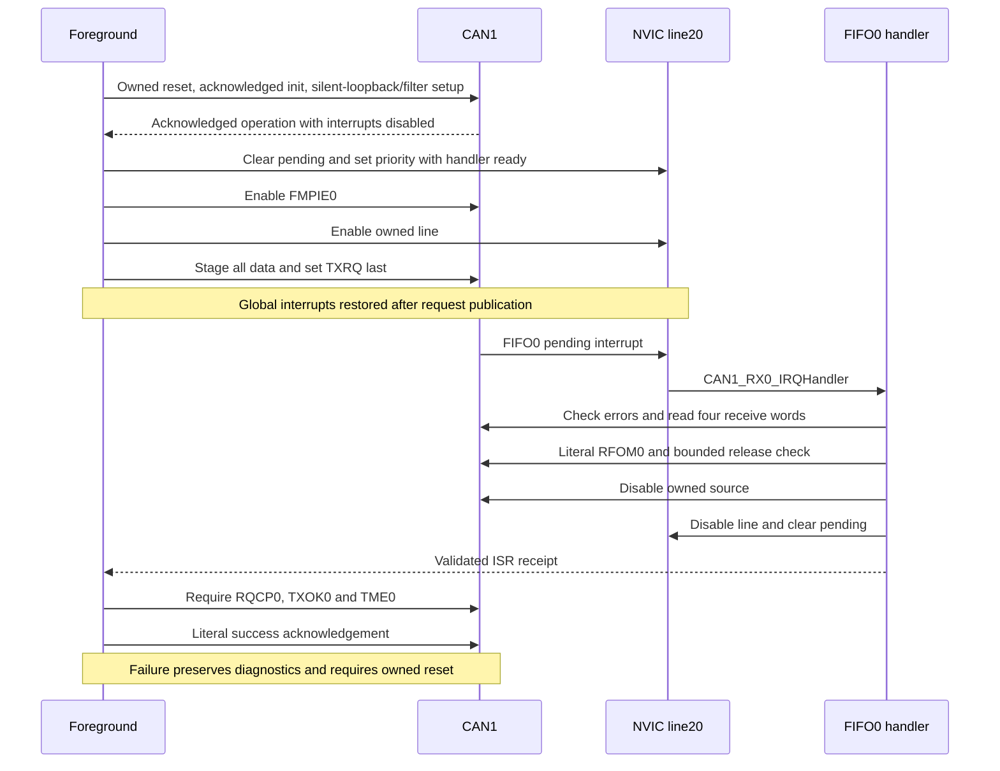

# CAN1 internal loopback and interrupt coverage

The `stm32f407g-disc1-e01-can-v1` bundle adds two reviewed CAN1 contracts:
`silent_loopback` and `silent_loopback_fifo0_irq`, with RCC gate/reset and NVIC
line-preparation dependencies. Previous DAC, I²C, ADC, clock and UART contracts
remain intact. The bundle has **20 reviewed subsets, 24 mode contracts and
15 ready authored workflows out of28**. Declaration inventory is 41 published
blocks, 523 register rows and2,131 fields. These counts describe authored coverage,
not every MCU capability. The [33-goal catalog](../examples/capabilities/stm32f407g-disc1-can.json)
includes planned boot/update work and is not an exhaustive percentage denominator.

The example is a CAN1-only standard0x123/eight-byte one-shot, mailbox0,
bank0/FIFO0, at nominal500kbit/s from the reviewed42MHz PCLK1 point. Combined
SILM/LBKM internally disconnects CANRX and holds CANTX recessive. No external
CAN wiring is required for this scope. External normal bus operation, transceiver
and board routes, CAN2, extended/remote/time-trigger traffic, CAN FD and general
recovery remain unsupported. No probe access, flash, reset or physical CAN test
occurred in this continuation.

## Compiler and source review

Hardware facts came through actual ingestion MCP responses: exact CMSIS
declarations, complete RM0090 Rev22 CAN chapter pages1069–1112, inherited
reviewed clock/NVIC records and selected source images. The author visually
reviewed silent-loopback isolation, filter packing, interrupt generation and
ambiguous reset tables. The [profile](../sources/stm32f407g-disc1/profile-can-v1.json)
records complete used parts and archive references. Raw acquisition archives
and local MCP traces are excluded from public distribution. Serving the bundle
requires neither source PDFs nor ingestion tools.

The generic compiler already supports explicit nested register-prefix and
non-overlapping field views. This extension exercises them through profile data:

```json
{
  "structure": "CAN_TypeDef",
  "prefix": "CAN",
  "register_prefixes": {
    "sTxMailBox_0__TIR": "CAN_TI0R",
    "sFIFOMailBox_0__RIR": "CAN_RI0R"
  },
  "register_fields": {
    "TSR": ["RQCP0", "TXOK0", "ALST0", "TERR0", "ABRQ0",
            "RQCP1", "TXOK1", "ALST1", "TERR1", "ABRQ1",
            "RQCP2", "TXOK2", "ALST2", "TERR2", "ABRQ2", "CODE", "TME", "LOW"]
  }
}
```

The names map an ABI-checked nested C member to exact vendor field macros.
Explicit field views avoid competing aggregate/individual aliases; they do not
invent masks or approve operating semantics. Discovery initially exposed31
missing mailbox fields. The final view publishes all89 CAN declaration rows and
108 fields, with operating semantics reviewed for23 registers only. Other
mailboxes/banks stay declarations. Filter offsets0x200–0x31C exist only in CAN1,
despite the vendor's reused CAN_TypeDef; mode instance scopes block CAN2 use.

The first publication drafts were rejected for non-semantic mode provenance and
overlapping header aliases. Both were corrected before immutable publication.
No source-authority or mask checks were relaxed. The new amendment binds the
exact composed parent, preserves earlier RCC modes and adds the scoped NVIC
contract. Repeated MCP publication produced49 byte-identical files. The largest
Markdown document is the62,364-byte provenance catalog, below65,536 bytes.

Two review decisions prevent guessed facts:

- Mailbox/filter data marked `X` stays unknown; the example explicitly stages
  every transmit word instead of assuming a zero reset.
- The FMR printed full reset includes reserved values left unenumerated in the
  summary table. The contract asserts defined FINIT/CAN2SB fields and preserves
  other bits read from hardware. It publishes no whole-register reset value.
  Both reserved-bit presentations are exercised by the model. Copied DATA4..7
  prose is resolved using explicit bit labels, exact masks and layout.



## Initialization, interrupt and completion contract

CAN starts in sleep. Under exclusive fresh-reset ownership, clear SLEEP while
requesting initialization, bound INAK/SLAK acknowledgement, and access BTR only
while initialization is acknowledged. BRP5/TS1=10/TS2=1/SJW0 derives
42MHz/(6×14)=500kbit/s, sample point12/14. Use NART and RFLM, keep automatic
recovery/time-trigger modes off, and configure/activate only bank0 while FINIT=1.
Leave initialization with a bounded acknowledgement wait.

Prepare CAN1_RX0_IRQn20/vector36 and handler state with global interrupts masked.
Clear the empty/disabled source's pending state, program priority5 policy, enable
FMPIE0, then the NVIC line. Stage identifier/DLC/both data words in the empty
mailbox and publish software expectations before TXRQ. Restore intended global
interrupt state last. The shared canonical NVIC document retains earlier
UART/TIM/EXTI retrieval dependencies. Those reads do not require their hardware
initialization for this CAN example. Document routing and actual writes are
separate evidence, as with other HEDG gates.

The handler checks errors before/after reading all four FIFO words and validates
identifier, length, accepted filter index and every byte. Only then may literal
RFOM0 release the oldest frame. Bound release acknowledgement, disable the
owned source/line, then clear NVIC pending. Spurious interrupts cannot establish
a receipt. Foreground completion requires that receipt plus RQCP0/TXOK0/TME0;
only validated success acknowledges RQCP0. Errors and cleanup failures preserve
diagnostics and latch reset-required. No automatic abort, drain or retry is added.



## Evidence and reproduction

The [shared controller](../examples/stm32f407g-disc1-can/application/can_controller.h)
runs in a [digital effect model](../tests/fixtures/f407_can_model.c) and the
[target example](../examples/stm32f407g-disc1-can/README.md). Forty-six modeled
cases cover missing interrupt delivery, stale/incomplete completion, simultaneous
errors, wrong identifiers/IDE/RTR/DLC/filter indexes/payload, lost writes,
initialization/release timeouts, source/NVIC cleanup failures, owner conflicts,
clock/reset assumptions, spurious interrupts and two reserved-bit presentations.
Models do not establish physical exception delivery or arbitrary code correctness.

An actual sixteen-call knowledge/build replay passes scope/gates, matching
revisions, rootless ARM compilation/full linking, ELF/vector checks and artifact
revalidation. The target-link test verifies vector slot36 points to the real
handler rather than Default_Handler. The [evidence](can-expansion-evidence.json)
records exact bundle/source/artifact identities and the regression outcome.

```bash
.venv/bin/praxis lint --bundle bundles/stm32f407g-disc1-e01-can-v1
.venv/bin/praxis support --bundle bundles/stm32f407g-disc1-e01-can-v1 \
  --catalog examples/capabilities/stm32f407g-disc1-can.json \
  --workflow can1_silent_loopback_irq
.venv/bin/pytest -q tests/test_can_modes.py
.venv/bin/python tools/check_workflow_mcp.py \
  --bundle bundles/stm32f407g-disc1-e01-can-v1 \
  --workflow can1_silent_loopback_irq \
  --blocked-workflow feature_can --blocked-workflow can1_external_bus \
  --mode can/silent_loopback --mode can/silent_loopback_fifo0_irq \
  --mode rcc/can1_gate_reset --mode nvic/can1_rx0_prepare \
  --source-directory stm32f407g-disc1-can/application \
  --output /tmp/praxis-can-replay
```

Use a fresh output directory and provisioned [sandbox](verification.md). The
[matching OpenCode example](../examples/opencode.can.example.json) selects the
new knowledge/build bundle without hardware tools. Existing launchers are not
switched. CI definitions now include CAN retrieval/preflight and isolated build
checks; no hosted CI execution is claimed.

The subsequent [CAN telemetry increment](can-telemetry.md) implements artifact-bound
observation and offline qualification for a separate firmware variant. The base
example's debug globals remain separate from that ABI. Next: complete read-only
physical preflight, obtain exact-image approval and observe the internal-loopback
result through MCP. Internal loopback needs no CAN jumper; physical timing,
revision/errata qualification, external-bus interoperability and independent
review remain separate work.
