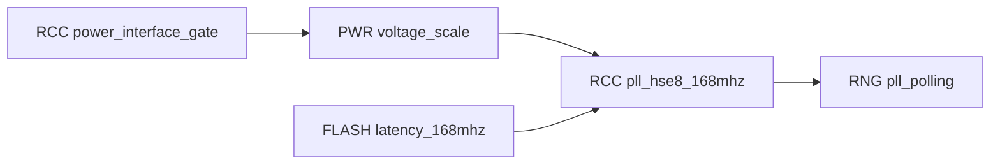

# Reviewed F407 clock modes and dependency-driven publication

The clock-v1 extension adds FLASH read-interface latency and PWR Scale 1 support for the
STM32F407VGT6 reference target. It also adds a reusable, instance-scoped **mode dependency
graph** to the compiler. Reviewed modes can require other exact modes without creating a
cycle in the document retrieval graph.

Use [the new bundle](../bundles/stm32f407g-disc1-e01-clock-v1/wiki/index.md),
[profile](../sources/stm32f407g-disc1/profile-clock-v1.json) and
[optional OpenCode configuration](../examples/opencode.clock.example.json).
Revision: `0e8737e667f05858aa39cf6484cd7a5c30125fd5ae2910c441187185380eccda`.
Earlier immutable bundles, active client selections and installed UART firmware are unchanged.

The bundle has **15 reviewed peripheral subsets, 12 explicit operating-mode contracts,
41 published register blocks, 523 register rows and 2,100 field definitions**. It recognizes
42 blocks and 99 typed instances; 33 blocks still lack a mode contract. These counts are
not a percentage of all MCU capabilities. Complete MCU feature support remains unfinished.

## Added scope

| Contract | Exact scope | Boundary |
| --- | --- | --- |
| `rcc/power_interface_gate` | RCC APB1 PWR gate and readback | Gate enablement does not establish regulator readiness |
| `pwr/voltage_scale` | F407 internal-regulator Scale 1 with bounded VOSRDY polling | No Stop/Standby, backup-domain, over-drive or physical voltage qualification |
| `flash/latency_168mhz` | FLASH_ACR latency 5 at declared 2.7–3.6 V and 168 MHz HCLK | No erase/programming, option-byte, cache-maintenance or bootloader support |
| `rcc/pll_hse8_168mhz` | Owned startup, HSE8 crystal, M8/N336/P2/Q7, AHB/1, APB1/4, APB2/2 | Assumed clock/supply and quiescent ownership; no measured timing or errata certification |
| `rng/pll_polling` | Existing RNG polling procedure with the complete declared clock-mode closure | No entropy certification or physical RNG qualification |

The clock recipe derives SYSCLK/HCLK 168 MHz, PCLK1 42 MHz, PCLK2 84 MHz and PLL48CLK
48 MHz under those assumptions. The compiler checks declared mode/instance references,
semantic source authority and publication readiness. It does not discover the physical
board's supply, clock modifications or silicon revision.

## Two different graphs

Document HEDG gates require evidence retrieval. The mode graph requires an explicit
configuration contract. Neither graph alone proves the order of arbitrary direct-register code.



There is no RCC document → PWR document → RCC document cycle: RCC foundational gate facts
are retrieved first; the same RCC document also describes a later PLL mode. The RNG document
requires RCC, FLASH and PWR retrieval. The mode graph separately resolves configuration
prerequisites, checks exact instances and renders a deterministic prerequisite order in
the index/coverage Markdown. A valid topological order does not prescribe a total order
between independent preparation steps.

The mode DAG is a knowledge/publication plan for the prerequisites of committing or enabling
a dependent mode. Preparatory actions, such as moving to HSI, can precede prerequisite setup
inside the reviewed startup sequence. The graph is not an executable instruction trace;
the separate shared-callback tests check the supported example's actual modeled operations.

Reusable schema example, using synthetic identities:

```json
{
  "requires_modes": [
    {"peripheral": "power", "mode": "run_scale", "instances": ["POWER0"]},
    {"peripheral": "memory", "mode": "read_latency", "instances": ["MEMORY0"]}
  ]
}
```

These entries belong to an `OperatingMode`; its existing instance, register, field,
operating-requirement and source fields still apply. Duplicate dependency entries, missing
modes, incompatible instance scopes and cycles fail validation. A workflow selects root modes;
the compiler expands their transitive mode requirements, their register requirements and their
document prerequisites. Optional workflows remain visibly blocked when their required facts
are absent. Missing dependencies inside an authored mode are invalid references, not guesses.

## Evidence review and publication sequence

```mermaid
sequenceDiagram
    participant A as Author / coding assistant
    participant I as Ingestion MCP
    participant C as Offline compiler
    participant K as Knowledge MCP
    participant B as Build MCP
    A->>I: Read exact headers and complete cached manual parts
    A->>I: Prepare F407-scoped FLASH/PWR review packets
    I-->>A: Offsets, fields, hashes, qualifiers and gaps
    Note over A: Resolve shared-manual variants; review semantics and author mode contracts
    A->>I: Record scoped editorial review
    A->>I: Publish reviewed clock profile
    I->>C: Validate declarations, provenance, links and both graphs
    C-->>I: New immutable bundle revision
    A->>K: Index, foundational RCC, FLASH, PWR and dependent RNG
    K-->>A: Complete Markdown and prerequisite errors until dependencies are served
    A->>B: Get matching profile; build clock example; revalidate artifact
    B-->>A: Rootless compilation/link/ELF results
    Note over A,B: No hardware tool or physical operation
```

All new hardware facts came through actual ingestion MCP calls. The full RM0090 manual
contains F405/F407 and F42/F43 variants. Exact F407 page selection removes inappropriate
variants from the review packets; it does not make applicability inference automatic.
The reviewed F407 VOS field is one bit, and FLASH latency is three bits. FLASH address
helper macros are excluded from the ACR field view through the existing configurable
discovery policy, instead of being interpreted as hardware bit fields.

The source archive and review receipt are bound to exact bytes. The author synthesized
normalized records from full-source review; the compiler contains no model calls. Editorial
review is explicitly separate from independent engineering approval. Every new mode and
its used registers/fields have registered semantic provenance. Complete register/field
tables remain intact; the largest document is 61,133 bytes, below the 64 KiB limit.

## Validation and limits

An actual 20-call knowledge/build MCP replay passed routing, clock-mode readiness,
continued FLASH-programming/SPI-wiring blocks, matching revisions, pinned-sandbox ARM
compilation/full linking and ELF revalidation. Repeated ingestion MCP publication produced
byte-identical bundle files. The new [clock example](../examples/stm32f407g-disc1-clock/README.md)
also has 27 focused register-model/routing checks, including failure at every startup stage.
The model runs the same callback as the target application and detects premature PLL switching;
it supplies simulated ready flags and cannot establish physical timing or silicon behavior.

The example has not been flashed. Its result structure is not the existing UART telemetry
ABI. FLASH erase/programming, low-power transitions, most protocol/analog modes, independent
review, UART repeatability investigation and broader physical qualification remain open.
See [sanitized evidence](clock-mode-evidence.json) and [release status](PUBLICATION_READINESS.md).

```bash
praxis features --bundle bundles/stm32f407g-disc1-e01-clock-v1
praxis serve --bundle /absolute/path/to/bundles/stm32f407g-disc1-e01-clock-v1
```

Select the same bundle in both knowledge and build clients and restart those MCP sessions.
The optional OpenCode example enables no hardware tools. Raw manual archives are excluded
from public distributions; serving the published bundle works with preinstalled runtime
dependencies and does not require ingestion tools.
