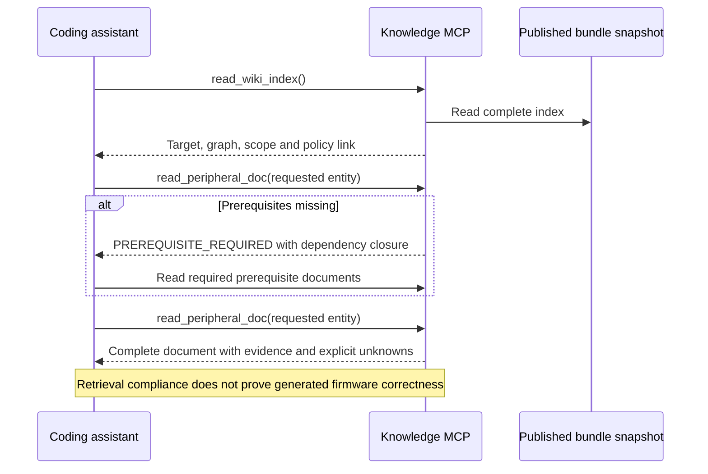

# Declarative compiler and publication contracts

Praxis separates source extraction from publication requirements. The compiler no longer
selects F407 register names, a manufacturer-specific clock recipe, GPIO array names or a
family-specific HEDG route. Those decisions are explicit, versioned input data. This change
expands the compiler architecture; it does not add reviewed peripheral operating modes.

A hardware part still needs specific facts and a reviewed scope. Removing hardcoded policy
does not mean inferring every requirement from any PDF. Headers can establish declarations;
manuals, errata, datasheets and schematics establish different kinds of evidence. A contract
states what evidence must exist. It cannot fill an extraction gap.

Verification for this continuation: **922 tests passed, four native KiCad checks skipped**;
219 direct stdio MCP calls and 313 Docker MCP calls passed. Four fresh bundles reproduce
byte-identically, and distribution checks verify all 19 contract files. No physical board
operation or new peripheral operating support is claimed.

## Responsibilities and files

| Layer | Responsibility | Implementation / example |
| --- | --- | --- |
| Raw evidence | Original declarations, manual imports, topology and connectivity | `sources/*/raw`, reviewed source imports |
| Source adapters | Parse a supported format; preserve offsets, widths, arrays, symbols and provenance | [headers](../praxis/adapters/headers.py), [discovery](../praxis/adapters/discovery.py), [header constraints](../praxis/adapters/constraints.py) |
| Target profile | Select sources, extraction mappings, dependencies, aliases and workflows | [synthetic profile](../sources/synthetic-cortex-m3/profile.json), [real G0 profile](../sources/stm32-experimental/stm32g071rbt6/profile.json) |
| Publication contract | Pin target/package/CPU/adapter identity, minimum reviewed registers, clock constraints and routing links | [generic validator](../praxis/contracts.py), [F407 contract](../sources/stm32f407g-disc1/contracts/profile-arm-core-v2.json) |
| Normalized facts | Typed records for registers, fields, instances, references and relationships | [models](../praxis/models.py) |
| Compiler | Merge compatible evidence, validate scope, render deterministically and publish atomically | [compiler](../praxis/compiler.py) |
| Bundle validator | Verify hashes, identities, graph, complete documents and internal links | [bundle](../praxis/bundle.py) |
| MCP | Serve one fixed Markdown revision and enforce prerequisite retrieval | [routing](../praxis/routing.py), [server](../praxis/server.py) |

The root [compiler.py](../compiler.py) is only a CLI entry point. The orchestration is in
`praxis/compiler.py`.

## Contract format

Every compilation profile now requires `compilation_contract`, naming a registered source
with `authority: configuration` and an `expected_sha256`. All 19 existing profiles are migrated.
The source file contains strict JSON conforming to `PublicationContract`:

```json
{
  "schema_version": 1,
  "id": "publication_policy",
  "review": {
    "status": "reviewed",
    "reviewer": "Named fixture author",
    "basis": "Fictional extraction policy only; no physical qualification"
  },
  "sources": [{"source": "profile", "locator": "target and extraction policy"}],
  "family": "praxis_demo",
  "mcu": "PRAXIS-DEMO-M3",
  "package": "Fixture:QFP-16",
  "header_kind": "cmsis",
  "cpu": "cortex-m3",
  "header_identity": ["PRAXIS_DEMO_M3_H", "PRAXIS_DEMO_PART"],
  "required_registers": {},
  "clock_plan": null,
  "pin_document": "pins",
  "board_prerequisites": ["clock", "pins"]
}
```

This excerpt describes the fictional fixture. It is not evidence for real silicon. See its
[complete contract](../sources/synthetic-cortex-m3/contracts/profile.json). Empty minimum
requirements permit declarations-only publication; operating workflows remain blocked when
required semantics are missing.

Contract `required_registers` is a reviewed minimum for the selected publication scope.
`header.required_registers` may add requirements; clearing it cannot remove the pinned minimum.
To change the minimum, review the contract explicitly and update its source version/hash.
A hash detects changed bytes; it does not authenticate a reviewer or establish truth.

`clock_plan` uses a small declarative integer-constraint language: `equals`, `minimum`,
`maximum`. All declared keys must be present, extra keys fail, and an undeclared plan fails.
There is no `eval`, executable predicate, shell command or manufacturer dispatch in the
validator. The F407 operating point is now data in its contract, including the supply range.
A different clock topology may require additional tested constraint primitives; do not invent
operating limits or encode executable expressions to avoid that work.

CMSIS CPU/header identity and AVR compiler MCU are explicit. Executable selection remains in
the source-format adapter, with fixed commands and validated arguments. A profile cannot
supply arbitrary compiler flags, plugins or build scripts.

## Normalization and gaps

Normalization unifies **representation**, not hardware semantics. A register at a source
member path becomes a record with an offset, width, array count, fields and source locators.
A GPIO register does not acquire STM32 meanings merely because another target calls a block
`gpio`. Dependencies come from explicit reviewed/profile policy, not declaration order.

Named array views are data in `discovery.peripherals.*.member_views`, or a pinned contract
`member_views` entry for automatic discovery. Explicit profile views may add mappings but
cannot override a conflicting pinned mapping. For example:

```json
{
  "structure": "PINMUX_Type",
  "prefix": "PIN",
  "prerequisites": ["energy"],
  "member_views": {"ROUTE": ["INPUT_PATH", "OUTPUT_PATH"]}
}
```

The adapter checks the actual array length, covers every element exactly once, preserves its
stride and records `PINMUX_Type.ROUTE[0]` / `[1]` as provenance. STM32 AFRL/AFRH use the same
mechanism. Missing arrays, count mismatches and collisions fail; no vendor-name branch is used.

An extraction gap is a specific unresolved fact or unsupported construct. An unsupported mask
set may retain the register layout while withholding all fields for that register. Missing
access semantics remain `unknown`; missing reset values remain unasserted. Coverage records
the affected entity, evidence and reason. Required facts block publication; optional gaps can
be published explicitly. Successful parsing is not equivalent to reviewed operating support.

## Compilation and validation algorithms

```text
compile(profile, output):
    validate strict profile schema and source identities
    read each registered source inside the source root
    verify any expected source hashes
    load the registered, hash-pinned publication contract
    validate its schema, review metadata, provenance and applicability
    validate adapter/CPU/package identity and declared clock constraints
    extract declarations using the selected source-format adapter
    load reviewed semantic records
    merge records only when layouts, bases, masks and known reset values agree
    required = contract minimum UNION additive profile requirements
    for each required register:
        require a published, reviewed record with known access semantics
    validate dependency graph, aliases and required workflow coverage
    render complete peripheral tables, policy, index, topology and coverage
    validate all internal links, full UTF-8 content and bundle hashes in staging
    recheck every input hash
    atomically publish a new immutable revision
```

The gate applies to both discovery-based and explicitly mapped header imports. A missing or
unpinned contract fails before extraction. Changing CPU/header guards in the profile without
updating the contract fails as `TARGET_MISMATCH`, before invoking Clang. Failed publication
leaves existing revisions usable.

```mermaid
sequenceDiagram
    participant U as Author / ingestion client
    participant C as Compiler
    participant P as Pinned policy
    participant A as Source adapters
    participant V as Validation
    participant B as Immutable Markdown bundle
    U->>C: Select profile and a new output directory
    C->>P: Verify registration, hash, scope and constraints
    P-->>C: Declarative publication requirements
    C->>A: Extract registered source evidence
    A-->>C: Normalized facts, provenance and extraction gaps
    C->>V: Merge evidence and check minimums, workflows and graph
    alt Required evidence missing or conflicting
        V-->>U: Stable error; no publication
    else Validation succeeds
        C->>V: Render into staging; validate complete content, links and hashes
        C->>B: Atomic publication of a fixed revision
        B-->>U: Bundle path and content revision
    end
```

At runtime the MCP reads the published Markdown and manifest. It does not load raw source
contracts, run Clang, scrape documents or execute validation scripts. `wiki/policy.md` records
the compiled policy for inspection; `wiki/sources.md` and the manifest record its hash.
New provenance catalogs keep complete path-prefix and metadata tables together without a
document byte ceiling. Historical linked registries remain valid. No peripheral table,
source row, origin URL or hash is truncated. See [document scaling](document-scale.md).



## Compatibility and limits

Historical immutable bundle bytes and hashes are unchanged. The three old MCU/package/clock
qualification boundaries and schema-v1 routes are preserved in a versioned
[compatibility catalog](../praxis/data/legacy-targets.json), read by a small
[compatibility loader](../praxis/compatibility.py). New compilation requires its own pinned
source contract; it cannot silently rely on that legacy catalog. The standalone header-parser
API retains its historical default views through this data catalog for compatibility; the
compiler passes explicit views.

Python still implements format/architecture rules: C ABI layouts, restricted macro evaluation,
AVR address spaces and supported CMSIS core semantics. Target-specific startup/linker, flash,
telemetry and sandbox backends remain separately qualified. They have not become universal
through this refactor. Adding unfamiliar formats or unsupported semantics may need a tested
adapter extension. PDF diagrams and operating sequences are not automatically understood.

## Contributor procedure

1. Add licensed, versioned sources with exact identities; pin acquired inputs.
2. Create a target profile and reviewed publication contract. Start from the synthetic or
   real MCU-only examples; select the actual CPU and header guards.
3. Configure canonical names, instance expressions, field/array views and dependency edges
   in data. Do not add manufacturer `if` branches or register lists to the core compiler.
4. Add reviewed operating definitions and instance-scoped workflows where evidence permits.
   Leave unknown facts explicit; mandatory workflows fail while their gaps remain.
5. Pin the contract source SHA-256 and increment its source version when its scope changes.
6. Compile into a new directory, lint, repeat compilation and exercise actual MCP retrieval.
7. Add firmware/build/physical qualification separately, with its own evidence and approvals.

```bash
uv run praxis compile \
  --profile sources/stm32-experimental/stm32g071rbt6/profile.json \
  --output .praxis-output/my-g071-policy-bundle
uv run praxis lint --bundle .praxis-output/my-g071-policy-bundle
uv run pytest -q tests/test_publication_contracts.py tests/test_target_adapters.py
```

Existing published paths still serve their original revision. Restarting an MCP on an old
bundle path does not rebuild or upgrade it; select the newly compiled bundle explicitly.
See [validation evidence](compiler-contracts-evidence.json) for checks actually performed.
