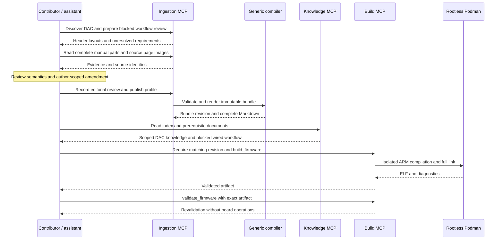
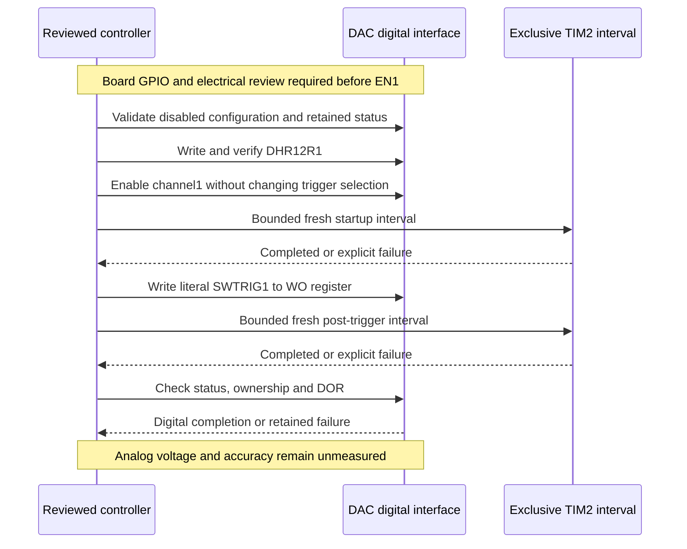

# DAC coverage and digital completion evidence

The immutable `stm32f407g-disc1-e01-dac-v1` bundle adds a reviewed STM32F407VGT6
**DAC channel1, 12-bit right-aligned software-trigger** contract and its RCC
gate/reset dependency. Previous ADC, I²C, clock and UART contracts remain intact.
The bundle contains 19 reviewed peripheral subsets, 20 explicit mode contracts
and 13 ready authored workflows out of 25. Declaration inventory remains
41 published blocks, 523 register rows and 2,100 field rows. These are authored
coverage counts, not an exhaustive MCU feature denominator.

`dac_channel1_software_trigger` is knowledge-ready. `feature_dac` and
`dac_channel1_wired_output` remain blocked: broad DAC operation and the required
board output/reference endpoints are not established. Channel2/dual operation,
external triggering, waveform generation, DMA and interrupts need separate
contracts. The [30-goal contributor catalog](../examples/capabilities/stm32f407g-disc1-dac.json)
also retains planned boot/update features and must not be read as an MCU percentage.

## Sources and compilation

Engineering facts were retrieved through actual ingestion MCP calls: exact
CMSIS declarations, complete RM0090 Rev22 pages 238–239, 247 and 435–456,
DS8626 Rev12 pages 141–143, and existing reviewed clock records. Adjacent manual
pages were inspected without publishing unrelated peripheral semantics. Source
page images were inspected for the write-only trigger and electrical table
qualifiers. Source hashes and the bound composed-parent digest are recorded in
[sanitized evidence](dac-expansion-evidence.json). Raw acquired files and MCP
logs stay outside the public distribution.

The [profile](../sources/stm32f407g-disc1/profile-dac-v1.json) and
[definition amendment](../sources/stm32f407g-disc1/reviewed/dac-v1/extension.json)
use the existing generic compiler. No new peripheral branch, model call,
embedding or database is needed. An author reviews complete source evidence,
expresses scoped register/field semantics and prerequisites, and binds the
previous composed definitions. Pydantic, header checks and compiler validation
then enforce identities, provenance, sizes, links, modes and publication gates.
Editorial review receipts are not independent engineering approval.

Repeated publication through the ingestion MCP produced 49 byte-identical files.
Every register and field table is contiguous. The largest Markdown document,
the provenance catalog, is 55,033 bytes, below the unchanged 65,536-byte limit.
Serving this bundle needs no ingestion tools or downloaded PDF files.



## Operational details that extraction must preserve

- All 14 DAC registers and 34 fields are retained. DAC/DAC1 name one block;
  they do not establish two independent DAC instances. Every register access is
  an aligned 32-bit word, even for eight-bit formatted data views.
- SWTRIGR is **write-only**. Hardware clearing of its trigger command does not
  establish a software-readable completion bit. The controller never polls or
  reads it. DOR is read-only; SR underrun flags are W1C and are retained on failure.
- Configure trigger selection while disabled, with channel2/DMA/IRQ/waves off.
  Both channels must be owned before shared reset. Do not overwrite another
  channel's control state during cleanup.
- TEN=1 holding data waits for the selected trigger. Software-trigger loading
  takes one APB1 cycle. Fresh bounded waits precede triggering and checking DOR;
  an old matching DOR value cannot substitute for completing the new interval.
- DOR proves only digital latch content. DS8626's settling row has a **10-bit
  input transition** condition and a final ±4 LSB criterion; it cannot establish
  arbitrary 12-bit analog accuracy. Wakeup, loading, supply, reference and output
  swing requirements remain conditional facts, preserved in the document.



## Verification and limits

The [shared C controller](../examples/stm32f407g-disc1-dac/application/dac_controller.h)
runs in both the ARM application and a
[host MMIO-effect model](../tests/fixtures/f407_dac_model.c). Tests exercise
write-only/read-only restrictions, initial owner conflicts, failed configuration,
lost writes, stale matching output, post-read errors, both-channel underruns,
finite waits, reserved output bits, cleanup acknowledgement and reset-required
retry blocking. The model establishes these software cases, not physical timing
or correctness of arbitrary generated firmware.

The actual thirteen-call knowledge/build MCP replay passes retrieval gates,
scope checks, matching revisions, rootless ARM compilation, full linking,
ELF/vector validation and artifact revalidation. The integration entry is kept
in the linked image through a volatile address reference, and its symbol size
is checked by the target-link test. This addresses the limitation where an
unused integration function can disappear under linker garbage collection.
The [example's main](../examples/stm32f407g-disc1-dac/application/main.c) configures
with EN1=EN2=0 and never invokes the output entry. No board operation occurred.

```bash
.venv/bin/praxis lint --bundle bundles/stm32f407g-disc1-e01-dac-v1
.venv/bin/praxis support --bundle bundles/stm32f407g-disc1-e01-dac-v1 \
  --catalog examples/capabilities/stm32f407g-disc1-dac.json \
  --workflow dac_channel1_software_trigger
.venv/bin/pytest -q tests/test_dac_modes.py
.venv/bin/python tools/check_workflow_mcp.py \
  --bundle bundles/stm32f407g-disc1-e01-dac-v1 \
  --workflow dac_channel1_software_trigger \
  --blocked-workflow feature_dac --blocked-workflow dac_channel1_wired_output \
  --mode dac/channel1_software_trigger --mode rcc/dac_gate_reset \
  --mode tim/polling_update_delay --peripheral gpio --peripheral flash --peripheral pwr \
  --source-directory stm32f407g-disc1-dac/application \
  --output /tmp/praxis-dac-replay
```

Use a fresh output directory. The build requires a provisioned
[sandbox](verification.md). The [OpenCode example](../examples/opencode.dac.example.json)
selects matching bundles without hardware tools. Existing client selections
are not switched automatically. Independent review, board/errata qualification,
boot/update modes and broader peripheral workflows remain open.
