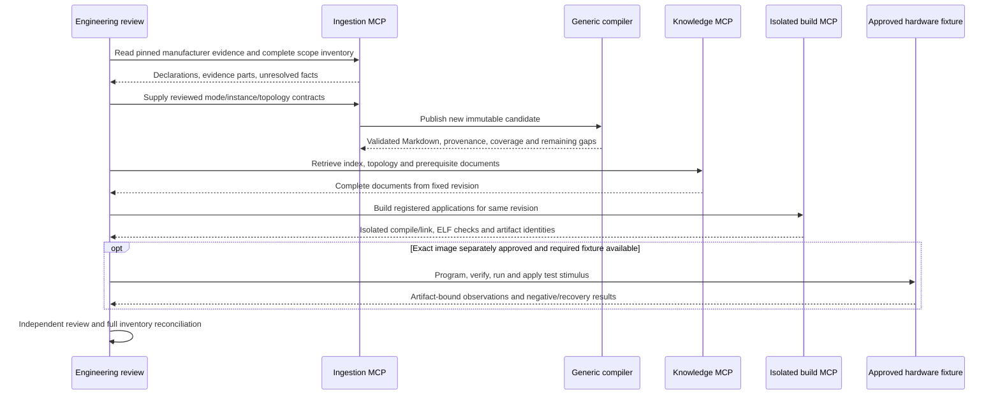

# Full F407 acceptance: audit and closure plan

The active priority is **full STM32F407VGT6 coverage before additional MCU families**.
The board reference is STM32F407G-DISC1, MB997-E-01; the physical card revision is
still unconfirmed. **Full MCU acceptance has not been achieved.**

The [manufacturer scope stage](manufacturer-inventory.md) is now implemented: four
source-pinned documents yield1,683 indexed records with explicit applicability bindings,
extraction gaps and links to existing workflows. This is a source-scope checklist, not
the completed body/table operating-mode inventory or an MCU completion denominator.

“Full” means every applicable manufacturer-documented capability, instance and
operating mode has explicit requirements and source evidence, with reviewed
dependencies, configuration constraints and verification. It includes startup,
boot/update, memory, power, clocks, core services and peripheral operation.
It does not mean every possible application or combination of register values
can be exhaustively tested. Package exclusions require source-backed applicability
decisions; missing equipment remains an open physical-validation requirement.

## What this audit closes

The generic Clang adapter now handles integer scalar union views. ITM previously
failed on its stimulus-port union. The parser preserves all three declared C views,
their native offsets, widths, array counts and provenance; it does not infer legal
hardware accesses or operating semantics from C qualifiers. Unsupported pointer,
array, bit-field, nested-record and floating union alternatives still fail explicitly.
Independent ARM GCC assertions check the supported fixture's structure size and stride.
No F407 register names or vendor branches were added to this parser.

Two actual ingestion-MCP publications produced byte-identical bundles: **51 files**, revision
`b740659eca4934318119722a6ca55b30f5e2918e76fc1a3e8b857ae23a226b20`.
All historical published bundle directories remain unchanged.

| Current candidate inventory | Result | Meaning |
| --- | --- | --- |
| Recognized register blocks published | 42/42 | Declaration coverage within this header inventory |
| Register rows / field records | 541 / 2,144 | Includes array banks; not a count of every physical register instance |
| Blocks with reviewed operating subsets | 22/42 | Some semantics reviewed; not every mode |
| Ready authored workflows | 20/33 | Limited authored scope, not the whole MCU |
| Unmapped declaration types | 11 | Explicitly retained for classification and instance review |
| Existing applications linked and ELF-revalidated | 12/12 | One combined candidate, pinned build assets and sandbox image |
| Full MCU completion percentage | Unmeasured | No exhaustive, reviewed manufacturer capability denominator yet |

The first combined replay exposed a real example-layout defect: the CAN RX application
directory contained Markdown, which the strict C/header snapshot rejects. Eleven examples
passed; CAN RX returned `INVALID_SOURCE`. Its documentation now lives in
[README_RX.md](../examples/stm32f407g-disc1-can/README_RX.md), outside the application directory.
The sandbox input policy is unchanged. The corrected replay made **81 actual MCP tool calls**
and linked/revalidated all twelve applications. The initial failure is retained in the evidence.

The [data-only acceptance plan](../examples/acceptance/stm32f407g-disc1.json) registers
each case and its limitations. The [generic client](../tools/check_target_acceptance_mcp.py)
checks full-document bytes, session gates, all declared workflow readiness rows, required
topology queries and knowledge/build revision agreement. It then builds every case and
revalidates its ELF through MCP. The build session exposes only three build tools, with
no hardware capabilities. A failed case makes software acceptance fail.

Build results retain source, artifact, bundle, firmware-asset and toolchain identities.
The report joins linked examples to their authored workflow scope while leaving physical
qualification unassessed for the rebuilt artifacts. A successful compile never upgrades
an unsupported operating mode to ready. For example, the DAC example deliberately leaves
the outputs disabled in `main`; linking its retained output routine is not an analog test.

Full strict regression: **970 passed, zero skipped**, with required external tools enabled.
The rebuilt Docker knowledge image passed **161 calls across four stdio sessions**, covering
this candidate, historical F407 and AVR bundles, fresh-session gates, corrupt/missing bundle
failures, non-root execution, read-only mounts and absence of optional ingestion/build extras.
This is Linux amd64 software evidence, not physical qualification. No hardware operation occurred.

## Remaining gaps, without hiding them as test skips

The [machine-readable audit](f407-full-acceptance-evidence.json) preserves every recognized
block, unmapped type, authored workflow, catalog goal, required-signal result and build case.
The companion catalog is explicitly **non-exhaustive**, so closing its current goals alone
would not complete this objective.

Thirteen authored workflows remain blocked: `can1_external_bus`,
`dac_channel1_wired_output`, `feature_can`, `feature_dac`, `feature_eth`, `feature_flash`,
`feature_fsmc_bank1`, `feature_i2c`, `feature_rtc`, `feature_sdio`,
`feature_usb_otg_global`, `i2c1_wired_transmit`, and `spi1_wired_polling`.
The evidence records their exact missing operating facts, scopes and connections.
Related narrower workflows can be ready while these broader contracts remain blocked.

Actual topology MCP queries still return no match for `CAN1_TX`, `CAN_TRANSCEIVER`,
`DAC1_OUT`, `DAC_REFERENCE`, `I2C1_SCL`, `I2C1_SDA`, `SPI1_MISO`, `SPI1_MOSI`, and
`SPI1_SCK`. These are missing published mappings, not evidence that the MCU lacks those
functions. The board netlist is a reviewed partial transcription, not a complete native
CAD export. Installing KiCad enables the adapter tests but cannot create missing board CAD.

The eleven unmapped types include CPU special-register representations, nested CAN helper
structures, and USB channel/endpoint types. Some CAN layouts already appear within the
published parent block. USB mappings still need explicit instance/address evidence. Do not
count every helper as an independent missing peripheral, or discard every unmapped type
as harmless. The final inventory must classify each with provenance.

The full-scope closure backlog includes:

| Area | Work still required for full acceptance |
| --- | --- |
| Manufacturer scope | Reconcile datasheet, reference manual, core manual, errata and package inventory; enumerate applicable instances/modes with exact locators |
| Startup, memory and boot/update | Reviewed reset/exception/vector contracts, memory placement, boot selection/handoff, flash operations and recoverable update workflows |
| Clocks, resets and power | All documented source/divider/reset/power modes, readiness and failure paths; review dependencies per instance |
| Timers and interrupt/DMA routing | Extend beyond current timing scenarios to applicable PWM/capture/trigger/advanced modes and transfer/interrupt combinations |
| Serial communication | Complete applicable USART, SPI/I2S, I2C and CAN modes, alternate routes, DMA and error recovery |
| USB, Ethernet and SDIO | Complete controller/sub-block mappings, operating contracts, board interfaces, fixtures and protocol checks |
| Analog and processing | Complete applicable ADC/DAC/CRC/RNG modes and constraints, with external measurements where required |
| External memory and storage | Controller timing, wiring, ownership and error handling; suitable external hardware for physical evidence |
| ARM core and debugging | Applicable exceptions, priority/masking, protection, floating point and debug/trace contracts; do not infer hardware behavior from header layout |
| Board topology | Account for every required package pin, onboard connection, external interface and assembly/solder-bridge condition |
| Qualification | Per-mode positive/negative checks, exact-artifact physical evidence, repeatability and independent review |

This table is a review backlog, not a replacement manufacturer capability list. Existing
UART recovery anomalies remain recorded. Historical LED/button, UART and CAN observations
are useful evidence for their exact original artifacts; they do not qualify every mode or
automatically transfer to this candidate. The release checker still reports missing
independent review of bundle revisions and firmware assets. No review was fabricated.

## Closure sequence and implementation files



1. Complete the manufacturer capability inventory and classify all extraction/mapping gaps.
2. Close operating modes through reviewed, source-pinned profile data. The
   [generic register-view prerequisite](register-field-views.md) is implemented and validated;
   the [timer operating increment](timer-modes.md) adds internal PWM reference/software-capture
   contracts and examples, without qualifying external pins or physical behavior. Continue with timer
   PWM/capture and blocked storage/boot contracts; retain complete tables and dependencies.
3. Add matching positive/negative configuration models and target examples, and rerun the
   combined MCP acceptance plan without dropping existing cases.
4. Qualify applicable physical workflows with the necessary fixtures and exact-image approval.
   Missing tools or equipment block required checks; they do not become passing skips.
5. Reconcile the complete scope and independent review before declaring the MCU accepted.

Core files: [native layouts](../praxis/adapters/headers.py),
[normalized declarations](../praxis/adapters/discovery.py),
[record schema](../praxis/models.py), [compiler validation](../praxis/compiler.py),
[source constraints](../praxis/adapters/constraints.py),
[support assessment](../praxis/support.py), and
[acceptance joins](../praxis/acceptance.py). Target facts and policy remain in
[the F407 profile](../sources/stm32f407g-disc1/profile-arm-core-v2.json) and its registered imports/contracts.

## Reproduce the software acceptance

Install the documented native dependencies and provision the pinned rootless sandbox first.
These commands require a fresh output directory and do not flash or reset hardware:

```bash
export PRAXIS_REQUIRE_EXTERNAL_TOOLS=1
uv run praxis compile --profile sources/stm32f407g-disc1/profile-arm-core-v2.json \
  --output .praxis-output/f407-acceptance-local/bundle
uv run python tools/check_target_acceptance_mcp.py \
  --bundle .praxis-output/f407-acceptance-local/bundle \
  --plan examples/acceptance/stm32f407g-disc1.json \
  --catalog examples/capabilities/stm32f407g-disc1-arm-core.json \
  --workspace examples --assets assets/stm32f407vg --lock toolchain-f407.lock.json \
  --output .praxis-output/f407-acceptance-local/replay
uv run pytest -q
```

Exit zero from the replay means its software checks passed. Read
`full_mcu_accepted` and `acceptance_blockers` separately; this audit does not implement
or claim a completed physical/full-MCU acceptance gate.
