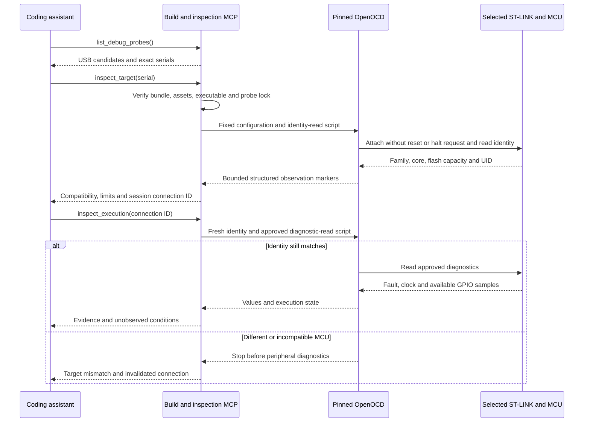

# Read-only ST-LINK inspection

Praxis now bridges knowledge and a connected board through an optional Linux inspection backend
inside `project-praxis-build`. The knowledge server retains exactly its three retrieval tools.
The build container has no USB access. The inspection executor runs separately on the host with
a hash-pinned OpenOCD 0.12.x executable and a fixed, minimal debug configuration.

This inspection stage answers whether a selected probe reaches a compatible MCU and what approved diagnostic
registers currently show. It does not program firmware or establish a successful application test.
See the separately gated [programming/control tools](hardware-programming.md) and
[complete hardware roadmap](hardware-verification.md) for the next stages.

## Model-facing tools

| Tool | Required input | Result |
| --- | --- | --- |
| `list_debug_probes()` | None | Linux USB descriptors for supported ST-LINK products; no debug attachment |
| `inspect_target(probe_serial)` | Exact selectable serial returned by enumeration | Family/core/flash compatibility, unique MCU identity, declared bundle target, observation time, session connection ID and limits |
| `inspect_execution(connection_id)` | Successful preflight ID from this process | Fresh identity verification, fault/clock registers, clock-gated GPIO samples, SysTick reload, and core registers only if already halted |
| `plan_firmware(artifact_id, connection_id)` | Accepted artifact and successful preflight | Read-only image/target plan with complete affected erase sectors |

No tool accepts Tcl, shell commands, arbitrary addresses, backend paths or execution-control
options. Multiple candidates are not silently selected. A connection is tied to a probe serial
and MCU UID; restarting the server invalidates it. Diagnostic Tcl checks the family/core before
family-specific identity reads and checks the expected UID before peripheral diagnostics.
The verified executable hash is checked before each operation. Changing the bundle/assets or
backend requires a reviewed new profile and restart.

IDCODE `0x413`, Cortex-M4 CPUID and 1024 KiB flash establish compatibility with the supported
F405/407-family profile. They cannot prove the exact part suffix, package, PCB revision, solder
bridge settings or attached circuitry. The physical PCB revision remains unknown until separately
identified. A reference `MB997-E-01` in the knowledge bundle is not a physical detection result.
Early silicon reporting a different ID is rejected rather than silently reclassified.

## Inspection policy

The backend requests no reset, halt, resume, stepping, breakpoint, flash operation or target
register write. Attachment still changes debug-transport state and is not electrically passive.
OpenOCD internals control debug transport; this policy is about exposed operations and generated
commands, not a claim that every bus transaction is a read.

The standalone configuration disables GDB/Tcl/telnet listeners, uses no flash bank or work area,
and sources no vendor target scripts. Installed STM32 target scripts include initialization hooks
outside this policy; they are deliberately not reused. The profile pins the executable bytes, not
all host shared libraries or the operating system. This is a reviewed local backend contract,
not isolation against an administrator replacing the trust inputs.

Each operation has an eight-second timeout and 64 KiB diagnostic cap, runs from a private temporary
directory, and holds a per-probe advisory lock across Praxis processes using the same configured
lock directory. All instances inspecting a probe must use that shared directory. It cannot exclude
unrelated debugger software that ignores this lock. Access failures return actionable errors without a
reset/halt fallback.

Approved reads are defined in [hardware.py](../praxis/hardware.py) and checked against the pinned
ST/Arm header addresses. They include MCU identity, CFSR/HFSR/MMFAR/BFAR, selected RCC registers,
GPIOA input/GPIOD output latch and SysTick LOAD. GPIO reads are skipped when the sampled RCC clock
gate is disabled and their signals return `null`. A running program can still change clock gates
between sequential reads. Fault address validity comes from CFSR validity bits; stale address
values alone do not establish a fault.

SysTick CTRL and direct DHCSR reads are excluded because reads can clear observation flags.
The clock report derives nominal HCLK from RCC, HSI nominal frequency or the bundle's assumed
8 MHz HSE. It does not measure the oscillator. The SysTick period is conditional on processor-clock
selection; that selection remains unverified because CTRL is omitted. A changed pair of CFGR
samples marks the clock result unstable; unchanged samples do not prove an atomic snapshot.

OpenOCD can report `unknown` state without requesting a halt/poll. That state is returned honestly.
PC/SP/LR/xPSR are returned only if the backend already reports the target halted. Empty core
registers are not an error or proof of execution. The service does not inspect arbitrary stack
memory, unwind a backtrace or claim which artifact is running.



This diagram describes the implementation contract, not a captured trace.

## Provision and launch

Install OpenOCD separately and provide normal user USB permissions. Provisioning validates its
version and pins the executable hash; it does not attach to a board. Use a new output path when
replacing a profile rather than overwriting one used by an active session.

```bash
.venv/bin/praxis hardware-profile \
  --bundle bundles/stm32f407g-disc1-e01-m1 --assets assets/stm32f407vg \
  --backend /usr/bin/openocd --output .praxis-output/hardware-profile.json

# Enumeration only; diagnostics require the exact serial from this result.
.venv/bin/praxis hardware-inspect \
  --bundle bundles/stm32f407g-disc1-e01-m1 --assets assets/stm32f407vg \
  --profile .praxis-output/hardware-profile.json --locks .praxis-output/probe-locks

.venv/bin/praxis hardware-inspect \
  --bundle bundles/stm32f407g-disc1-e01-m1 --assets assets/stm32f407vg \
  --profile .praxis-output/hardware-profile.json --locks .praxis-output/probe-locks \
  --probe-serial SERIAL_FROM_ENUMERATION --diagnostics
```

For MCP add `--hardware-profile /absolute/path/to/profile.json` to `praxis build-serve`.
Use the [public client example](../examples/opencode.example.json) and add the option explicitly.
Exit the current OpenCode instance and start a fresh client after changing its configuration.
The client starts the stdio child; a separate terminal `server.py` process is unnecessary.
Use [the inspection scenario](mcp-test-prompts.md#read-only-inspection).

## Evidence and limits

[The evidence record](hardware-inspection-evidence.json) separates mock-backed tests, real Tcl
guard tests, real stdio discovery, real isolated compilation, and the connected-board inspection.
Private raw serial/UID/diagnostics remain under `.praxis-output/hardware-inspection`; the public
record omits unique device identifiers. Hardware integration checks are deliberate read-only
runs, not automatic pytest tests that attach to whatever board is connected.

On 2026-10-10 a connected ST-LINK/V2.1 yielded compatible family/core/flash identity. Its RCC
configuration indicated nominal 168 MHz from assumed 8 MHz HSE and SysTick LOAD=167999. CFSR/HFSR
were zero. Execution state was `unknown`. No program was flashed or identified as running; physical
LED timing and button response remain untested.

The corrected OpenCode application was separately rebuilt and statically validated. Reviewed
host fixture models cover AHB-prescaler synchronization and clock/SysTick failures; they do not
simulate all silicon behavior or establish that this application runs on the connected board.

Backend design follows the official OpenOCD documentation for
[adapter selection](https://openocd.org/doc/html/Debug-Adapter-Configuration.html),
[target configuration](https://openocd.org/doc/html/CPU-Configuration.html),
[memory/register reads](https://openocd.org/doc/html/General-Commands.html),
[disabled listeners](https://openocd.org/doc/html/Server-Configuration.html), and
[reset configuration](https://openocd.org/doc/html/Reset-Configuration.html).
Family identification is cross-checked with the
[OpenOCD STM32 flash implementation](https://github.com/openocd-org/openocd/blob/v0.12.0/src/flash/nor/stm32f2x.c).
