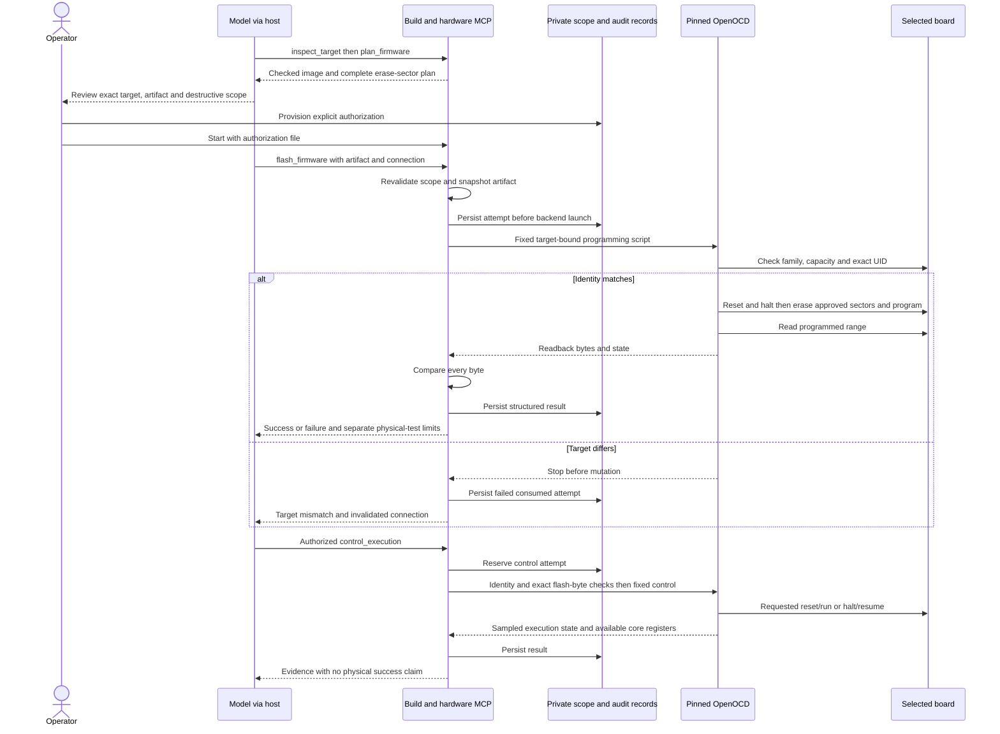

# Target-bound programming and execution control

The optional build MCP implements planning, programming with exact readback, and four execution
controls for the pinned STM32F407VG profile. These are implemented capabilities backed by fixture,
Tcl and protocol tests. The first operator-authorized physical attempt wrote the expected image
but failed during final core-register reporting. A separate read-only comparison confirmed all
1,164 image bytes. A subsequent execution-only MCP test successfully reset/ran the verified
image, and the user confirmed the basic LED/button behavior. A subsequent explicitly approved
physical demonstration completed the entire flash/readback/halted-reporting and reset/run path,
and the user again confirmed the LED/button behavior. This qualifies that exact demonstrated
path; standalone halt/resume and measured timing remain unqualified. See the
[latest flash evidence](flash-demo-evidence.json), [earlier execution evidence](hardware-execution-evidence.json)
and [failure analysis and recovery procedure](hardware-recovery.md).

The separately approved [UART/timer/EXTI image](reports/uart-loopback-results.md)
has now also passed one MCP flash with exact readback and one reset/run. On 2026-10-11 the user
confirmed positive-loopback LED behavior, pause, jumper-removed failure and restored-jumper recovery.
Measured timing and independently captured packets remain unverified. This result does not qualify unrelated scenarios.

## Boundaries and tool discovery

Knowledge and build are separate MCP servers; an optional [ingestion MCP](ingestion-mcp.md)
adds authoring separately. `project-praxis` retains three read-only knowledge tools.
`project-praxis-build` has three build tools, adds four inspection/planning tools with a hardware
profile, and exposes mutating tools only for actions in an explicit local authorization file.
Full programming/control scope exposes nine tools; execution-only or flash-only scope exposes
eight. The execution-only scope has zero flash attempts and no `flash_firmware` tool.

Optional telemetry adds `read_firmware_telemetry`. Selecting the fixed CAN ABI also
adds `read_can_diagnostics`, whose clock/init-gated named reads retain exact-image
checks and cannot program or control execution. These optional read-only tools
do not broaden the operator's write scope. See [CAN observation](can-telemetry.md).

| Tool | Input | Behavior |
| --- | --- | --- |
| `plan_firmware` | Accepted artifact ID, current connection ID | Validate artifact, refresh MCU identity, return immutable target/image/sector plan; read-only |
| `flash_firmware` | Approved artifact ID, current connection ID | Check scope, reset/halt, erase the approved sectors, program canonical image, read back and compare all programmed bytes; leave halted |
| `control_execution` | Approved artifact ID, current connection ID, operation, observation window | Recheck identity and exact image bytes before `reset_run`, `reset_halt`, `halt` or `resume` |

Without an authorization file, the mutating tools are absent. Creating a file is insufficient:
the operator must explicitly launch with `--hardware-authorization`. No MCP tool can create or
broaden an authorization. The default OpenCode launcher remains in inspection/planning mode.

The knowledge HEDG and programming scope are separate contracts. Programming cannot prove the
model followed knowledge retrieval, and successful retrieval cannot authorize changing a device.

## Flash image and erase scope

The service revalidates the content-addressed artifact, snapshots the checked ELF, verifies its
hash again and derives a canonical binary from its physical `PT_LOAD` bytes. Gaps are filled with
`0xff`; overlapping physical loads fail. It does not trust a caller-supplied binary, offset,
sector list or backend command. The image starts at `0x08000000` and remains within 1 MiB.

For this exact single-bank F405/407-family profile, sectors are 4 × 16 KiB, 1 × 64 KiB and
7 × 128 KiB. The plan identifies the minimum contiguous sectors covering the image. **Erasure
destroys the entire listed sectors, including bytes outside the image.** Existing contents are
not backed up or preserved automatically. Bytes above the listed sectors are not intentionally
erased; there is no mass erase, option-byte/OTP operation, protection removal or automatic unlock.

The standalone OpenOCD configuration uses the `stm32f2x` driver with a single main-flash bank,
software system reset, disabled network listeners and no work area or sourced vendor hooks.
Programming resets/halts the MCU, erases explicit sector numbers and writes only the fixed binary
address. A bounded `dump_image` is compared byte-for-byte in Python. Success leaves the core halted.
Failures can leave partial flash or unknown device state and are never retried automatically.

Execution control uses generated bounded `read_memory` comparisons against every image byte
before taking action. It does not use a target-side checksum algorithm or a CRC-only shortcut.
The observation window is 0–5000 ms. Each backend invocation is limited to 30 seconds or the
remaining authorization lifetime, whichever is shorter, with 64 KiB diagnostics. `reset_run`
and `resume` may leave firmware running after return and after authorization expiry. Expiry
prevents subsequent commands; it does not stop firmware or roll back a device.

## Operator authorization and persistent attempts

A local operator reviews the private plan and provisions a scope containing:

- Exact plan, ELF/image/artifact hashes, bundle/asset/backend revisions, probe serial and MCU UID.
- Operator attribution, board confirmation/remaining assumptions and expiry of at most one hour.
- An explicit subset of supported operations, one flash attempt when flash is allowed (otherwise
  zero) and at most 16 control attempts. Requested controls require a positive control budget.
- A fixed audit directory outside the generated-source workspace.

The server checks the unchanged scope before every operation and rechecks identity in the same
OpenOCD script before reset/halt/erase. It persists and synchronizes an attempt reservation before
backend launch. Failed, interrupted and uncertain attempts remain consumed across process
restarts. Per-probe advisory locks and scope-budget locks serialize cooperating Praxis processes.
All instances must share the configured probe-lock directory. Unrelated debugger programs do not
honor these locks and must not own the probe concurrently.

Results include run ID, scope and artifact identities, separate success/readback/state outcomes,
diagnostics and explicit physical-test limits. Persistent JSON records are private, operator-owned
local evidence. A reserved attempt without a result means an uncertain outcome, not permission to
retry. If result persistence fails after an operation, `AUDIT_FAILED` explicitly states that the
operation may have occurred; the attempt remains consumed.

This is a trusted local operator contract. Hashes establish integrity, not signatures or proof
of human consent. A host with access to alter the service, authorization or audit files can bypass
the policy. Keep those files outside the model's generated-source workspace and enforce host
filesystem/tool permissions separately. Do not delete audit records to replenish a budget.

The physical PCB revision and solder bridge state are not detected by MCU identity. Operator
confirmation records those assumptions rather than turning a reference revision into a measured
fact. An authorization for one artifact does not permit a model to flash a replacement after
repairing its source. Broader bounded repair scopes remain a later extension.



This is the implemented logical sequence, not a captured physical programming trace.

## Commands and OpenCode

Read-only planning requires a selected, connected probe and an accepted artifact. Replace
`EXACT_SERIAL` and `ARTIFACT_ID` with actual values; do not infer or auto-select among probes.

```bash
.venv/bin/praxis hardware-plan \
  --bundle bundles/stm32f407g-disc1-e01-m1 --assets assets/stm32f407vg \
  --workspace temp --artifacts .praxis-output/firmware-artifacts \
  --lock toolchain-f407.lock.json --hardware-profile .praxis-output/hardware-profile.json \
  --probe-serial EXACT_SERIAL --artifact-id ARTIFACT_ID \
  --output .praxis-output/hardware-plans/reviewed-plan.json
```

The following is an **operator procedure after explicit approval**, not an instruction for the
model to authorize itself. Review the plan before acknowledging complete-sector erase. Use a
new file for every genuinely reviewed scope; never regenerate a grant to hide an uncertain result.

```bash
.venv/bin/praxis hardware-authorize \
  --plan .praxis-output/hardware-plans/reviewed-plan.json \
  --output .praxis-output/hardware-authorization.json \
  --audit-root .praxis-output/hardware-audit \
  --operator OPERATOR_NAME --board-confirmation 'Actual board and wiring confirmation or explicit remaining assumptions' \
  --actions flash reset_run halt resume --lifetime-seconds 900 \
  --max-control-attempts 6 --acknowledge-sector-erase

```

In the client configuration, add
`--hardware-authorization /absolute/path/to/grant.json` to `praxis build-serve`.
Without that explicit option, no programming/control tools are exposed. Restart the client.
Obtain a fresh `connection_id` after restart; the plan remains deterministic for the same target
and artifact. Use [the authorized scenario prompt](mcp-test-prompts.md#approved-programming).
`--acknowledge-sector-erase` is required when actions include `flash`. An execution-only scope
uses `--actions reset_run halt resume`, omits that acknowledgement, and cannot erase or program.
For the already-written candidate use [the execution-only procedure](hardware-recovery.md)
and [its MCP prompt](mcp-test-prompts.md#execution-only).

## Current evidence and next stage

The first prepared candidate is the corrected LED/button artifact `0f3095c100e6311a…`. Its image
contains 1,164 bytes. The plan erases sector 0, `0x08000000–0x08003fff` (16 KiB), and programs
`0x08000000–0x0800048b`. Full private identifiers remain in `.praxis-output/hardware-plans`.
The public [evidence record](hardware-programming-evidence.json) keeps only target fingerprints.
The earlier implementation-only evidence predates the first operator-authorized attempt.
The current [recovery evidence](hardware-recovery-evidence.json) records that attempt's late
failure and the subsequent byte-identical read-only comparison. The original failed audit and
consumed attempt are preserved.

Tests exercise accepted artifacts, corrupted readback, mismatched targets/scopes, expiry,
persistent budgets, audit failures, disconnects/timeouts/output limits, real Tcl guards with
mocked memory, config parsing without adapter initialization and full MCP calls using a fake
probe executable. These establish wrapper behavior, not the electrical behavior of real flashing.
Successful end-to-end programming reporting, reset/control integration and physical behavior
remain to be qualified after applicable authorization. OpenOCD's status register is case-sensitive
`xPSR`; the shared query maps it to the public `xpsr` field. Strict Tcl fixtures now reject the old
spelling, and a live read-only register-cache listing confirms the installed backend's spelling.

Readback success does not establish boot, reaching `main`, LED emission, blink timing or debounce.
State `running` can include a fault handler or infinite loop. Symbol-bound boot breakpoints,
registered stimulus/measurements and hardware repair orchestration remain later work. The first
LED/button check will need explicitly labeled human button presses and visual observations unless
a validated automated observer is added.

The backend uses the official OpenOCD contracts for
[flash banks, explicit erasure and writes](https://openocd.org/doc/html/Flash-Commands.html),
[dumping memory and reset/run/halt/resume](https://openocd.org/doc/html/General-Commands.html),
and [reset configuration](https://openocd.org/doc/html/Reset-Configuration.html).
The [pinned STM32 driver source](https://github.com/openocd-org/openocd/blob/v0.12.0/src/flash/nor/stm32f2x.c)
and ST RM0090 define the supported flash geometry; other MCU/bank arrangements require a new
reviewed adapter and negative fixtures.
