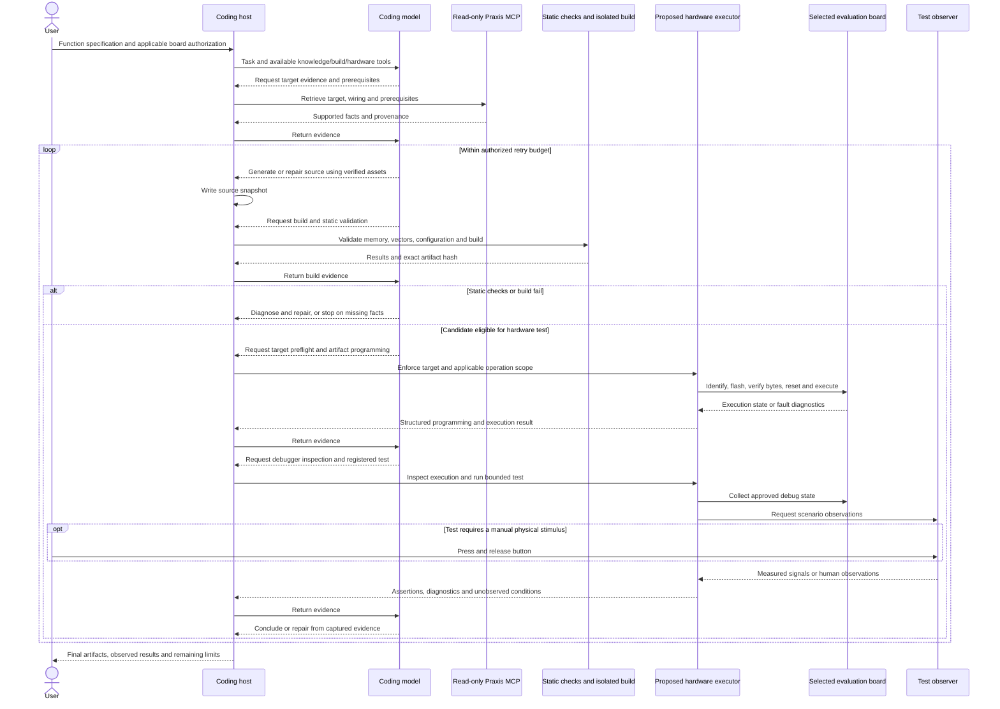

# Hardware-backed verification roadmap

Hardware-backed verification is an intended Praxis extension. The original roadmap deferred
full linking, flashing, hardware execution and debug-probe integration until after the pre-build
baseline. The user reaffirmed this intention on 2026-10-10. This document describes proposed
behavior and marks the implemented stages; it does not authorize programming a board.
The build/link/static-image portion is now implemented by the separate
[F407 build MCP](build-service.md). Its optional [read-only ST-LINK backend](hardware-inspection.md)
supplies probe enumeration, target identity checks and bounded diagnostics. The separately gated
[programming/control tools](hardware-programming.md) are implemented with fixture/Tcl/protocol
tests. One explicitly approved LED/button flash/readback/reset-run path is physically demonstrated;
broader programming qualification and physical test adapters remain open.
The [artifact-bound telemetry extension](firmware-telemetry.md) now supplies coherent software
counters through MCP. A real paused → running → paused check demonstrated timer progress,
validated UART traffic and no reported UART/queue errors; see [the public evidence](telemetry-evidence.json).
Independent wire capture, measured timing and general debugger operations remain open.

## Product objective: the board is a model-accessible tool

The intended experience is for the user to describe a function and authorize work on a selected
board, then for the coding model to generate, build, program, execute, debug and repair the
firmware through tools. The user should not need to copy debugger commands or manually relay
fault logs between programs. Praxis supplies the hardware knowledge and the execution/debugging
bridge; the model in the host owns reasoning and tool selection.

The current knowledge MCP is the first layer of that product. Runtime operation is a core part
of the intended complete workflow. Build, inspection and separately authorized programming/control
wrappers are implemented. The first physical attempt failed during final register reporting;
separate read-only comparison confirmed the approved image. The subsequent execution-only
MCP reset/run succeeded and the user confirmed the basic LED/button scenario. A later approved
MCP flash completed erase/program/exact readback/halted reporting and reset/run; the user again
confirmed visible LED/button behavior. Standalone halt/resume and calibrated timing remain
unqualified. See [the actual flash demonstration](flash-demo.md),
[earlier execution evidence](hardware-execution-evidence.json) and [recovery analysis](hardware-recovery.md).
It should not be described as merely a manual flashing convenience.

## Purpose

A connected board enables a feedback loop: retrieve knowledge, generate code, validate and build,
program an approved artifact, execute, observe, and repair within a bounded number of attempts.
Permission enables an operation; it does not implement its backend or provide a test observation.

The Discovery board includes ST-LINK programming/debugging support. See
[ST UM1472](https://www.st.com/resource/en/user_manual/dm00039084-discovery-kit-with-stm32f407vg-mcu-stmicroelectronics.pdf).
OpenOCD offers reset, halt, resume and memory/register inspection operations; see its
[command reference](https://openocd.org/doc/html/General-Commands.html).
Praxis's default profile exposes inspection/planning. Reset/halt/resume/programming tools require
an explicit operator authorization tied to the target and accepted artifact.

Hardware tests complement static checks. The generated LED/button example linked with an invalid
stack address and a misordered peripheral vector table. Boot observation could expose the stack
failure. A successful blink/SysTick test would not validate unused peripheral vector entries.
Reject known memory/vector violations before programming.

## Proposed component boundary

Keep the three-tool knowledge server read-only and portable. The separate optional build MCP
now hosts inspection and separately authorized programming/control with a fixed backend profile. The executor
owns the authorized device connection. The compilation sandbox remains without USB/debug-probe
access; hardware execution and compilation isolation have different responsibilities.

Bind a run to the bundle revision, source hash, verified ELF hash, compiler identity, probe
identity, detected MCU, declared PCB revision, test definition and applicable authorization.
MCU/probe detection does not identify PCB revisions, solder bridges or attached circuitry.

Program only the selected target with the validated artifact. Define the flash range and operation
scope; do not silently include option-byte changes, readout protection or unrelated erases. Bound
execution/retries, capture diagnostics and retain a recovery path. Never rewrite the knowledge
bundle automatically to make a failing program pass. Discussing this design does not authorize
actual flashing.

## Proposed model-facing tool contract

The table describes the complete intended contract. `build_firmware`, `inspect_target`, and
`inspect_execution`, `flash_firmware` and `control_execution` have implemented subsets documented
in their service contracts. Breakpoints, stepping, variable inspection and test orchestration
remain proposed.
The host should present the model with typed operations and structured results rather than
requiring it to construct unrestricted shell, GDB or OpenOCD commands.

| Proposed operation | Model supplies | Executor returns |
| --- | --- | --- |
| inspect_target | Selected connection/profile ID | Probe/MCU identity, connection state and applicability checks |
| build_firmware | Source snapshot ID, bundle revision and approved build profile | Build ID, diagnostics, validation results and immutable artifact ID/hash |
| flash_firmware | Passing artifact ID and selected connection ID | Program/readback result, programmed range and artifact identity |
| control_execution | Connection ID and bounded reset, run, halt or step operation | CPU state, stop reason and elapsed execution information |
| set_breakpoint | Matching artifact ID and approved symbol/location | Breakpoint identity or actionable error |
| inspect_execution | Connection ID and requested diagnostic set | PC/SP/LR, fault status, backtrace when available and matched source locations |
| read_variable | Matching artifact ID and approved symbol | Typed value, address, observation time and execution state |
| run_test | Selected connection, artifact and registered test ID | Assertions, measurement/stimulus evidence, failures and unobserved conditions |

Builds use the compilation sandbox and reviewed assets. Artifact IDs bind subsequent operations
to the exact checked ELF; a model cannot silently substitute another image after validation.
Symbol-based operations require matching debug information. Memory/peripheral reads need an
approved range and side-effect policy rather than unrestricted address reads. Missing capabilities
return explicit errors rather than a fabricated successful observation.

Each result needs a run ID, target and artifact identity, status, bounded diagnostics and explicit
limits. A fault is actionable feedback to the model: inspect the faulting location, consult
target evidence, change generated source, rebuild and retry. A bounded retry policy stops on
repeated failures, missing facts, target mismatch or exhausted attempts. The model may repair
generated firmware; failed hardware runs do not automatically modify reviewed knowledge.

Applicable authorization can cover a bounded session on the selected board, so the host can
execute permitted build/flash/debug iterations without asking the user to perform each command.
Operations beyond that scope require additional authorization. The executor enforces the scope
and device selection; the model cannot expand it by changing a tool argument.

This is a design sequence, not a captured run. The current verify CLI supports syntax/object modes;
the build MCP supports isolated full linking, inspection and explicitly authorized programming/control.
Physical programming qualification, registered observers and automatic hardware repair require
additional work.
Success, an unrecoverable missing fact or a scope violation exits the logical loop immediately.
The host executes calls requested by the model; the user is not the debugger operator in this
workflow. Manual stimulus is needed only when the test lacks an automated physical input fixture.

## Observability

| Observation | Evidence provided | Limit |
| --- | --- | --- |
| Flash readback verification | Intended bytes reached checked addresses | Does not show boot or application behavior |
| Breakpoint at main | Execution reached that location | Does not show sustained operation |
| Counter/register snapshots | Selected state and fault diagnostics | Do not directly measure physical LEDs or precise timing |
| GPIO output latch | Programmed output state | Does not prove emitted light |
| Input samples during manual button presses | Observed input transitions | Manual stimulus is not fully automated |
| Logic-analyzer capture | Electrical timing at the connected point | Does not measure optical output or unconnected signals |
| Camera, photodiode or human observation | Physical LED behavior within observer limits | Does not validate all firmware/hardware behavior |

Define stimulus, expected response and tolerance before running a test. For the first scenario,
observe LED_A's 500 ms toggles, LED_B's press/release response, debounce, and continued blinking
while the button is held. Manual presses and visual confirmation are useful but must be labeled
manual. Automated testing needs validated stimulus/measurement equipment and its connection
profile. A debugger connection alone supplies neither.

## Proposed delivery order

1. Implemented: pinned startup/linker assets and memory/vector validation.
2. Implemented: provisioned rootless sandbox and isolated F407 full linking, exposed by
   [the optional build MCP](build-service.md). Independent review remains pending.
3. Implemented: optional read-only ST-LINK preflight and bounded state/fault/clock/GPIO inspection.
   Live read-only checks were recorded on the user's connected board; this is not physical
   application qualification. See [inspection evidence](hardware-inspection-evidence.json).
4. Implemented: target-bound programming/readback and reset/run/halt/resume with explicit local
   authorization and persistent attempt budgets. The first real attempt failed late; a separate
   read-only comparison confirmed the image. Execution-only reset/run and the human LED/button
   check subsequently passed. A later approved physical flash also passed full flash reporting;
   standalone halt/resume remains unqualified. See the [flash demonstration](flash-demo.md) and the
   earlier [fixture evidence](hardware-programming-evidence.json), [recovery evidence](hardware-recovery-evidence.json)
   and current [execution evidence](hardware-execution-evidence.json).
5. Record manual observations, then add instrumented test adapters.
6. Integrate bounded repair using captured evidence and separate artifact revisions.

Require positive and negative integration tests against real hardware. Report build, programming,
boot, scenario and physical results separately. One successful scenario does not qualify unused
interrupts, another board revision or arbitrary firmware. See [evaluation](evaluation.md) and
[knowledge/assets](asset-contract.md).
