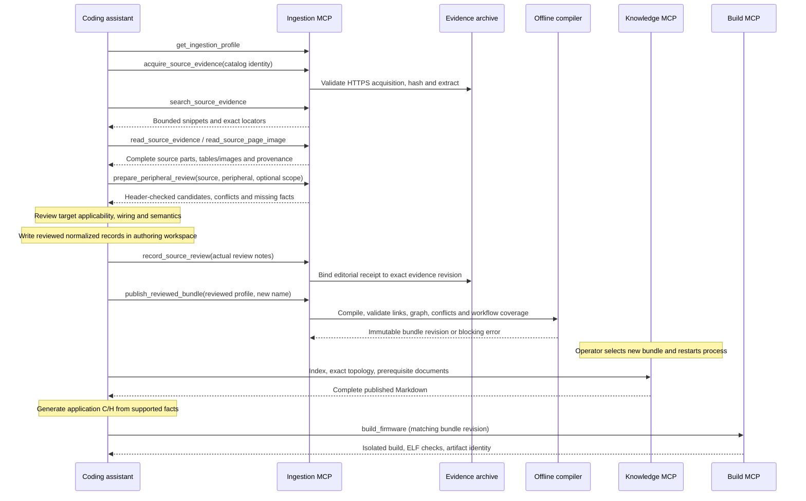

# Offline authoring through MCP

Praxis now has an optional **ingestion MCP** in addition to its knowledge and build services.
It gives an assistant access to source evidence and the existing offline compiler. This closes
an observed gap: a knowledge server could correctly report missing timer/connector facts, but
could not expose acquired manuals for review or publish an expanded bundle.

The implementation is [praxis/ingestion_server.py](../praxis/ingestion_server.py). It uses
literal source search and filesystem identities, with no embeddings or model calls. Only
explicit acquisition can contact the network. The three-tool knowledge server remains offline
and serves one fixed immutable bundle. Authoring does not change a running retrieval session.

The service exposes eleven tools. Its [manual review adapter](manual-review-compiler.md) is shared
with the offline CLI and prepares candidates, never automatically approved operating facts.

## Launch and separation

Install the `ingest` and `web` extras with the repository's dependency lock. Launch using
absolute executable and argument paths in a client. For an interactive terminal at the project
root, the equivalent command is:

```sh
.venv/bin/python -m praxis ingest-serve \
  --profile sources/stm32f407g-disc1/profile-discovery.json \
  --catalog sources/stm32f407g-disc1/web-sources.json \
  --archive-root sources/stm32f407g-disc1/imports/uart-scenario \
  --publication-root bundles \
  --evidence-archive imports/f407/rm0090
```

The last argument is optional and repeatable. It mounts an existing validated evidence archive
for reading; that archive cannot receive a review receipt unless it is inside the configured
authoring archive root. Stdio is the transport; starting a terminal process does not connect
an unrelated IDE session. Let each MCP client launch its own configured process.

For OpenCode, add a separate local entry to its `mcp` object, using absolute paths:

```json
{
  "mcp": {
    "project-praxis-ingest": {
      "type": "local",
      "command": [
        "/absolute/path/to/Praxis_Bundle/.venv/bin/python", "-m", "praxis", "ingest-serve",
        "--profile", "/absolute/path/to/Praxis_Bundle/sources/stm32f407g-disc1/profile-discovery.json",
        "--catalog", "/absolute/path/to/Praxis_Bundle/sources/stm32f407g-disc1/web-sources.json",
        "--archive-root", "/absolute/path/to/Praxis_Bundle/sources/stm32f407g-disc1/imports/uart-scenario",
        "--publication-root", "/absolute/path/to/Praxis_Bundle/bundles"
      ],
      "enabled": true
    }
  }
}
```

Use this authoring service when expanding knowledge. Keep it out of an ordinary firmware-only
session if source acquisition/publication is unnecessary. The ingestion MCP cannot build,
flash or execute firmware. The knowledge MCP cannot acquire or publish source material.

## Tool contracts

| Tool | Behavior and boundary |
| --- | --- |
| `get_ingestion_profile()` | Fixed target, catalog, source hashes, archive revisions/locators and exact `composed_definitions_sha256` for extension parent binding |
| `search_source_evidence(source_id, query, limit=20)` | Literal offline search, case insensitive, bounded snippets; full evidence must follow |
| `read_source_evidence(source_id, locator)` | Complete extracted page including tables and origin/hash information; registered text supports `complete` or `lines:START-END` |
| `read_source_page_image(source_id, page_number)` | MCP image of a hash-checked cached PDF page for visual schematic/table review |
| `discover_source_declarations(peripheral_name)` | Configured CMSIS adapter result; layout/masks only, with coverage limitations |
| `prepare_peripheral_review(source_id, peripheral_name, register_names=None, evidence_locators=None)` | Manual candidates checked against declarations; conflicts/gaps/provenance; always pending review |
| `prepare_workflow_review(source_id, workflow_name, evidence_locators=None)` | Expand authored document/mode prerequisites and register scopes into per-peripheral review packets; always pending review |
| `acquire_source_evidence(source_id, pages=None)` | Explicit HTTPS acquisition of an allowlisted catalog identity; no arbitrary URL or recursive crawl |
| `stage_cached_source(source_id, pages, output_id)` | Extract selected cached bytes into a new authoring archive without network; retained URL is declared provenance |
| `record_source_review(source_id, notes)` | Immutable exact-byte editorial review receipt after actual review; explicitly not independent engineering approval |
| `publish_reviewed_bundle(reviewed_profile, output_name)` | Existing compiler validates a profile in the configured source tree and publishes a new immutable revision |

A registered text range contains at most 200 lines and 1 MiB. Extracted page responses preserve
complete text/tables; search snippets do not. The in-memory extracted evidence snapshot is
bounded to 128 MiB. Published peripheral documents retain their separate 64 KiB limit. Rendered
PDF previews are bounded to 1800 pixels on their longest edge; use source bytes for any details that remain
unreadable. Preview rendering requires the optional PDF dependencies.

Source identities and locators select registered content, not arbitrary paths. Invalid paths,
source changes, hash mismatches, unknown identities and compiler failures become MCP tool errors.
Registered files and extracted pages are snapshotted at launch. Adapter execution and rendered
source bytes receive additional integrity checks. All authoring tools are serialized per process.
Profile inspection verifies stable registered inputs before exposing the composed-definition
hash; it does not extract headers or qualify operating semantics. See
[successive reviewed extensions](i2c-expansion.md) for its use.

## Evidence and publication workflow



The assistant still writes reviewed JSON/Markdown source records in its permitted workspace.
Optional [definition extensions](adc-expansion.md) add or explicitly replace records while
binding them to an exact base hash and reviewed MCU applicability. Workflow review packets
never create these operating records or approve them automatically.
Review preparation recognizes supported literal text/table shapes and numeric declarations;
it leaves unsupported shapes, operating semantics and target-variant conflicts for review.
No ingestion tool automatically approves normalized facts from snippets, rewrites firmware,
or grants hardware access. A receipt records who performed editorial review and its scope;
it cannot prove the review was competent. Independent engineering sign-off remains a separate
release condition. Unsupported modes and unknown facts remain visible in coverage reports.

Published bundles do not contain evidence instructions. Imported text is untrusted content,
even when hosted by a vendor, and must never be treated as executable agent instructions.
Source-specific authority still matters: headers establish declarations, schematic sheets
establish connectivity, and manuals establish operating semantics. Nets remain separate across
components. A fitted test jumper is a physical attachment, not a permanent board net.

## F407 UART experiment

The user authorized this service after an actual 44-call MCP replay exposed missing UART
connector topology and unreviewed timer/EXTI/SYSCFG semantics. Through the new MCP we acquired
ST's MB997-E-01 schematic and UM1472, read complete selected RM0090 pages from the cached manual,
viewed the schematic header/MCU sheets as MCP images, and checked CMSIS declarations.

Reviewed source records are in
[sources/stm32f407g-disc1/reviewed/uart-loopback](../sources/stm32f407g-disc1/reviewed/uart-loopback).
The new [profile](../sources/stm32f407g-disc1/profile-uart-loopback.json) publishes
`bundles/stm32f407g-disc1-e01-uart-v1`, revision
`1e7e9f44e7e8a4a9c2f1730ae725a2fed50cd80271b75adf63cdaa495899900b`.
The published workflow covers USART2 loopback, TIM2 update and PA0 EXTI; shared type declarations
are not a claim that every timer/UART mode is supported. GPIO/RCC/USART/NVIC remain canonical;
`tim`, `syscfg`, `exti` add the reviewed subset. Configured field views avoid mutually overlapping
TIM mode encodings; selected SYSCFG arrays expand without losing their C member/offset identity.

The first publication attempt failed because selected extraction files are named by extraction
ordinal, not physical PDF page number. It left prior bundles usable. The corrected profile used
`artifact` paths returned by the MCP, and publication passed. Raw failed/successful responses
remain in `temp/uart-ingestion-mcp-07` and `temp/uart-ingestion-mcp-09`.
The matching knowledge/build pair then passed the
[actual readiness replay](reports/uart-readiness.md).
No physical behavior follows from that result.

## Reproduce evidence calls

[tools/call_ingestion_mcp.py](../tools/call_ingestion_mcp.py) starts the real stdio server,
discovers tools and records actual responses/images. Its request file is a JSON list:

```json
[
  {"tool": "get_ingestion_profile"},
  {"tool": "search_source_evidence", "arguments": {"source_id": "rm0090", "query": "TIMx_SR"}},
  {"tool": "read_source_evidence", "arguments": {"source_id": "rm0090", "locator": "page:639"}}
]
```

Choose locators from actual search/profile results; the example locator is illustrative.
Pass the same launch settings plus `--calls requests.json --output NEW_DIRECTORY` to the
batch client. Existing acquisition archives and published revisions are immutable. Reacquiring
changed upstream bytes requires a new archive and explicit review; never relabel it as the old
revision. Raw documents may have distribution restrictions and are not needed by portable
knowledge retrieval. Preserve acquisition hashes/tool versions for reproducibility.
