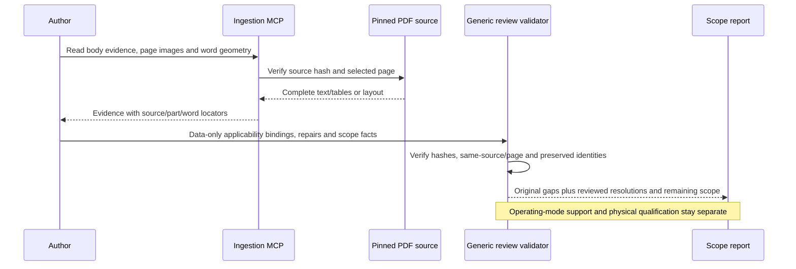

# F407 source-scope reconciliation

This continuation resolves the 29 previously recorded layout items and strengthens target
applicability using actual MCP source responses. It does **not** add new reviewed peripheral
modes or declare full F407 support.

The [second inventory revision](../examples/inventory/stm32f407g-disc1/inventory-v2.json)
uses the original immutable outline packets, additional pinned evidence and explicit editorial
review records. The [first inventory](../examples/inventory/stm32f407g-disc1/inventory.json)
remains reproducible with its original gaps.

| Measure | Original scope | Revised scope |
| --- | --- | --- |
| Indexed section/errata records | 1,683 | 1,683 |
| Original extraction items retained | 29 | 29 |
| Extraction items still unresolved after editorial review | 29 | 0 |
| Pending/mixed applicability sections | 741 | 299 |
| Editorial target/package facts | 0 | 24 |
| Ready authored operating workflows | 20/33 | 20/33 |
| Full MCU acceptance | Open | Open |

These counts describe source reconciliation, not an MCU completion percentage. The remaining 299
include 91 silicon-revision-dependent errata rows, electrical conditions, package-constrained
interfaces and mixed-family memory/power/flash sections. DMA2D applicability remains pending
rather than being excluded merely because an instance was not found in a header.

## Source review and concrete findings

RM0090 section 1.3 directs peripheral availability checks to the respective datasheets. The
MCP-read DS8626 Table 2 supplies the F407Vx feature/package column. Its ordering page additionally
confirms `V` = 100 pins, `G` = 1024 Kbytes, `T` = LQFP and the `6` temperature code. The inventory
distinguishes 100 package pins from 82 GPIOs and total 192 KiB system SRAM from contiguous
application RAM. Memory banks still need their own placement and reachability contracts.

Five previously pending RM chapters have explicit non-target restrictions in their bodies:

| Chapter | Controller | Source restriction |
| --- | --- | --- |
| 16 | LTDC | STM32F429xx/439xx |
| 23 | CRYP | STM32F415/417xx and STM32F43xxx |
| 25 | HASH | STM32F415/417xx and STM32F43xxx |
| 29 | SAI | STM32F42xxx and STM32F43xxx |
| 37 | FMC | STM32F42xxx and STM32F43xxx only |

They are excluded from this F407 source scope with body-page provenance. This is an applicability
decision, not an unimplemented F407 feature. The SPI/I2S interfaces remain distinct from SAI.
Datasheet package branches for other footprints are also excluded from the selected LQFP100
mechanical scope. Core applicability is backed by the datasheet's Cortex-M4/FPU/DSP/MPU description;
that decision does not approve every instruction, exception path or operating condition.

The package review revealed a restriction that register discovery alone cannot establish:
**for LQFP100, FSMC is restricted to Bank1/Bank2**. Table 2 footnote 1 specifies multiplexed
NOR/PSRAM through NE1 for Bank1, 8/16-bit NAND through NCE2 for Bank2, and no FSMC interrupt
line because Port G is unavailable. The inventory keeps FSMC mixed and records that constraint;
it does not approve all discovered FSMC banks. See the pinned
[datasheet evidence](../examples/inventory/stm32f407g-disc1/supporting-evidence-v2/part_ds_part_matrix_page_16.json)
and [ordering evidence](../examples/inventory/stm32f407g-disc1/supporting-evidence-v2/part_ds_ordering_page_186.json).

## How all 29 layout items were handled

The new read-only ingestion MCP tool
`read_source_page_layout(source_id, page_number)` returns complete text-layer words with
font/size/coordinates, table-cell boxes, source/archive hashes and a packet hash. It requires
the already extracted cached PDF page. It neither downloads documents nor infers diagrams.
No new dependency is required beyond the installed web extra. The optional authoring MCP now
has 13 tools; the portable knowledge MCP still has exactly three.

Every affected page was queried through MCP. Representative source images were also inspected.
Twenty-four isolated numbers occur below the document footer in the text layer, outside the
contents body. Those artifacts are explicitly classified as metadata using their individual
word locators. They were not silently discarded by a global rule.

Three long headings are repaired with complete titles and source-confirmed destination pages:
RM 5.4 → 141, RM 10.5.8 → 334 and RM 10.5.9 → 334. Two detached `BAT` subscripts are reattached to
DS 3.20 and DS 6.3.23. Source images and geometry support those decisions. Original titles,
unknown destinations, fragments, hashes and raw line accounting remain available.

## Generic review validation

The implementation lives in [inventory_review.py](../praxis/inventory_review.py). Replacement
titles, applicability decisions, device counts and package facts live in versioned data.
There are no STM32 register lists or manufacturer branches in this review engine.

```text
load_supporting_evidence(files, pinned_source_documents):
    reject escaped paths and changed file hashes
    require a PDF hash registered by the source inventory
    verify layout packet hashes or extracted source-part hashes
    register actual page, word and table-row locators

apply_editorial_repairs(outline, reviews):
    require a unique existing unresolved item
    validate every evidence reference
    require the same pinned PDF and affected page
    for numeric metadata:
        require the exact isolated source word
    for a heading repair:
        preserve its existing section identity
        require source evidence of the destination-page word
        retain the original title/destination and unresolved fragment
    record the editorial reviewer and provenance
    never delete a section or approve an operating mode
```

Facts and applicability bindings also resolve through the same pinned evidence registry. A
repinned envelope cannot retain a stale extracted-part hash after changing its source content.
Tests reject wrong PDFs/pages/words, changed packets, unknown gaps, renamed identities and
unsupported repair actions. This is integrity and consistency checking; it does not establish
that an editorial interpretation is independently correct.



## Reproduce and continue

Validation passed **1,022 tests with zero skips**, with required external tools enabled.
All twelve existing applications still link and ELF-revalidate through 81 actual knowledge/build
MCP calls. The rebuilt Docker knowledge runtime passes 161 calls across four sessions; its
minimal inventory CLI loads the source-bound review without ingestion extras and correctly
returns exit 1 with `--require-complete`. Repeated inventory reports are identical. No board
programming or execution control occurred.

Use the existing public bundle, or select a freshly compiled F407 candidate:

```bash
praxis inventory --bundle bundles/stm32f407g-disc1-e01-arm-core-v2 \
  --inventory examples/inventory/stm32f407g-disc1/inventory-v2.json --format markdown
```

The historical bundle's ITM publication gap remains visible. Add `--require-complete` to make
the unfinished manufacturer-wide review return exit 1. The optional acceptance MCP client can
select the same file with `--inventory`; it retains scope gaps as blockers while separately
checking supported firmware builds.

Next, author body/table-level instance and mode requirements, beginning with uncovered timer
PWM/capture paths, while continuing the remaining applicability and silicon-revision review.
Package restrictions must become requirements of each applicable mode contract. This inventory
is authoring evidence; it does not automatically alter existing published operating documents,
client bundle selection, firmware assets or the connected board.

See [machine-readable evidence](inventory-reconciliation-evidence.json),
[the original inventory algorithm](manufacturer-inventory.md), and
[the full F407 acceptance plan](f407-full-acceptance.md). Independent review and physical
qualification remain open.
