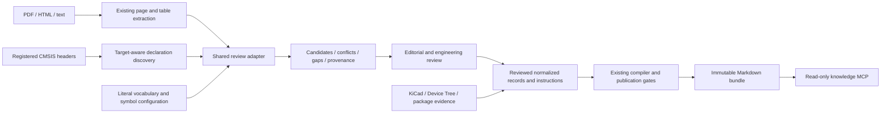

# Configurable manual evidence compiler

Praxis prepares deterministic **review packets** from extracted PDF, HTML and text evidence,
checked against the selected target's header declarations. This is an offline authoring stage
shared by the CLI and ingestion MCP. It contains no model calls, embeddings or network access.
It does not automatically approve peripheral operation or publish a bundle.

The purpose is to expand ingestion across peripheral families without writing a different
page parser for every peripheral. Configurable literal register symbols and table labels
handle supported document vocabulary. Unknown layouts remain visible gaps. New architectures
still need their own validated structured adapters and target profiles; a configurable parser
does not establish support for every MCU or every document format.

The [ADC expansion](adc-expansion.md) adds workflow-driven packet preparation and
hash-bound definition extensions. They reuse this adapter for dependencies and
new reviewed operating records, rather than adding another peripheral page parser.

## Position in the compiler



PDF extraction supplies text lines and source-local table fragments. Pydantic validates
records and configuration; it does not understand a page or infer its hardware meaning.
The new adapter recognizes explicit register headings and supported table columns, then
compares numeric candidates with declaration offsets and masks. It cannot reconstruct clock
trees, schematic connectivity or other visual relations from their labels alone. Use the
existing PDF-image evidence tool for visual review, and structured netlist adapters for wiring.
Complete published register tables are still rendered from reviewed records and never sliced
for retrieval. Raw extracted table fragments remain intact in their evidence archive.

## Sequence and authority

```mermaid
sequenceDiagram
    participant A as Author or coding assistant
    participant I as Ingestion MCP / CLI
    participant H as Header adapter
    participant E as Cached evidence
    participant P as Shared review adapter
    participant C as Bundle compiler
    A->>I: Select profile, archive, peripheral, optional registers/parts
    I->>H: Discover layouts and masks using fixed target adapter
    H-->>I: Declarations with source hashes
    I->>E: Read hash-validated complete evidence parts
    E-->>I: Text, tables, locators and archive revision
    I->>P: Match literal symbols and compare candidates
    P-->>A: Pending review packet, conflicts, gaps, provenance
    Note over A: Read full source parts; resolve applicability and operating semantics
    A->>I: Record explicit editorial review after actual review
    Note over A: Author reviewed normalized records and dependency/mode contracts
    A->>C: Compile reviewed profile to a new revision
    C-->>A: Validated immutable bundle or publication error
```

The packet always has `status: "pending-review"`, `review_required: true` and
`publication_ready: false`, even if all numeric comparisons match. It is not accepted as a
reviewed `Peripheral` record. The packet does not create a review receipt, change the vault,
advance hardware qualification or increase reviewed feature counts.

Headers establish declarations. Manuals and errata establish operating semantics. Package
documentation and schematics establish available pins and board connectivity. Device Tree
configuration is separate evidence. A match between two numbers does not establish side
effects, electrical safety, timing, a correct initialization procedure or physical operation.

## Supported extraction rules

| Input shape | Behavior |
| --- | --- |
| Register heading with an exact parenthesized symbol | Match a configured register identity; numbered sections reset inherited context, including wrapped or mode-qualified headings |
| Offset/reset label followed by one hex or decimal literal | Retain the value and any parenthetical qualifier; compare unconditional values with available declarations |
| Explicit `Bit N NAME` or `Bits H:L NAME` | Match an exact header field and compare position, width and mask |
| Table with literal configured register/value columns | Read supported cells and retain full table/row/column locators |
| Short register name, such as `CR` | Require an explicit table-to-peripheral scope; never guess the peripheral |
| Multiple variants, disagreeing values or mismatched fields | Retain alternatives and report conflicts for reviewed resolution |
| Unsupported expressions, access text, fields or irregular rows | Report extraction issues or missing facts; do not invent values |

Per-register read/write access is accepted only when explicitly labeled in a supported shape.
Bit-diagram `rw` cells are not automatically promoted to register-wide access semantics.
Reset-domain and section qualifiers survive in candidates; reviewers must inspect the complete
source part because a wrapped heading may contain only part of its applicability condition.
Offsets in a different address domain, stream formulas, encodings, write-one-to-clear behavior,
readiness waits and dependency edges require explicit review rather than numeric guessing.

Numeric PDF page order is preserved. Gaps in selected pages break inherited register context.
Part selection includes complete source parts, never arbitrary text slices. The packet is limited
to 256 KiB, 2,000 candidate observations and 500 requirement hints. Exceeding a limit fails with
`REVIEW_LIMIT`; select fewer complete registers or parts. No silent truncation occurs. These
authoring-operation bounds are separate from published Markdown, which has no fixed byte ceiling.

## Configuration

An optional `manuals` section belongs to the source profile. Its keys are evidence archive
identities. The following vocabulary is synthetic and demonstrates configuration, not support
for another manufacturer's MCU:

```json
{
  "manuals": {
    "example_manual": {
      "register_symbols": {"example": {"CTRL": ["EXAMPLE_CTRL"]}},
      "table_scopes": {"page:12/table:1": "example"},
      "labels": {
        "register": ["Symbol"],
        "offset": ["Displacement"],
        "reset": ["Initial value"],
        "access": ["Permission"],
        "field": ["Field name"],
        "bits": ["Position"]
      }
    }
  }
}
```

Without an override, symbols use discovery's peripheral prefix and per-register prefix mapping.
Explicit symbol lists replace the default for that register. Duplicate symbol bindings and
ambiguous labels fail. Configuration contains literal names, not executable expressions or
arbitrary regular expressions. Field prose and diagrams still require review.

## CLI and MCP usage

After acquiring the cataloged source archive as described in [web ingestion](web-ingestion.md),
use its actual path and identity. Local downloaded archives are deliberately excluded from the
public source distribution.

```bash
praxis prepare-review \
  --profile /absolute/path/to/profile.json \
  --archive /absolute/path/to/cached-manual-archive \
  --peripheral crc \
  --register CR \
  --output /absolute/path/to/new-crc-review.json
```

Omit `--register` for the complete declared peripheral. Repeat it for multiple registers.
Optionally repeat `--locator page:114 --locator page:115` to select exact complete archive parts
after reviewing target applicability. Those locators are examples from the tested RM0090
revision, not universal page numbers. Existing output files are never overwritten.

The optional ingestion MCP exposes the same implementation as its tenth tool:

```json
{
  "name": "prepare_peripheral_review",
  "arguments": {
    "source_id": "rm0090_features_v1",
    "peripheral_name": "crc",
    "register_names": ["CR"],
    "evidence_locators": ["page:115"]
  }
}
```

Use `get_ingestion_profile` to discover registered archives and exact part locators first.
Omit either optional list to select the whole entity or archive. Unknown/duplicate locators,
unknown register names and traversal input fail. Declaration discovery is cached within one
ingestion process, with registered source and profile hashes checked before reuse. Source
changes require a restart. The three-tool knowledge MCP remains read-only and unchanged.

Each packet binds the source PDF/document hash, extraction archive revision, source part hashes,
profile hash, declaration source hashes, normalized declaration hash, parser configuration hash
and packet hash. Identical source/profile/parser versions produce identical packets. The CLI
and MCP serialize the same records; deterministic preparation is separate from review quality.

## Recorded evaluation and remaining work

See [sanitized evidence](manual-review-evidence.json) for the actual local MCP evaluation and
test results. It covers ten F407 peripheral groups, explicit conflicts, negative queries and
determinism. These are **extraction candidates**, not ten newly qualified feature implementations.
No physical board operation or bundle publication was performed by this evaluation.

Next work follows the existing plan: resolve target-specific FLASH/PWR operating evidence,
extend reviewed instance/mode contracts and dependency-driven workflows, then compile and
qualify supported scenarios. Broader adapters, visual document understanding, unsupported
formats, independent engineering review and complete MCU feature coverage remain open.

The subsequent [clock-mode extension](clock-modes.md) applies this review workflow to exact
F407 sections, publishes scoped FLASH/PWR contracts and checks transitive mode dependencies.
It preserves the unreviewed status of candidate packets and excludes unsupported programming modes.
