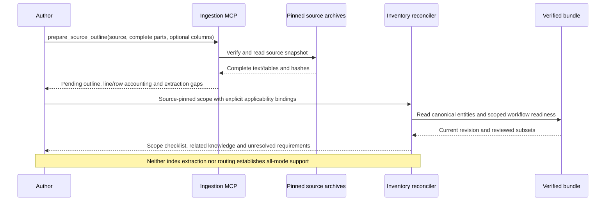

# Manufacturer capability inventory

The [second review revision](inventory-reconciliation.md) now accounts for all 29 extraction
items while preserving this original scope. Pending/mixed applicability falls from 741 to 299
using pinned body/table evidence; operating-mode coverage remains unchanged.

Praxis now has a source-pinned **scope inventory** for STM32F407VGT6, before expanding
to additional families. It is a concrete starting checklist for full coverage, not a
claim that every indexed section or operating mode is implemented.

The [inventory specification](../examples/inventory/stm32f407g-disc1/inventory.json)
references immutable outline packets produced through actual ingestion MCP. It reconciles
manufacturer sections with existing bundle entities and authored workflows. It preserves
unknown applicability, extraction failures and missing evidence.

## Current source scope

| Document | Pinned revision | Indexed records | Remaining extraction items |
| --- | --- | --- | --- |
| RM0090 reference manual | Rev 22 | 1,255 | 22 |
| DS8626 datasheet | Rev 12 | 109 | 4 |
| PM0214 core manual | Rev 10 | 228 | 3 |
| ES0182 errata | Rev 19 | 91 | 0 |
| Total | Four documents | 1,683 | 29 |

These are source sections and errata-summary rows, **not 1,683 MCU features**. The reference
manual covers multiple parts. The scope currently contains **741 sections with pending or
mixed applicability**, and three missing evidence requirements: ROM boot/protocol references,
complete board connectivity/assembly evidence, and the body/table-level operating-mode inventory.

The source packets retain original PDF hashes, archive revisions, complete selected-part hashes
and source-local line/table-row locators. Raw PDFs remain in private evidence archives, outside
the public package. ES0182 Rev 19 was explicitly acquired from the configured official source
through MCP. That acquisition does not automatically revise existing reviewed operating facts.

The previous cached RM contents ended at page 35, inside the later chapters. The new extraction
stages pages 1–40 from the same pinned PDF and observes both contents boundaries. The DS and PM
contents boundaries and the errata table-index boundaries are also observed. A boundary check
proves the selected index region was observed; it does not prove every mode appears in that index.

The remaining 29 extraction items are retained explicitly. They include unlabelled numeric footer
artifacts, detached subscript text and three numbered RM headings whose destination layout is
ambiguous. Those three section identities remain in the inventory with unknown destination pages;
they were not removed to improve the counts. Exact locators and fragments remain available for
source-image/editorial repair.

## Extraction and reconciliation algorithms

The generic [outline adapter](../praxis/adapters/outline.py) recognizes numbered or appendix
headings in an English `Contents` block, with dotted leaders or clearly aligned page references.
Wrapped titles retain every contributing locator. It also supports index tables whose literal
section/title columns are supplied as data. For errata, these columns are `Section` and
`Limitation`; all revision-status cells remain literal.

Every selected nonempty text line receives a disposition and hash. Table extraction additionally
accounts for every extracted row. Unrecognized lines/rows remain gaps; duplicate identities fail.
Missing pages cannot join unrelated fragments. The adapter does not interpret errata status
letters, infer absent peripherals, reconstruct diagrams or approve operating semantics.

```text
prepare_outline(selected_pages, source_metadata, optional_column_labels):
    verify unique locators and page identities; sort pages
    account for every selected nonempty line
    if table columns are supplied:
        match exact labelled headers
        retain section/title and every other literal cell
        retain malformed rows as gaps
    else:
        identify contents pages and evidence gaps
        collect numbered headings and wrapped lines
        extract supported page references
        retain incomplete section identities and unresolved fragments
    reject duplicate section identities
    record observed index boundaries and source hashes
    hash the deterministic pending-review packet
```

The optional ingestion MCP currently has thirteen tools, including:

```text
prepare_source_outline(source_id, evidence_locators=None, table_columns=None)
```

It reads only configured, integrity-checked evidence archives and runs offline against cached
pages without LLM calls. The three-tool knowledge MCP remains unchanged.

[The reconciliation module](../praxis/capability_inventory.py) validates the exact target,
outline-file hashes and packet hashes. Target-specific bindings live in JSON, not Python.
Bindings select explicit section identities or ancestor prefixes; the most specific binding wins.
Unbound sections remain pending. Unknown entities, workflows, sections, escaped paths, changed
source packets and duplicate bindings fail predictably. Known-but-unpublished entities remain gaps.

For example, RM section 6 explicitly names the F42/F43 RCC branch, so the F407 scope excludes
that branch using the title's retained source locators. Section 7 explicitly names the F405/07
branch and relates to the F407 RCC entity. CRYP, HASH, DMA2D, LTDC, SAI and FMC applicability
remain pending until part-specific availability evidence is reconciled. The compiler does not
decide exclusions from an absent header instance or general STM32 familiarity.

```text
reconcile(bundle, inventory):
    verify exact MCU, package and reference-board identity
    validate pinned document packets and authored section/entity/workflow bindings
    for every indexed section:
        apply the most specific applicability binding, or pending
        attach related entities and current workflow readiness
        retain known-but-unpublished entities as gaps
        never infer all-mode support from a related ready workflow
    retain extraction, applicability and missing-evidence requirements
    report incomplete manufacturer scope and separate qualification boundaries
```

Register declarations, source applicability, reviewed modes, compilation and physical qualification
remain separate. A ready TIM2 workflow does not cover every timer chapter. An applicable chapter
does not establish that all its pins are bonded out on LQFP100. A hash proves integrity, not
independent interpretation. Exhaustiveness review remains pending, so `--require-complete` fails.



## Use the inventory

Read the scope against the existing public F407 bundle without native ingestion tools:

```bash
praxis inventory --bundle bundles/stm32f407g-disc1-e01-arm-core-v2 \
  --inventory examples/inventory/stm32f407g-disc1/inventory.json --format markdown
praxis schema --kind capability-inventory
```

That historical bundle still has the older ITM extraction blocker, which the report exposes.
For the candidate with the fixed parser, compile into a fresh directory, then use the inventory:

```bash
praxis compile --profile sources/stm32f407g-disc1/profile-arm-core-v2.json \
  --output .praxis-output/my-f407-inventory/bundle
praxis inventory --bundle .praxis-output/my-f407-inventory/bundle \
  --inventory examples/inventory/stm32f407g-disc1/inventory.json --require-complete
```

The second command exits 1 because full inventory review remains incomplete. Ordinary report
generation exits 0; it does not claim full support. Neither command flashes or resets a board.

The [MCP acceptance client](../tools/check_target_acceptance_mcp.py) accepts optional
`--inventory`. It adds scope gaps to acceptance blockers and saves the complete inventory report
separately. All twelve registered applications still compile/link and ELF-revalidate against the
same candidate in 81 actual MCP calls. No hardware tools are exposed.

Strict regression passed **1,005 tests with zero skips**. Four repeated outline-MCP preparations
produced identical packets. The rebuilt Docker knowledge runtime passed **161 calls across four
sessions**. Its minimal runtime also generated the complete inventory report with networking
disabled and no ingestion extras; `--require-complete` returned exit 1 as expected.

## Next closure work

The original next step was to reconcile availability, package and silicon-revision evidence and repair the 29
source-layout items through exact source/image review. Then enumerate applicable body/table-level
instances, modes, constraints and errata workarounds. Author reviewed requirements and positive/
negative verification cases, beginning with uncovered timer modes and boot/flash paths. Complete
hardware qualification and independent review remain required before declaring full F407 support.

See [the full F407 acceptance plan](f407-full-acceptance.md),
[sanitized inventory evidence](manufacturer-inventory-evidence.json), and
[the contribution guide](../CONTRIBUTING.md). The standalone documentation website is not
automatically synchronized by compiler work.
