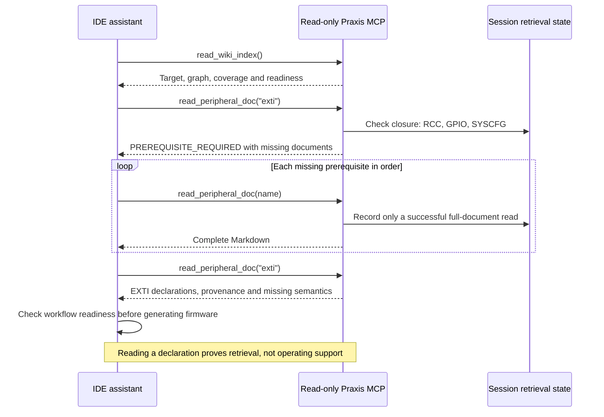

# Configurable peripheral discovery and coverage

Praxis now inventories register types across the selected CMSIS device header and its
registered core includes. Publication and session routing use a configured dependency graph.
The previous four-document limitation remains only for compatibility with schema-1 bundles.

This is the foundation for broad MCU coverage. It is **not a claim that every feature of an
STM32F407, or every mode of every peripheral, is ready for firmware generation**. A header
can establish a declaration, address or layout; it cannot establish a safe initialization
procedure, electrical limits, board wiring, clock state, or physical operation.

## Current reference bundle

- Input profile: [`profile-discovery.json`](../sources/stm32f407g-disc1/profile-discovery.json).
- Bundle: [`stm32f407g-disc1-e01-discovery-v2`](../bundles/stm32f407g-disc1-e01-discovery-v2/wiki/index.md).
- Complete coverage and machine-readable record: [`wiki/coverage.md`](../bundles/stm32f407g-disc1-e01-discovery-v2/wiki/coverage.md).
- Target: STM32F407VGT6, LQFP100, STM32F407G-DISC1 reference revision MB997-E-01.
  The user's physical revision remains unconfirmed.
- 42 register blocks with typed or explicitly configured instances; **41 published**,
  containing **520 register rows and 2,048 field definitions**. Array rows retain counts/strides.
- Four published documents retain reviewed subsets: RCC, GPIO, USART and NVIC.
- Two of the published blocks, FLASH and TPI, have partial mask extraction. Complete register
  layouts remain available; an affected register's entire field set is withheld and the
  reason appears in its document and coverage report. No conflicting mask is published.
- ITM is blocked because its nested union has no supported unambiguous flattening rule.
- Eleven other types are reported as unmapped: these include helper types, CPU status
  representations, and USB endpoint/channel types requiring instance mappings. They are
  never silently treated as unsupported silicon.
- Largest document is 44,489 bytes, below the 65,536-byte limit.

These counts describe this exact source/profile revision, not a percentage of all silicon
capabilities. DMA request mapping, AF/package availability, protocol modes, clocks, errata,
and board connections are different dimensions of coverage.

For the latest reviewed subset and mode counts, see [mode-scoped feature expansion](peripheral-modes.md).
The shared [manual evidence compiler](manual-review-compiler.md) now prepares numeric candidates
against discovered declarations across peripheral families. It accelerates authoring while keeping
target applicability, operating semantics and publication approval explicit.

## Profile configuration

Keep engineering inputs and reviewed imports in the existing source tree. Add `discovery`
to a profile that has `header.discover: true` and `header.kind: "cmsis"`:

```json
{
  "discovery": {
    "automatic": true,
    "default_prerequisites": ["rcc"],
    "exclude": [],
    "peripherals": {
      "tim": {
        "structure": "TIM_TypeDef",
        "prefix": "TIM",
        "prerequisites": ["rcc"]
      },
      "syscfg": {
        "structure": "SYSCFG_TypeDef",
        "prerequisites": ["gpio"]
      },
      "exti": {
        "structure": "EXTI_TypeDef",
        "prerequisites": ["syscfg"]
      }
    }
  },
  "workflows": {
    "uart_timer_interrupts": {
      "peripherals": ["usart", "tim", "exti", "syscfg", "nvic"],
      "registers": {
        "tim": ["CR1", "DIER", "SR", "PSC", "ARR"],
        "exti": ["IMR", "RTSR", "FTSR", "PR"],
        "syscfg": ["EXTICR"]
      },
      "operating_semantics": true
    }
  },
  "publication_requires": ["uart_timer_interrupts"]
}
```

This example deliberately **blocks publication** until operating imports for the required
workflow exist. Remove that workflow from `publication_requires` to publish declarations
while retaining an explicit readiness failure. Do not mark a workflow ready just to make
code generation continue.

`automatic: false` publishes reviewed definitions plus explicitly selected peripherals.
Discovery still inventories all recognized types so selection does not hide omissions.
`automatic: true` also selects extractable instance-bearing blocks. Explicit selections
must extract successfully; unknown structures, duplicate structure identities and exclusions
of reviewed documents fail the build.

`default_prerequisites` is retrieval policy, not an automatically inferred hardware sequence.
Reviewed definitions retain their prerequisites unless a profile explicitly overrides them.
Set dependencies for each required workflow after reviewing the target manuals. Shared
requirements form a DAG, not a forced linear tour through unrelated peripherals.

Optional `instances` map names to restricted integer macro expressions when a header does
not expose typed pointers. The reference profile demonstrates USB FS/HS global/device/host
base expressions. These establish address declarations only, not USB operating support.
Optional `register_prefixes` maps register names to complete vendor macro prefixes, as used
for `DMA_SxCR`, `DMA_SxNDTR`, and the other stream registers. Generated instance aliases
such as `tim2`, `spi1`, and `dma1_stream0` resolve to their canonical document. Collisions fail
publication instead of selecting an arbitrary target.

## Offline workflow

```bash
.venv/bin/praxis coverage \
  --profile sources/stm32f407g-disc1/profile-discovery.json \
  --output /tmp/praxis-coverage.json

.venv/bin/praxis compile \
  --profile sources/stm32f407g-disc1/profile-discovery.json \
  --output /tmp/praxis-discovery-bundle

.venv/bin/praxis lint --bundle /tmp/praxis-discovery-bundle
.venv/bin/praxis evaluate --bundle /tmp/praxis-discovery-bundle
.venv/bin/praxis serve --bundle /tmp/praxis-discovery-bundle
```

The coverage command writes a new JSON file or prints JSON when `--output` is omitted. It
performs the same source, target, extraction and integrity checks as compilation. It can
report missing workflow evidence even when those workflow requirements block normal
publication. Structural conflicts and malformed profiles still fail; a report is not a
way to make invalid inputs publishable. Temporary analysis bundles are removed.

Outputs contain no timestamps or input-directory-dependent paths. Sources have hashes and
versions; extraction tool versions accompany the report. Every published Markdown document
is registered and hashed. Staging validation rejects broken links, duplicate identities,
cycles, missing dependencies and oversized documents. Automatic optional documents that
exceed the size bound, and their dependent optional documents, are reported as blocked;
explicit or reviewed documents fail rather than disappearing. Tables are never truncated.
An existing bundle revision cannot be overwritten.

## What a coverage state means

| State | Meaning | Firmware use |
| --- | --- | --- |
| `reviewed_subset` | Authored operating import exists; declaration and reviewed facts are reconciled | Only explicitly supported facts/workflows |
| `declarations_only` | Register layouts and available masks extracted; operating behavior unreviewed | Further review required |
| `partial_declarations` | Layout retained, but at least one field set withheld with an explicit error | Resolve gaps before using affected fields |
| `not_selected` | Discovered and extractable but not selected by this profile | Change publication policy if needed |
| `blocked` | Extraction or optional publication failed with a stated reason | Fix adapter/input/editorial issue |
| `unmapped_type` | No supported instance mapping; may be a helper type | Classify it or provide a supported mapping |

Workflow readiness checks the transitive prerequisite closure, reviewed imports, required
register presence and known access modes. Register requirements can fall back to
`header.required_registers` for foundational documents. It does not validate every field
encoding, numerical configuration, board circuit, arbitrary C initialization order or
physical behavior. Those checks remain separate verification layers. A required workflow
with missing evidence blocks publication; optional incomplete workflows remain visible.

## Sequence: discovery and publication

```mermaid
sequenceDiagram
    actor Maintainer
    participant CLI as Offline compiler
    participant Clang as Target parser and preprocessor
    participant Coverage as Coverage and dependency policy
    participant Vault as Immutable Markdown bundle
    Maintainer->>CLI: Profile, registered sources and reviewed imports
    CLI->>CLI: Bound paths and hash inputs
    CLI->>Clang: Parse all recognized register types and macros
    Clang-->>CLI: ABI layouts, instances, masks and extraction failures
    CLI->>Coverage: Inventory and configured selections
    Coverage->>Coverage: Validate graph and reconcile reviewed facts
    Coverage->>Coverage: Check workflow dependency closures and requirements
    alt Required evidence missing
        Coverage-->>Maintainer: Coverage report; compile publication blocked
    else Publication requirements met
        CLI->>CLI: Render contiguous tables; validate staging and source hashes
        CLI->>Vault: Atomically publish fixed revision
        Vault-->>Maintainer: Index, peripheral documents, topology and coverage
    end
```

## Sequence: branching retrieval



## Direct MCP evidence and optional OpenCode playground

The actual direct replay passed **21 MCP tool calls**; see
[recorded evidence](peripheral-discovery-evidence.json). It verified denied out-of-order calls,
full-response hashes, canonical aliases and branch independence. It also confirmed that
`USART2_TX` has **no matching net** in the current partial board transcription. Broader
register coverage does not fill in schematic wiring. No hardware operations were performed.

Reproduce the replay (choose a new output directory):

```bash
.venv/bin/python tools/check_discovery_mcp.py \
  --bundle bundles/stm32f407g-disc1-e01-discovery-v2 \
  --output /tmp/praxis-mcp-replay
```

The output includes full `responses.jsonl` and a compact `report.json` with hashes and outcomes.
The external model run was not performed: the user chose direct MCP testing instead.

The [portable discovery prompt](mcp-test-prompts.md#discovery-and-routing) tests real calls,
alias resolution, prerequisite gates and recognition of missing operating guidance. Configure
only the knowledge MCP for this evaluation, select the discovery bundle explicitly, and disable
other file/web/hardware tools in the client. A hosted model may receive returned documents;
choose its provider deliberately. No model-evaluation pass is claimed without an actual trace.

The ordinary `temp/opencode.json` and build launcher still select the earlier qualified
LED/button reference bundle. Use the isolated playground configuration to test this new
coverage release. Switching knowledge bundles does not automatically requalify a
bundle-bound hardware profile, prior build artifact, or operator authorization.

## Extending coverage toward all MCU features

1. Inventory the exact vendor header and core includes; review every blocked/unmapped type.
2. Select register blocks, canonical names, instance mappings and dependency edges in the profile.
3. Import reviewed operating semantics, pin/AF tables and errata with source provenance.
4. Declare narrow workflows and their required registers; include readiness requirements in
   `publication_requires` before advertising those workflows as supported.
5. Add reviewed numerical configuration and target-header assertions, compiler checks and
   ordering tests for each workflow. Add board-specific circuits separately.
6. Run real-client retrieval evaluations, then isolated target builds. Authorize hardware
   operations separately and distinguish readback, execution and physical behavior evidence.

New MCU families still require a validated target/ABI/package backend; this change does not
remove that boundary. AVR's existing reviewed ingestion remains available but automatic
whole-header CMSIS discovery is not an AVR adapter. Web acquisition still archives evidence;
it does not automatically turn arbitrary manuals into verified operating contracts.
