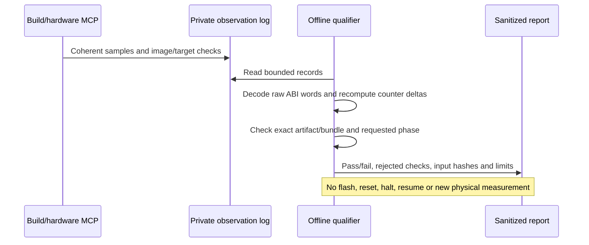

# Operating-mode support and Milestone 4 qualification

For the subsequent FLASH/PWR and reusable mode-dependency extension, see
[clock-mode support](clock-modes.md). Its separately selected bundle has 15 reviewed subsets
and 12 contracts. The counts and blocked PLL workflow below describe the earlier feature-v1 baseline.

The 2026-10-11 expansion adds six reviewed peripheral subsets to the F407 bundle:
CRC, DMA controllers, DMA streams, SPI, RNG and IWDG. The bundle now has **13 reviewed
subsets**, **41 published register blocks**, **523 register rows** and **2,094 field
definitions**. Its inventory recognizes 42 blocks and 99 typed instances; ITM remains
blocked. Seven explicit operating-mode contracts are published. Thirty-five recognized
blocks have no explicit mode contract, including earlier reviewed subsets whose legacy
workflow checks remain separate. **Complete MCU feature support is not achieved.**

Use the separately selected
[feature bundle](../bundles/stm32f407g-disc1-e01-features-v1/wiki/index.md) and
[authoring profile](../sources/stm32f407g-disc1/profile-features-v1.json).
Revision: `bd8b793388dff8303e5f7d46469b48afea1807dd2f7ae9b71541eb01779a3fbc`.
Existing OpenCode launchers, hardware profiles and installed UART firmware are unchanged.

## What the new contracts establish

| Entity | Reviewed mode and instance scope | Boundary |
| --- | --- | --- |
| RCC | CRC/DMA/SPI/RNG bus gates, RCC | A gate is separate from source-clock readiness |
| CRC | Fixed-polynomial word feed, CRC | 32-bit bus accesses, including the byte-sized CMSIS IDR member; host CRC convention must match |
| DMA | Status and W1C flag clearing, DMA1/DMA2 | Peripheral request/channel routing is outside this contract |
| DMA streams | FIFO word-copy polling, DMA2 streams 0–7 | DMA1, circular/direct mode, double buffering and peripheral handshakes excluded |
| SPI | Controller full-duplex Motorola master polling, SPI1–3 | Current board wiring/AF evidence is insufficient; wired workflow blocked |
| RNG | Polling with clock/seed and consecutive-output checks, RNG | Complete PLL/FLASH/PWR setup remains blocked; no entropy certification |
| IWDG | Software configuration/start/refresh, IWDG | Timing bounds, option-byte state and debug-freeze behavior need separate evidence; no watchdog hardware test |

CRC and DMA2 memory-copy workflows pass their declared knowledge publication gates.
IWDG passes its scoped semantic gate; this is neither an authorization to start it nor
proof of a reset/recovery procedure. SPI wiring and complete RNG clock workflows remain
blocked with concrete missing facts. I²C, CAN, ADC, DAC, RTC, SDIO, Ethernet, FSMC, USB,
FLASH programming and PWR mode objectives are explicitly reported as blocked.

The compiler also corrects a source interpretation defect: a macro with a `_Pos`/`_Msk`
field definition, such as `CRC_CR_RESET`, is a bit-field command, not an inferred register
reset value. The reviewed CRC_CR reset value is zero. Older affected CRC documents are blocked by
[PRAXIS-2026-001](bundle-advisories.md), while their immutable files remain available as history. A separate bus-access-width field
prevents treating C member width as a permitted hardware transaction width. DMA bit 20
is retained as a header declaration but explicitly marked reserved for operation according
to RM0090; the header's ACK name is not used as operating authority.

## Compilation and publication

All new hardware facts were obtained through real ingestion MCP responses from cached
RM0090 Rev22 pages and pinned CMSIS declarations. The compiler contains no model call.
An author synthesized instance-scoped records and explanatory Markdown from those responses;
an editorial receipt records that review. It is not an independent engineering sign-off.

```mermaid
sequenceDiagram
    participant A as Author or coding assistant
    participant I as Ingestion MCP
    participant C as Offline compiler
    participant B as Immutable bundle
    A->>I: Read source evidence and discover declarations
    I-->>A: Exact page/register evidence and provenance
    A->>A: Review facts and author instance-scoped modes
    A->>I: Record editorial review and request publication
    I->>C: Compile reviewed profile
    C->>C: Check layouts, masks, access widths and semantic sources
    C->>C: Check exact instances, modes, signals and dependency closure
    alt Required workflow lacks facts
        C-->>A: Publication blocked; previous bundle remains usable
    else Required workflows pass
        C->>B: Atomic immutable publication
        B-->>A: Bundle revision and complete Markdown
    end
```

An operating-mode contract names exact instances, required registers and fields,
requirements, and semantic sources. Publication requires reviewed access widths and
semantic provenance for used registers/fields. Required workflow gates check modes,
instances, dependency closure and exact board signal lookups. A DMA1 stream cannot inherit
DMA2 memory-copy support just because both use the same register structure.

Full tables remain contiguous; the largest published document is 58,172 bytes, below
the 64 KiB limit. Oversize publication is rejected rather than truncated. The generated
`features.md` is indexed from `index.md`; it and `coverage.md` remain Markdown knowledge.
Their embedded JSON supports deterministic offline reporting. The three retrieval tool
signatures remain unchanged. MCP initialization additionally advertises the verified target
and bundle revision, allowing comparison with the separate build service without modifying
the complete index response.

```bash
.venv/bin/praxis features --bundle bundles/stm32f407g-disc1-e01-features-v1
.venv/bin/praxis serve --bundle bundles/stm32f407g-disc1-e01-features-v1
```

Mode gates constrain publication. Session HEDG gates constrain retrieval. Neither gate
proves that arbitrary assistant-generated C uses the retrieved facts correctly.

## Deterministic observation qualification

`praxis qualify-telemetry` strengthens Milestone 4 by checking recorded MCP observation
windows. It reconstructs the fixed UART ABI from numeric words and recomputes outcomes;
it does not trust supplied state labels, indicators, assessments or pass flags. It checks
artifact/bundle identity, reported image verification, coherent records, timer progress,
every adjacent counter transition and phase-specific behavior. Failed/mixed runs cannot be
turned into a success by adding a later passing window.

```bash
.venv/bin/praxis qualify-telemetry \
  --bundle bundles/stm32f407g-disc1-e01-uart-v1 \
  --artifact c192a736ed2958697e4c89022094ae3b896b01529c8f391e074068c1c2c71688 \
  --phase paused \
  --observation /absolute/path/to/private/observation-00.json \
  --output /absolute/path/to/new/qualification.json
```

Repeat `--observation` for windows from the same phase/run; do not combine power cycles.
Exit 0 means the declared phase passed; exit 1 means a completed qualification failed.
Malformed input produces an actionable error. Output files must be new. Reports contain
input hashes and omit probe identifiers. This command does not attach to a board or
independently repeat the image readback reported in the input log. Logs must remain
trusted local evidence; hashes bind the inputs, not their physical truth.



Replaying all eight earlier physical telemetry windows preserves their outcomes:
jumper-removed failure passes; the initial failed/mixed recovery is rejected; two stable
recovery windows pass; the first intended pause is rejected; an intervening running window
passes; the final paused window passes. **Repeatability remains unqualified**, and the
timeout/new-run anomalies remain unexplained. See
[sanitized replay evidence](feature-expansion-evidence.json) and
[the original physical report](reports/telemetry-failure-recovery-results.md).

## Verification evidence and next coverage work

The reproducible [MCP replay client](../tools/check_feature_modes_mcp.py) tests routing,
mode readiness and no-match behavior using only actual MCP responses. With the optional
source argument it also checks that knowledge/build revisions match and builds in the
pinned rootless sandbox. It enables no hardware tools.

The [CRC/DMA smoke example](../examples/stm32f407g-disc1-crc-dma/README.md) passed real
MCP full linking and ELF revalidation. Its portable CRC calculation is checked against
independent polynomial division over 1,003 cases. This is arithmetic and compilation
evidence, not peripheral behavior or hardware ordering evidence. The example has not been
flashed; DMA buffer reachability and a suitable observation contract must be reviewed first.

Expansion must continue per mode and instance: complete FLASH/PWR clock and boot knowledge;
prove SPI board AF/connectivity; review ADC/DAC/I²C/CAN and their DMA/interrupt paths;
then RTC, USB, Ethernet, SDIO, external memory, low-power/reset/watchdog modes and core/startup
features. Additional timer modes and advanced PWM/capture also need contracts. Headers alone
cannot establish package availability, electrical constraints, errata or bootloader correctness.
Contributors can add source/compile evidence without owning a board; hardware qualification
must identify the exact board, image, wiring, stimulus and observations separately.

The release remains an experimental alpha. Independent review of all nine shipped bundle
revisions and the firmware assets, UART repeatability/root-cause investigation, broader
physical qualification, hosted/clean-machine reproduction and third-party rights review
remain release work. See [publication readiness](PUBLICATION_READINESS.md).
