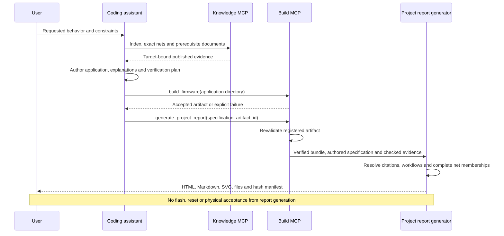

# Reports for the firmware project

Praxis can now produce a report about **the project requested by the user**. This is
separate from Praxis development logs, MCP traces or an MCU-wide coverage report.
The first example is a [fault-aware UART protocol supervisor](../examples/projects/stm32f407-protocol-supervisor/README.md).

The assistant authors requirements and design explanations, using the knowledge MCP as
evidence. The report generator resolves references and connectivity against one verified
bundle, assesses the named workflows, and renders a standalone documentation directory.
It does not use an LLM, embeddings, a browser, network access or ingestion subprocesses.
Target-specific facts remain in bundles and profiles; the renderer has no STM32 branches.
The separate, opt-in `project-pdf` command typesets the exported engineering report
with installed LuaLaTeX/CircuitikZ and Poppler tools. It does not flash or inspect a board.

## Report contents

| File | Purpose |
| --- | --- |
| `index.html` | Readable, self-contained HTML entry point, with inline connectivity SVG; opens directly in a browser |
| `REPORT.md` | Portable project explanation, requirement and verification tables, connectivity, build status and limitations |
| `schematic.svg` | Scoped net-membership diagram, preserving every endpoint on each selected net |
| `diagrams/*.svg` | Optional authored sequence diagrams with participants, messages and cited source documents |
| `report.json` | Structured requirements, target/bundle identity, assessment, topology, citations and evidence status |
| `references/*.md` | Complete cited published documents with hashes; no excerpts or fixed document size ceiling |
| `project_files/*.txt` | Optional complete UTF-8 project attachments, stored as text rather than executable web assets |
| `manifest.json` | SHA-256 hashes for every output except this manifest itself |
| `latex/report.tex` | Formal A4 report assembling the separate authored/evidence parts |
| `latex/sections/*.tex` | Cover, requirements, rationale, electrical design, verification and traceability |
| `latex/electrical.tex` | Native CircuitikZ reference sheets with component values and terminal/net legends |
| `latex/authoring.json` | Structured handoff identifying the report parts, drawing recipes and evidence |

After `project-pdf`, the new output directory additionally contains `report.pdf`,
`electrical/sheet-*.svg` previews, the compiled electrical PDF and a typesetting receipt.
The HTML preview links to the PDF and embeds the actual compiled electrical sheets.

The SVG is a **connectivity rendering**, not a reconstruction of the original KiCad
sheet layout or a complete electrical schematic. Resistor terminals, LED terminals and
their nets remain separate. Proposed external jumpers appear as dashed, unconfirmed
connections between published endpoints. Component values and operating explanations
come from cited documents; the renderer does not infer their electrical behavior.

The HTML uses a white background, charcoal text and plain document-control rules.
Review status is normal engineering text rather than a colored warning banner. The
typeset PDF uses serif report typography, a cover, contents, numbered sections, page
headers/footers and traceability appendices. HTML requires no remote fonts or JavaScript.

## Electrical schematics

Electrical sheets use CircuitikZ resistor, LED and normally-open-switch symbols.
The renderer recognizes only published component kinds and declared terminal roles.
It never guesses a symbol from a reference prefix such as `R`, `LD` or `B`.
An LED/resistor branch is drawn together only when the shared net has exactly those
two terminals and the LED's anode/cathode are declared. Four-terminal switch groups
require explicit source properties and consistent nets. Unknown internals, incomplete
terminal roles and solder-bridge states remain terminal representations.

Every selected endpoint is retained in a drawing and in the full net-membership appendix.
Identical net labels connect fragments across sheets. Component values and terminal
legends retain their source references. These are scoped redrawings, not the original
manufacturer CAD layout, a complete board circuit, an ERC pass or electrical sign-off.
Proposed external wiring is drawn dashed and remains unconfirmed.

## AI-assisted LaTeX authoring

The authoring handoff separates parts instead of asking a model to invent an entire
engineering document without evidence:

1. Praxis supplies target identity, source-backed facts, component/net data, figure
   recipes, evidence status and the files listed in `latex/authoring.json`.
2. The assistant authors requirements, design explanations and sequence diagrams in
   the project specification. Praxis exports escaped text into the corresponding `.tex`
   parts and assembles `report.tex`.
3. For a custom document, copy the kit into a **new authoring workspace**. The assistant
   can rewrite those LaTeX parts or use them in another template while preserving facts,
   citations and unverified results. Original reports remain immutable.
4. The controlled Praxis PDF command regenerates its own templates from checked data;
   it does not execute custom TeX edits. Custom AI-authored TeX requires a separate trusted
   or isolated compilation workflow and is outside this feature's acceptance claims.

No raw TeX field is accepted through MCP. Project text containing LaTeX commands is
escaped as literal text. Native PDF typesetting disables shell escape, bounds runtime
and diagnostics, checks electrical-sheet counts, and blocks missing glyphs or significant
text overflow instead of silently publishing missing content.

## Diagram schemas

The project JSON Schema also describes an optional `diagrams` list. The assistant supplies
the intended design through structured data, rather than submitting executable SVG or
JavaScript. Each sequence diagram declares a unique ID, title, description, source document
IDs, named participants and messages. The generator validates participant references and
citations, then renders escaped SVG deterministically. For example:

```json
{
  "id": "uart_message_flow",
  "title": "Receive path",
  "description": "Intended responsibilities, not a measured execution trace.",
  "documents": ["peripherals/usart"],
  "participants": [
    {"id": "uart", "label": "UART handler"},
    {"id": "main", "label": "Main loop"}
  ],
  "messages": [
    {"sender": "uart", "receiver": "main", "label": "Publish bytes and error flags"},
    {"sender": "main", "receiver": "main", "label": "Validate the framed response"}
  ]
}
```

Place this object inside the specification's `diagrams` array. Self-messages and return
messages are supported; long labels wrap without truncation. Message order is authored
design information and is not inferred from HEDG retrieval or hardware observations.
Schematics and sequence diagrams have separate roles: the former shows published net
membership, while the latter explains the intended software flow.

## Evidence boundaries

Each requirement names published workflow IDs and a verification plan. A named workflow
can be knowledge-ready while the implementation remains unassessed. Unknown workflows,
unmapped requirements and unresolved signals become explicit gaps. Ambiguous identities,
unknown document references, wrong targets/revisions and unknown jumper endpoints fail.

Build evidence is optional. Over MCP, the server revalidates an artifact in its own store;
the caller cannot submit a JSON success receipt. The report distinguishes this image
check from source attachment binding, application correctness and physical verification.
An attached file is not automatically certified as an input to that artifact.

In v1, physical verification and per-requirement implementation checks stay
`not_assessed`; overall project acceptance is not established. The user cannot assert a
physical pass through the project specification. Importing artifact-bound qualification
records into the report is a subsequent extension, not an implemented acceptance claim.
Authored explanations retain that label: valid citations do not mechanically prove their
interpretation. A report is a reviewable deliverable, not a safety certification.

## CLI

```bash
praxis schema --kind project > project.schema.json

praxis project-report \
  --bundle /absolute/path/to/bundles/stm32f407g-disc1-e01-timer-irq-v1 \
  --spec /absolute/path/to/examples/projects/stm32f407-protocol-supervisor/project.json \
  --workspace /absolute/path/to/examples/stm32f407g-disc1-uart-loopback \
  --output /absolute/path/to/new-project-report
```

This command renders documentation without enabling a build or hardware operation.
It cannot attach a caller-supplied build receipt. Open `new-project-report/index.html`.

To produce the formal PDF and electrical-sheet previews:

```bash
praxis project-pdf \
  --report /absolute/path/to/new-project-report \
  --output /absolute/path/to/new-typeset-report
```

Open `new-typeset-report/report.pdf`. The original report is never changed. The source
manifest and every registered file are checked before typesetting; exported TeX is
regenerated even if someone edits it and updates its file hash. PDF bytes can vary with
TeX/font versions; deterministic source generation does not imply identical PDFs across
different installations.

Required external tools: `lualatex`, `kpsewhich`, `pdftocairo` and `pdfinfo`. The check
tool also requires `pdftotext`. Required TeX packages are enumerated in
[project_pdf.py](../praxis/project_pdf.py), including CircuitikZ, fontspec, geometry and
standard report packages. TeX Gyre Pagella/Heros and Latin Modern Mono fonts must be
installed. Missing dependencies fail explicitly; nothing is downloaded automatically.

On Ubuntu, the optional document toolchain can be installed with:

```bash
sudo apt-get install texlive-luatex texlive-latex-extra texlive-fonts-recommended \
  texlive-pictures fonts-texgyre lmodern poppler-utils
```

Specifications use `praxis-project-v1`, exact target/bundle identities, requirement IDs,
workflow names, authored explanations citing manifest document IDs such as
`peripherals/rcc`, exact signal aliases, optional proposed endpoint-to-endpoint wires,
workspace-relative attachments, a procedure and explicit limitations. See the
[versioned example](../examples/projects/stm32f407-protocol-supervisor/project.json).

## Optional build MCP tool

Append this launch option to the existing `praxis build-serve` command:

```text
--project-reports /absolute/path/to/project-report-output
```

This enables `generate_project_report(specification: dict, artifact_id: str | None = None)`.
It writes to the operator-selected root under `specification.id` and returns the output
path, report revision, knowledge gaps and build status. To attach checked build evidence,
pass the exact ID returned by `build_firmware`; validation runs again before rendering.
Choose a new project ID for each revision. Existing report directories cannot be replaced.
This option enables no hardware tools and does not alter the knowledge server's three
read-only contracts. With no optional flags, the build server still exposes three tools.



## Verification and implementation

The deterministic implementation is in [project_report.py](../praxis/project_report.py).
[Tests](../tests/test_project_report.py) exercise complete resistor-separated nets,
unknown/ambiguous identities, wrong bundles, path escape and special-file rejection,
HTML escaping, deterministic output, immutable publication and a real stdio MCP build/report.
Attachments are bounded to 8 MiB each and 16 MiB combined; these limits do not apply to
the complete published Markdown documents copied as references.

[Document tests](../tests/test_project_documents.py) cover component/polarity provenance,
ambiguous branches, declared switch groups, unknown symbols, TeX escaping and immutable
outputs. The separate native-document CI job runs
`PRAXIS_REQUIRE_EXTERNAL_TOOLS=1 python tools/check_project_documents.py --output NEW_DIR`.
It compiles a real PDF, verifies every selected terminal in the electrical sheets, checks
output hashes, and confirms edited TeX exports are not executed. It has no dependency on
the firmware cross-compiler or hardware.

[The replay tool](../tools/check_project_report_mcp.py) retrieves real MCP knowledge,
follows returned prerequisites, cross-compiles an existing example, revalidates it and
generates the report. It saves private MCP traces separately from the project deliverable
and never enables hardware tools. A replay of the provided existing example is not
evidence that a separate model generated new firmware correctly.

Next: record the assistant generating a fresh application from the scenario prompt,
review its report and exact flash plan, then run separately approved physical checks.
Later reporting versions can attach independently validated qualification records without
conflating them with authored explanations.
