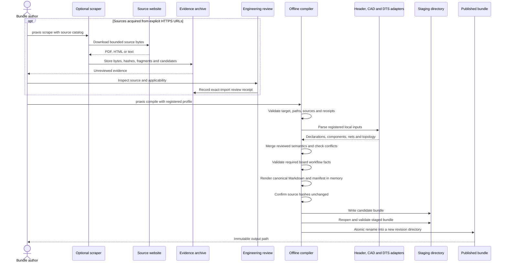
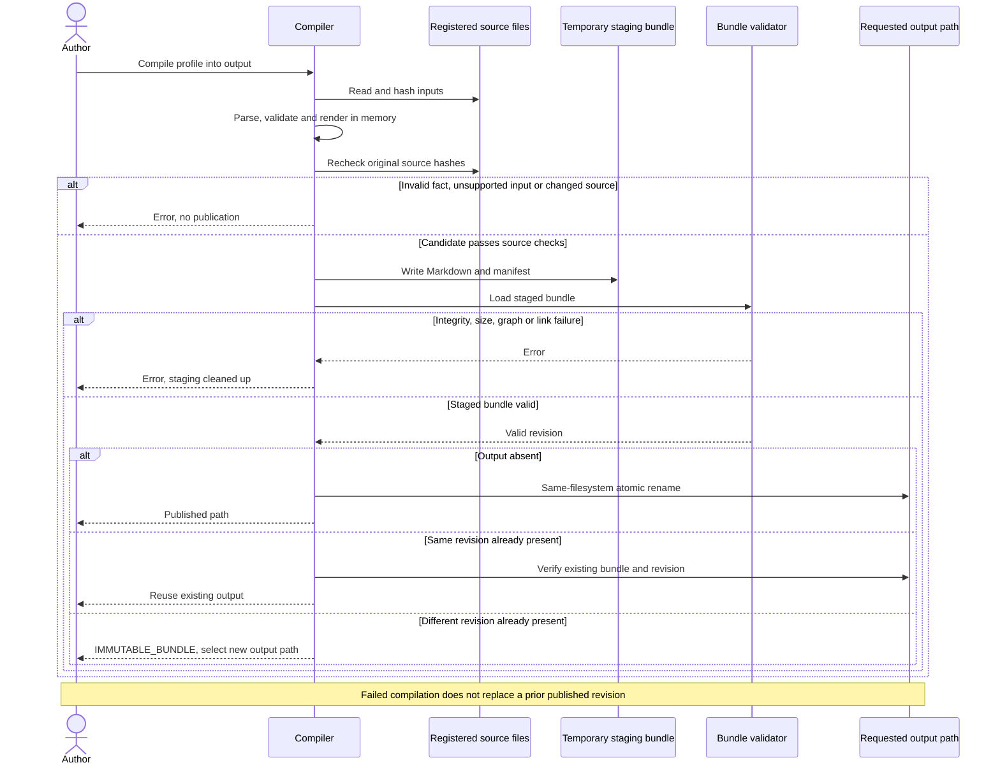
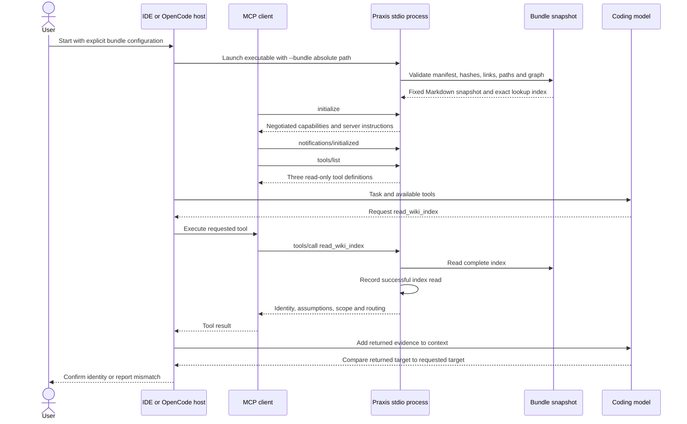
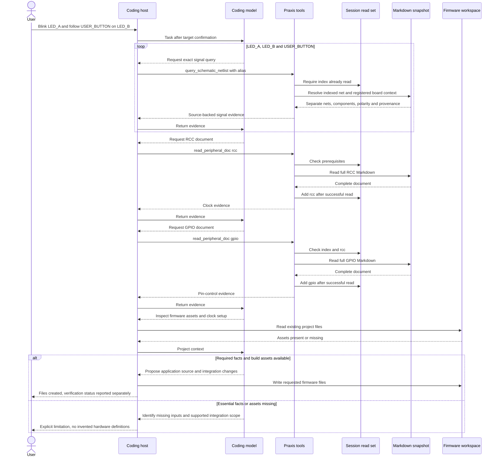
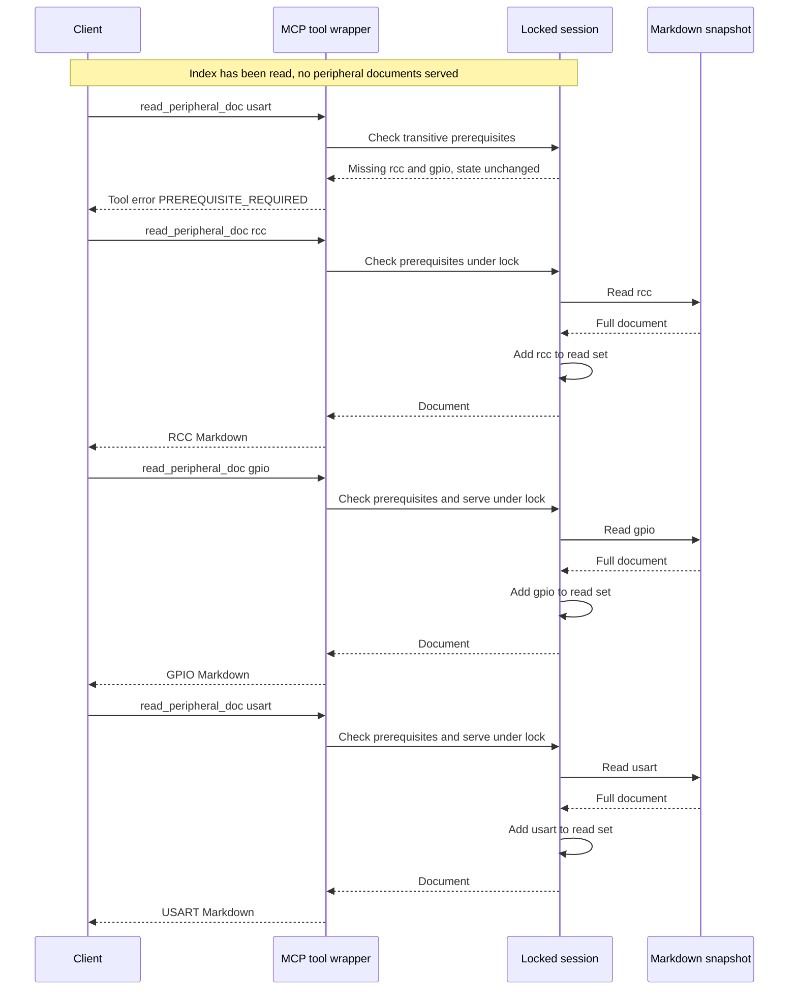
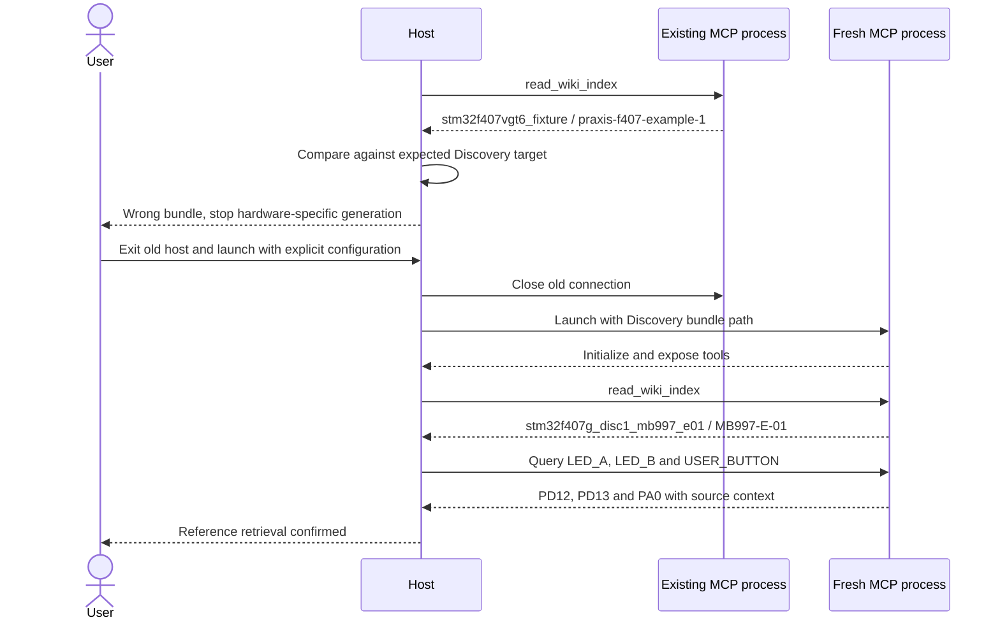
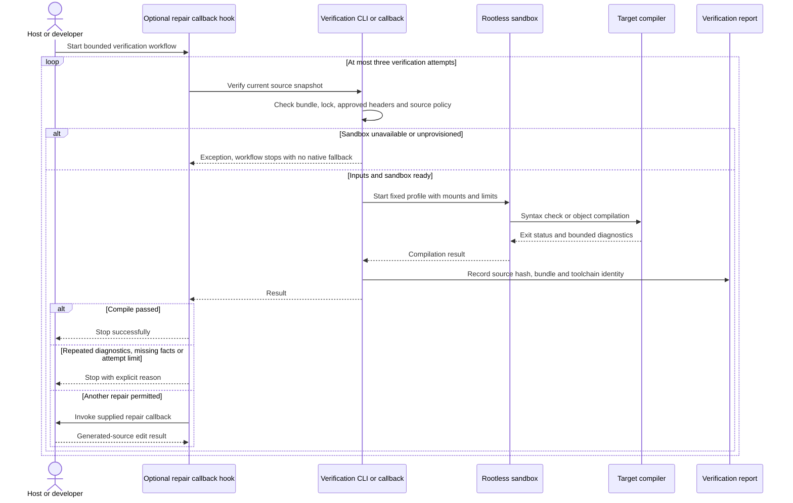

# Project Praxis sequence diagrams

These diagrams document logical control/data flow in the current implementation. Tool names
inside the knowledge server are its three public contracts; a host may prefix them with the
server name. The separate build and optional inspection sequences are documented in
[the build service](build-service.md) and [hardware inspection](hardware-inspection.md).
The model is shown separately from the host because it proposes calls and code while the host
executes tool calls and file writes. External model service details are intentionally omitted.

Configurable discovery, dependency-driven publication and branching retrieval sequences are
documented in [peripheral discovery](peripheral-discovery.md). Schema-2 bundles use their
declared graph rather than a universal four-document chain.

The [Cortex-M adapter sequence](target-adapters.md#compilation-and-retrieval-sequence)
shows configurable CPU/header extraction and source mapping without inherited firmware support.

The [STM32 ARM core sequence](arm-core-support.md#two-graphs-and-one-actual-implementation)
connects complete manual/diagram review, scoped write masks, immutable correction, modeled
effects and the actual retrieval/build MCP loop.

The implemented [ingestion MCP sequence](ingestion-mcp.md#evidence-and-publication-workflow)
adds assistant-driven source acquisition, complete evidence/image review and immutable
publication before restarting retrieval against the new revision.

## 1. Acquisition, review and offline compilation

Optional web acquisition is online. Review, compilation and publication are distinct steps.
Structured source adapters do not need the acquisition step when files are already local.

PDF wire geometry is not parsed automatically. Reviewed PDF transcription enters as a registered
structured source. A receipt
records review, but does not by itself establish independent hardware sign-off.

## 2. Publication success and failure

Publication is atomic at the directory rename boundary. It is not a signed-distribution system
or a transaction across multiple separately published bundles.

## 3. MCP startup and target confirmation

Identity comparison is a host/agent workflow requirement. The server isolates the selected
bundle, but cannot know a user's intended board from an unrelated conversation. Tool annotations
and server instructions are supplied to the client; adoption of instructions is client-dependent.

Each process serves one snapshot. Editing a bundle/configuration file does not retarget an existing
process. A manually started stdio process in another terminal is not automatically the process
the host uses.

## 4. LED and button retrieval followed by code generation

The model's actual behavior is not guaranteed by this expected sequence. In particular, it can
ignore instructions or generate unsupported startup code. A client trace and artifact review are
needed to establish what happened. GPIO polling does not require USART retrieval. SysTick timing
still requires a valid clock basis, vector/handler integration and core exception setup.

## 5. Prerequisite failure and retry

The lock covers both checks and successful state updates. A concurrently submitted dependent
call may succeed only if prerequisites have already been successfully served when its locked
check runs. Topology results never satisfy a peripheral prerequisite.

## 6. Detecting a stale or wrong bundle

This is the failure mode observed during the OpenCode walkthrough. The corrected retrieval was
reported by the user; it is not a controlled model benchmark or a physical board test. Reference
revision confirmation does not identify the physical PCB revision.

## 7. Separate compilation and optional repair

The loop is a logical view with stop branches; success or a stop reason exits the loop immediately.
The callback hook is a Python API, not an autonomous agent or additional MCP tool. Its callbacks
own edits. Verification never changes the knowledge bundle. The CLI does not link, flash or run
generated firmware. Live Podman compilation/isolation checks now run in the recorded environment.
The separate [F407 build MCP sequence](build-service.md#build-and-validation-sequence) adds full
linking, supplied integration assets, image validation and immutable artifact publication.

The server's isolation from compilation is deliberate: read-only retrieval remains portable
while the sandbox is a separate Linux extension. See [verification](verification.md) for exact
limits and failure behavior.
