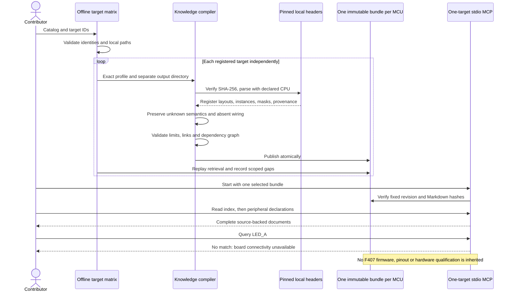

# Experimental STM32 family expansion

Praxis can now compile real STM32F1, STM32G0 and STM32H7 device headers into separate,
source-backed MCU knowledge bundles. This expands the compiler and retrieval coverage beyond
F407 without inventing an evaluation board or transferring its firmware assumptions.

## Published scope

| Intended MCU | Extraction CPU | Published register blocks | Register rows | Field definitions | Blocked types |
| --- | --- | ---: | ---: | ---: | ---: |
| STM32F103C8T6 | Cortex-M3 | 30 | 303 | 1,153 | 1 |
| STM32G071RBT6 | Cortex-M0+ | 35 | 289 | 1,731 | 0 |
| STM32H743ZIT6 | Cortex-M7 | 76 | 1,075 | 3,265 | 4 |

These are declaration counts for the exact profiles, not percentages of MCU capabilities.
Arrays retain their counts and strides; they are not expanded into inflated row counts.
Additional helper types without supported instance mappings are reported separately. Blocked
union layouts and ambiguous mask sets remain visible in coverage rather than becoming guessed facts.

All three bundles have **zero reviewed operating subsets**. Their GPIO, UART and timer
workflow requirements deliberately report missing operating evidence. No new firmware has
been generated, built, flashed or physically tested for these parts. Existing F407 build,
probe and qualified workflow scopes are unchanged; its published revisions are not overwritten.

Inputs come from ST's official
[F1](https://github.com/STMicroelectronics/cmsis-device-f1),
[G0](https://github.com/STMicroelectronics/cmsis-device-g0) and
[H7](https://github.com/STMicroelectronics/cmsis-device-h7) repositories, pinned to complete
commit identifiers in each profile and acquisition lock. ARM core headers use CMSIS 5.9.0;
upstream Apache-2.0 notices are retained. Every registered input carries `expected_sha256`.
Changed bytes fail with `SOURCE_HASH_MISMATCH` before parsing, rather than silently acquiring
the attribution of an unchanged upstream URL. Acquisition locks record URLs and hashes;
offline compilation never fetches them.

## MCU-only bundles

New profiles may declare `target.scope: "mcu"` with an explicit Cortex-M knowledge adapter.
They use `board_revision` and `primary_mcu_ref` equal to `not-applicable`. `clock_hz: null`
records that no active clock configuration is known. The declared package is an unreviewed
profile identity; physical package pins and pin availability are not supplied by the header.

MCU-only profiles omit the netlist. They cannot supply board models, physical pin maps,
signal aliases or board workflow claims. A valid empty topology document explicitly records
unavailable connectivity. `query_schematic_netlist("LED_A")` returns **No match: board
connectivity is unavailable**, after the ordinary index gate. This does not assert that the
MCU lacks LEDs, GPIOs or peripheral signals. Board profiles still require their original
schematic and clock evidence; an empty board netlist remains invalid.

The declaration inventories use an empty default dependency list: an entity requires the
index, and no operating initialization order is inferred. Once a contributor reviews an
operating workflow, its clock/pin/peripheral/interrupt dependencies must be explicitly authored.
HEDG retrieval gates continue to enforce those declared edges. Reading declarations does not
establish a safe initialization recipe.

The source differences are real: F103 GPIO has CRL/CRH, while G071/H743 expose MODER; USART BRR
is at offset 0x08 on the F103 header and 0x0C on G071/H743. UE is at bit 13 for F103 and bit 0
for G071/H743. These are source declaration checks, not reviewed operating guidance.

The generic parser now handles a compound non-contiguous mask only when separately named
contiguous component masks are disjoint and their exact union equals it. The component rows
retain their individual bits and provenance; the compound value, complete source identity
and algebraic relationship remain in the document. It never invents a contiguous field over
the gap. This restores CR1 field extraction on G071/H743 without a USART-specific parser rule.
Unproven partitions, conflicting positions and explicit unsupported compound field selections
still fail. Reviewed field views remain explicit. Earlier inventory-v1 bundles retain their
recorded extraction gaps; the latest inventory-v2 revisions add this capability.

## Compile and retrieve

Install the ingestion extras and native Clang/ARM GCC tools first, as in the
[setup guide](../README_DETAILED.md). The checked-in matrix is
[catalog.json](../sources/stm32-experimental/catalog.json).

```bash
praxis compile-matrix --catalog sources/stm32-experimental/catalog.json \
  --output /tmp/praxis-stm32-inventory

# Select one or more exact IDs; omit --target to compile all registered targets.
praxis compile-matrix --catalog sources/stm32-experimental/catalog.json \
  --target stm32g071rbt6_inventory --output /tmp/praxis-g071-inventory

# No ingestion tools or hardware connection are required to serve published Markdown.
praxis serve --bundle bundles/stm32g071rbt6-inventory-v2
```

The matrix validates unique identities, bounded local paths and target/profile matches before
compilation. Each target publishes atomically to its own directory. A failed target is reported
without hiding successful targets; the command returns 1 if any target failed its compile/replay.
Invalid catalogs return 2. `report.json` records revisions, counts, workflow gaps and document
sizes without timestamps or volatile paths. Repeating a successful build reproduces its bytes;
changed inputs need new output revisions. A changed matrix report is not overwritten.

Available published bundles:

- [STM32F103C8T6 inventory](../bundles/stm32f103c8t6-inventory-v2/wiki/index.md).
- [STM32G071RBT6 inventory](../bundles/stm32g071rbt6-inventory-v2/wiki/index.md).
- [STM32H743ZIT6 inventory](../bundles/stm32h743zit6-inventory-v2/wiki/index.md).

One server process still serves one explicit bundle. Use the
[OpenCode example](../examples/opencode.stm32-inventory.example.json) with absolute paths,
or change `--bundle` and restart your client. Existing F407 connections are not switched.
Rebuild an older Docker runtime image before serving the new MCU-scope manifests.

## Preserve complete documents at scale

New compilation has no fixed Markdown byte ceiling. Complete register/field tables retain
their full meanings and provenance; coverage/feature reports keep their tables and JSON in
one document. Size does not prune a selected peripheral or its dependencies. See
[document scaling and native KiCad acceptance](document-scale.md).

Historical inventory-v2 bundles retain their original lossless meaning dictionaries and
registered report companions. `praxis coverage`, `praxis features` and `praxis support` still
read those fixed, hash-verified companions. Arbitrary paths, nested references and missing
companions fail. Historical bundle bytes and revision hashes are unchanged.

## Contribution workflow

1. Copy an experimental part profile and select the exact header, identity macros and CPU.
   Register every transitive local include and retain the source license. Pin input hashes.
2. Start with empty operating definitions and MCU-only scope when no schematic is available.
   Add a unique matrix entry; export its schema with `praxis schema --kind target-matrix`.
3. Run batch compilation and inspect blocked/unmapped types, partial masks and workflow gaps.
   Add tested mappings or parser support where required; do not equate a helper type with a
   missing silicon feature. Unsupported declarations remain explicit.
4. Use [manual review packets](manual-review-compiler.md) to review exact clock, GPIO and
   peripheral semantics from applicable manuals, errata and package information. A shared
   peripheral name does not establish compatible offsets, encodings, resets or sequences.
5. Author reviewed mode contracts and dependency-scoped workflows. Add a separate exact
   board profile when connectivity becomes available. Firmware assets, toolchains, memory maps
   and probe backends require their own evidence; they are not inherited from F407.
6. Publish new immutable revisions, reproduce them, and replay real MCP retrieval. Physical
   contributors can qualify exact workflows later without blocking useful extraction work.



Actual stdio checks passed 168 calls across these three bundles, comparing full document
responses byte for byte. The complete regression passed 903 tests with four native KiCad skips.
The rebuilt Docker runtime passed 252 calls across five sessions, including the current F407
bundle, target isolation, restart behavior and negative startup/runtime checks. See [machine-readable evidence](stm32-family-expansion-evidence.json)
for revisions, validation outcomes and limits.

**Next:** review a bounded RCC/GPIO/UART workflow for F103 and G071, then generalize compile-only
firmware profiles for those exact parts. H7 cache/memory/domain behavior and bootloader/flash
workflows need their own contracts. Broad declarations accelerate that work; they do not replace it.
