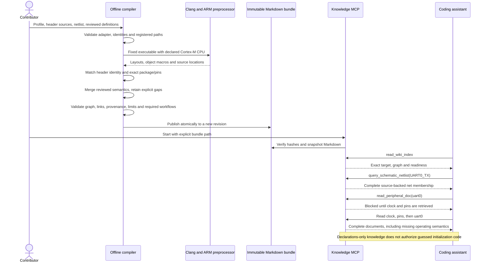

# Reusable Cortex-M knowledge target adapters

Praxis now accepts an explicit, declarative Cortex-M extraction adapter for a new MCU family.
The same compiler can inventory register layouts, resolve supported object macros, preserve
source provenance, publish a configured dependency graph and serve the resulting Markdown.
The adapter does **not** supply device operating semantics, firmware assets or a debug backend.
This is an extension of Milestones 1–3, with Milestone 4 rejecting unsupported firmware targets.

## Implemented scope

| Concern | Behavior |
| --- | --- |
| Target identity | Exact profile MCU/package/revision, header identity macros and schematic component/package checks |
| CPU selection | Explicit `cortex-m0`, `cortex-m0plus`, `cortex-m3`, `cortex-m4` or `cortex-m7`; no free-form compiler flags |
| Header layout | Clang ABI offsets, widths, reserved gaps, nested records and arrays; all non-system includes registered |
| Vendor naming | Configurable structures, instance expressions, register prefixes and field views; `_Msk`/`_Pos` or `_MASK`/`_SHIFT` |
| Provenance | Typedef locations and macro-definition locations mapped to hash-registered source identities |
| HEDG | Explicit profile prerequisites; no implicit RCC, STM32 AF layout or NVIC document route |
| Operating support | Existing reviewed definitions/modes/workflows; declarations remain insufficient for code generation |
| Firmware/hardware | A custom knowledge adapter cannot use the builtin sandbox verifier or F407 startup/linker/flash assets |

The executable example is [a fictional Cortex-M3 target](../sources/synthetic-cortex-m3/profile.json).
It is **not an NXP part, evaluation board, real schematic export or physically qualified device**.
Its header uses `_Type` structures and `_MASK`/`_SHIFT` macros deliberately to test conventions
different from the STM32 fixtures. There is no claim that every vendor header follows these conventions.

## Publication policy

Every source profile now requires a registered, hash-pinned `compilation_contract` in addition
to its extraction adapter. Target-specific requirements and operating clock constraints live
in this declarative input, rather than manufacturer branches in the compiler. See
[compiler contracts](compiler-contracts.md) for the complete schema and migration procedure.

## Profile contract

Add the following object inside `target` in a source profile:

```json
{
  "family": "praxis_demo",
  "knowledge_adapter": {
    "kind": "cmsis_cortex_m",
    "cpu": "cortex-m3",
    "header_identity": ["PRAXIS_DEMO_M3_H", "PRAXIS_DEMO_PART"],
    "mask_suffix": "_MASK",
    "position_suffix": "_SHIFT"
  }
}
```

This excerpt is not a complete profile. Use the example above or export the complete schema
with `praxis schema --kind profile`. Supply target identity, clock assumptions, registered
sources, pin map, netlist, reviewed definitions and configurable discovery. An empty definitions
array is valid for an explicitly declarations-only bundle. `header.constant_macros` can bind
integer part/CPU symbols in addition to checking identity-macro presence.

Builtin profiles retain their existing exact MCU/package/clock checks. Custom adapters cannot
override those identities or relabel one of the three builtin MCU models as a different family.
New STM32 parts may use family `stm32` with an explicit STM32 identity, CPU and header guards;
this registers knowledge extraction only. Other new families use their own canonical identity.
The custom Cortex-M adapter does not extend the AVR SFR adapter.
Header guards validate the declared profile against input symbols; they do not authenticate
a manufacturer or establish that the profile author selected the correct datasheet.

Discovery selects explicit structures and dependency edges, for example:

```json
{
  "automatic": false,
  "default_prerequisites": [],
  "peripherals": {
    "clock": {"structure": "CLOCK_Type", "prefix": "CLK", "prerequisites": []},
    "pins": {"structure": "PINMUX_Type", "prefix": "PIN", "prerequisites": ["clock"]},
    "uart": {"structure": "UART_Type", "prefix": "UART", "prerequisites": ["pins"]},
    "interrupts": {"structure": "IRQCTRL_Type", "prefix": "IRQ", "prerequisites": ["uart"]}
  }
}
```

These are **fictional policy names and relationships**, not universal hardware facts. On a real
device, establish each bus/clock/pin/interrupt prerequisite from applicable references. Preserve
the complete register tables, without a fixed document byte ceiling. Optional unsupported mask sets are withheld
and reported as partial declarations; explicitly required field views fail extraction instead.
Making an unreviewed workflow mandatory through `publication_requires` blocks publication.

The mask/position convention currently applies to the whole profile. Headers mixing vendor
`_MASK` fields with core `_Msk` fields may need a further per-entity adapter extension; fields
outside the configured convention are not extracted. A register layout with no published masks
does not establish its field semantics. Do not mark such a workflow supported without resolving
its required fields through tested extraction and reviewed evidence.

## Reproduce and test

Install the ingestion/test extras and native Clang/ARM GCC tools as described in the
[README](../README.md). The example needs neither a board nor online acquisition.

```bash
praxis compile --profile sources/synthetic-cortex-m3/profile.json --output /tmp/praxis-demo-m3
praxis lint --bundle /tmp/praxis-demo-m3
praxis evaluate --bundle /tmp/praxis-demo-m3
praxis serve --bundle /tmp/praxis-demo-m3
```

`serve` runs until stopped. In a separate terminal, use the reusable real MCP replay:

```bash
.venv/bin/python tools/check_bundle_mcp.py \
  --bundle /tmp/praxis-demo-m3 --peripheral uart0 --signal UART0_TX \
  --output /tmp/praxis-demo-m3-mcp
```

Use new output directories on repeated runs. The replay launches its own stdio server from
an unrelated working directory, discovers exactly three tools, tests index/dependency gates,
checks exact net membership, rejects invalid paths and compares complete document responses
byte for byte. It does not generate or compile C. The shipped
[synthetic bundle](../bundles/synthetic-cortex-m3-v1/wiki/index.md) supports the same replay.

## Compilation and retrieval sequence



## Contributor progression and limits

1. Select an exact new part/package and gather licensed header, manual/errata, package and
   schematic evidence. Specify the extraction CPU and header identities; do not infer a board
   pinout from an MCU family name. Review visual diagrams separately when their semantics
   cannot be decoded by the existing structured adapters.
2. Compile a declarations-only inventory and inspect every unsupported record. Add explicit
   mappings or a tested parser adapter when expressions, unions or naming are unsupported.
   This version still uses ARM GCC/libclang for CMSIS and its existing narrow AVR adapter;
   RISC-V, proprietary CPU ABIs and arbitrary vendor SFR languages need further adapters.
3. Add reviewed access/reset/side-effect/encoding facts, mode contracts and dependency-scoped
   workflows using [the shared manual review pipeline](manual-review-compiler.md).
4. Repeat deterministic publication and real MCP retrieval checks. Then add independently
   scoped toolchain/header locks, startup/linker assets, memory validation and hardware backends
   if builds/flashing are required. Those cannot be inherited from a knowledge adapter.
5. Label source review, modeled tests, cross-compilation and physical observations separately.
   Hardware access is optional for parser/knowledge contributions; physical qualification waits
   for someone with the exact hardware and an approved operation plan.

The current STM32/AVR immutable manifests remain readable with unchanged revision hashes.
Improved source attribution can produce a new revision when recompiling an older source profile;
never overwrite its existing published directory. Existing client configurations keep serving
their selected revisions until explicitly restarted with another bundle.

## Recorded validation

On 2026-10-12, the full regression passed **802 tests with four native KiCad skips**;
the subsequently added topology-only evaluation test passed separately, and Ruff passed.
The earlier focused regression passed 116 tests with the same four skips. Actual stdio MCP
performed four ingestion calls (profile, declarations, complete local header, publication)
and 14 knowledge calls. CLI and MCP publication produced ten byte-identical files at revision
`549fac8ec55251b7f49c77d6d458229394ddeef3b628f8f25000e6cf55db63e4`;
the largest document is 5,487 bytes. The ingestion catalog contained an explicitly unavailable
placeholder URL; no acquisition tool or network request was used. See
[the machine-readable evidence](target-adapters-evidence.json).

Checks preserve reserved spacing, arrays, exact masks/reset declarations and their actual
registered source identities. Negative cases reject a wrong CPU/header, unregistered includes,
wrong package, required missing semantics, graph cycles and builtin identity spoofing. Custom
knowledge targets fail before target verification or F407 asset reuse. Clang CPU-selector
checks cover all five allowed values; the complete compiler/MCP portability demonstration
uses Cortex-M3. These tests establish extraction and routing behavior, not real MCU operation.

**Next:** apply this adapter to one exact real non-ST Cortex-M part with supplied manufacturer
references, review a bounded UART/GPIO/clock workflow, and add its compile-only target profile
before offering any board programming support. Full MCU/bootloader support remains an open,
separately evidenced expansion.
