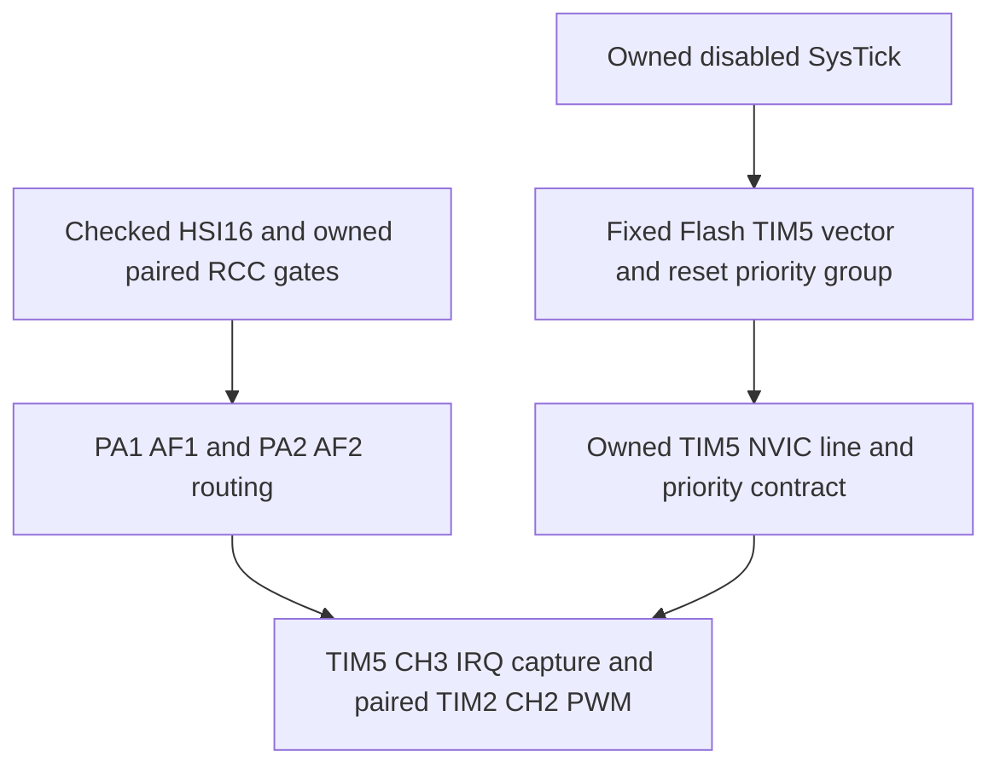

# Paired timer capture through interrupts

This increment adds the exact `tim2_tim5_capture_irq` workflow for the
STM32F407VGT6 / STM32F407G-DISC1 reference MB997-E-01. It pairs PA1/TIM2_CH2
PWM with PA2/TIM5_CH3 rising-edge capture through TIM5 IRQ50. Source contracts,
independent effects, isolated target builds and fixed-ABI observations are separate
checks. **This new image has not been flashed or physically qualified.** The earlier
[polling trial](reports/timer-route-results.md) does not qualify interrupt delivery.

The [source profile](../sources/stm32f407g-disc1/profile-timer-irq-v1.json) extends
the prior profile without changing historical bundles. MCU facts, exact instance
scopes, field views and prerequisites remain versioned data; the core compiler has
no new manufacturer branch. The [new application](../examples/stm32f407g-disc1-timer/irq_application/main.c)
is deliberately target-specific. Its startup, linker and headers still come from the
separately pinned firmware assets. See [recorded software evidence](timer-irq-evidence.json)
for the exact bundle, artifact and verification results.

## Source and prerequisite reconciliation

Actual ingestion MCP retrieved complete cached RM0090 Rev22 and PM0214 Rev10
parts, the pinned device IRQ enum, CMSIS operations and the firmware asset contract.
The [versioned evidence](../sources/stm32f407g-disc1/reviewed/timer-irq-v1/evidence.json)
records source hashes and exact locators. PDF extraction is evidence; editorial
semantic interpretation remains an implementing-author review, with independent
engineering sign-off pending.

- RM0090's literal DIER fields are on page 629, with status semantics on pages
  630–631. The new selected fields use these locators; historical broad references
  and published revisions are preserved.
- TIM5_IRQn is 50, vector slot 66, and four priority bits are implemented. Logical
  priority 2 / encoded byte 0x20 is application policy. PM0214 pages 210–215 establish
  write-one NVIC actions, pending versus active state and priority access.
- PM0214 pages 22–26, 225–229 and 247 establish privilege, masks, system exceptions,
  vector alignment, grouping and SysTick inspection. AIRCR is read only here.
- The older `flash_vector_table` mode requires a SysTick-specific handler. TIM5 uses
  its own `tim5_fixed_irq_context` mode instead, requiring a disabled owned SysTick,
  a matching strong TIM5 handler and the pinned main-SRAM stack. No inherited
  SysTick handler or arbitrary vector relocation is claimed.

The workflow's mode route is checked independently of the document retrieval DAG:



Document retrieval may additionally visit USART, EXTI and other preserved HEDG
prerequisites. Reading those documents does not require enabling unrelated hardware.
The expanded bundle has 43 operating contracts and 24/39 ready authored workflows.
These counts describe the authored scope, **not a percentage of all MCU features**.
USB, Ethernet, storage, boot/update, other timer modes and independent qualification
remain explicit gaps.

## Initialization, delivery and cleanup

This example requires a fresh privileged Thread/MSP startup, PRIMASK=1,
BASEPRI=FAULTMASK=0, nominal HSI16 and undivided AHB/APB clocks. It checks the fixed
Flash vector, initial stack, PRIGROUP=0, disabled SysTick and absent pending system
exceptions. It rejects enabled/pending/active external lines before acquiring its
own line. No RTOS, live handoff, shared timer/pin ownership or downstream UG/TRGO
consumer is supported.

The software recipe is TIM2 PSC15, ARR999, CCR2=250; TIM5 uses a free-running
32-bit counter with PSC15. The expected relative period is 1,000 ticks with ±2 tick
tolerance. Both counters share HSI: no independent frequency or duty calibration
follows from this check.

```mermaid
sequenceDiagram
    participant Assistant
    participant Knowledge as Knowledge MCP
    participant Build as Isolated build MCP
    participant Thread as Firmware Thread
    participant ISR as TIM5 handler
    participant Reader as Read-only telemetry MCP
    Assistant->>Knowledge: Index, exact PA1/PA2 nets, prerequisite documents
    Knowledge-->>Assistant: Versioned modes, instance scopes and source references
    Assistant->>Build: Snapshot and build the separate IRQ application
    Build-->>Assistant: Validated linked artifact and exact image identity
    Note over Assistant,Thread: Physical execution requires a new exact-image approval
    Thread->>Thread: Check ownership, clocks, vector, masks and disabled sources
    Thread->>Thread: Configure/read back pins and timers with all requests disabled
    Thread->>Thread: Set priority; arm capture; enable NVIC; enable capture request
    Thread->>Thread: Enable PWM last; publish armed state; unmask globally
    loop One discarded edge then nine natural timestamps
        ISR->>ISR: Check exception/live state; SR → one CCR3 read → SR
        ISR->>ISR: Reject overcapture/new flag; validate every stored interval
    end
    ISR->>ISR: Disable source before disabling line and clearing pending
    Thread->>Thread: Mask globally; verify inactive/pending/enable state; stop and release
    Thread->>Thread: Publish a stable terminal result with coherent generations
    Assistant->>Reader: Select exact artifact/kind at launch; bounded samples
    Reader-->>Assistant: Image-bound raw periods, IRQ receipts and shutdown snapshots
```

Main waits on volatile ISR completion with a bounded iteration count. It never
drains active capture data. A timeout records whether capture flags were pending:
missed exception delivery cannot qualify as a no-edge timeout. Errors latch;
the publisher does not retry or restart hardware. Failed or inaccessible cleanup
cannot count as quiet, even when initialized snapshot words are zero.

## Fixed software observation contract

`timer-irq-v1` is a separate 180-byte / 45-word software ABI at the ELF-bound global
`praxis_timer_irq_telemetry`. It retains the common raw capture/result prefix and adds
IRQ/data-read counts, discarded-edge count, error reason, encoded priority, vector
receipt, normalized enabled/pending/active end states, pending-capture timeout and
an IRQ snapshot validity bit. It does not redefine the previous polling ABI.

The sole publisher uses odd/even generations and memory barriers. The existing
read-only MCP tool checks the exact ELF object, target identity and every image byte
before and after duplicate coherent SRAM reads. Requests cannot select arbitrary
addresses, symbols or replacement artifacts. Readout exposes no flash/control tool.

The offline qualifier independently validates its own ABI and IRQ receipts before
adapting the common raw fields to the existing period qualifier. Supplied outcome
labels are not trusted. It recomputes all intervals, checks the validated prefix,
requires stable terminal values with fresh publications and rejects incomplete
shutdown. Positive results require ten IRQ receipts, ten data reads, one discarded
edge, nine natural timestamps and eight valid intervals. Quiet failure and no-edge
timeout are distinct expected outcomes.

## Reproduce software checks

```bash
PRAXIS_REQUIRE_EXTERNAL_TOOLS=1 .venv/bin/python -m pytest -q \
  tests/test_timer_irq.py tests/test_timer_irq_effects.py tests/test_telemetry.py

PRAXIS_REQUIRE_EXTERNAL_TOOLS=1 .venv/bin/python tools/check_target_acceptance_mcp.py \
  --bundle bundles/stm32f407g-disc1-e01-timer-irq-v1 \
  --plan examples/acceptance/stm32f407g-disc1-timer-irq.json \
  --catalog examples/capabilities/stm32f407g-disc1-timer-irq.json \
  --workspace examples --assets assets/stm32f407vg --lock toolchain-f407.lock.json \
  --inventory examples/inventory/stm32f407g-disc1/inventory-v2.json \
  --output .praxis-output/timer-irq-replay-new

praxis qualify-timer-irq --bundle /absolute/path/to/selected/bundle \
  --artifact EXACT_ARTIFACT_HASH --expect passed \
  --observation /absolute/path/to/observation.json \
  --output /absolute/path/to/new-qualification.json
```

The independent model exercises immediate delivery before unmask returns, counter
and publisher rollover, 54 faults, incorrect context/vector/group, busy lines,
failed enable/readback, absent edges, overcapture, wrong periods, lost gates and
failed quiet cleanup. Real stdio MCP with an explicitly synthetic probe and actual
OpenOCD Tcl guard tests validate reader behavior without touching a physical board.
The seventeenth isolated application case retains all previous cases. Full MCU
acceptance remains false.

Next is an exact-artifact physical interrupt trial: confirm the passive
PA1/P1-11 ↔ PA2/P1-14 wiring with power disconnected, approve the new image's exact
erase/program/reset plan, then observe wired success, clean no-edge timeout and
recovery through MCP. Physical PCB revision remains unconfirmed. Timer DMA is a
separate later contract and test increment; it is not enabled by this example.
