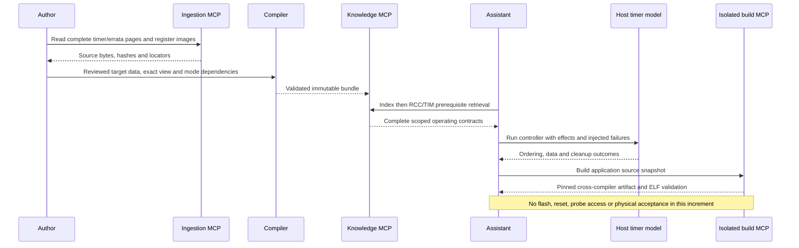

# Scoped F407 timer operating support

This increment adds three reviewed source-data contracts, two isolated examples
and an independent timer effect model. The compiler and MCP runtime are reused
unchanged. The previous [register-view representation](register-field-views.md)
now carries operating selection and field semantics with source provenance.

The [new immutable bundle](../bundles/stm32f407g-disc1-e01-timer-modes-v1/wiki/index.md)
retains every earlier contract and adds:

| Contract | Reviewed scope |
| --- | --- |
| `rcc/tim2_owned_gate_reset` | Checked HSI16 context; exclusive gate/reset; TIM1 inactive; unrelated RCC bits preserved |
| `tim/pwm_ch1_reference` | TIM2 edge-aligned upcounting PWM1 reference and buffered duty changes; external output disabled |
| `tim/software_capture_ch1` | Stopped TIM2 counter; internal TRC/ITR0; software capture events; stale/overcapture rejection |

The two ready workflows are `tim2_pwm_ch1_reference` and
`tim2_software_capture_ch1`. `tim2_pwm_ch1_pin` and `tim2_capture_ch1_external`
remain explicitly blocked: their operating contracts and board signal routing
are not published. No other timer instance inherits these TIM2 modes merely
because it uses the same CMSIS C structure.

Coverage is **22 reviewed peripheral subsets, 35 operating-mode contracts and
22/37 ready authored workflows**. These are bounded, uneven scopes, not a
percentage of all MCU features. The register inventory remains42 blocks,
541 register rows and2152 distinct primitive name/mask declarations.

## Source and publication path

Complete RM0090 Rev22 timer functional/register pages and ES0182 Rev19 timer errata
were read through ingestion MCP. Original register diagrams were inspected with
`read_source_page_image`; spatial `rw` labels were not promoted by a text heuristic.
The source profile binds the full previous definition state before replacing RCC
and TIM operating records. Their earlier narrative and mode contracts remain intact.

- [Profile](../sources/stm32f407g-disc1/profile-timer-modes-v1.json): explicit workflows, dependencies and pinned source hashes.
- [Reviewed extension](../sources/stm32f407g-disc1/reviewed/timer-modes-v1/extension.json): target-specific facts, instance scope, selected views and parent binding.
- [Evidence registry](../sources/stm32f407g-disc1/reviewed/timer-modes-v1/evidence.json): original PDF/part hashes, locators, register facts and errata scope.
- [Timer semantics](../sources/stm32f407g-disc1/reviewed/timer-modes-v1/tim.md) and [RCC semantics](../sources/stm32f407g-disc1/reviewed/timer-modes-v1/rcc.md).
- [Application sources](../examples/stm32f407g-disc1-timer/README.md), [effect model](../tests/fixtures/f407_timer_model.c) and [positive/negative checks](../tests/test_timer_modes.py).
- [Machine-readable verification](timer-modes-evidence.json).

The explicit view choices are CCMR1 `output_output` for the PWM reference and
`input_output` for software capture. Both require the checked HSI clock mode and
owned TIM2 gate/reset mode. Software capture selects internal TRC through ITR0,
whose TIM1 source must stay gated; GPIO is not part of that route. A separate
external input mode will need package/AF and board evidence.

Two actual ingestion MCP publications and an independent CLI compilation produce
identical bundle files. A pre-existing Docker runtime serves this new bundle,
demonstrating that adding these operating facts does not require a runtime branch
or rebuild. Historical bundles are unchanged.

## Verification algorithm

```text
before ownership:
    validate API parameters, privileged Thread context and interrupt mask
    confirm actual clock selection/divisors and synchronized nominal clock
    reject enabled TIM2 gate, asserted reset or active TIM1 trigger source

after gate enable and reset readbacks:
    keep CEN, channel enables and IRQ/DMA requests zero
    select and read back the register interpretation before CCR1 writes
    program the bounded mode, load preloads with UG, discard stale flags
    verify configuration before final counter/capture enable

PWM reference:
    leave external channel output disabled
    write/read back CCR1 preload; do not confuse readback with active duty
    clear stale UIF; wait for a new update with a finite iteration budget

software capture:
    refuse pre-existing capture/overcapture flags
    write/read back stopped CNT, issue one CC1G action
    wait boundedly, read capture data before the final status check
    reject lost/new events or mismatching data before publishing the value

on operational failure:
    latch failure, quiesce owned accessible hardware, verify shutdown
    never claim cleanup success erased the failure; never automatically retry
```

Model tests exercise preload transfer, nominal arithmetic and endpoint duties,
full-word capture, rc_w0 and read-to-clear behavior, context/ownership rejection,
failed gate/reset/configuration, stale flags, timeout, overcapture on either side
of a data read, corrupted capture, lost clock gate and unsuccessful shutdown.
Direction-readback fault injection caught a real ordering issue during development:
CCR1 must not be written before confirming that output mode was accepted.

These models establish behavior under explicitly modeled effects. They are not
an MCU emulator, a waveform capture or physical timing evidence. The software
capture example tests software-triggered capture, not incoming-edge measurement.
The PWM example configures OC1REF while CC1E stays zero; it does not drive a pin.
Counter/flag polling budgets bound iterations rather than promising milliseconds.

The combined acceptance plan retains all twelve earlier cases and adds both
timer applications. It obtains knowledge and builds/revalidates artifacts through
real MCP sessions, with no hardware tools exposed. Linking checks the target
headers, startup, memory layout and ELF; it does not establish physical execution.

## Sequence



## Next

Review board-routed PWM and external capture requirements, including package/AF
availability and shared-pin ownership. Add matching operating contracts and
positive/negative cases before a physical waveform/input test. Timer IRQ/DMA,
advanced modes, other timer instances, boot/storage and the remaining MCU inventory
still require their own source-backed scopes. Independent engineering review and
full F407 acceptance remain open.
