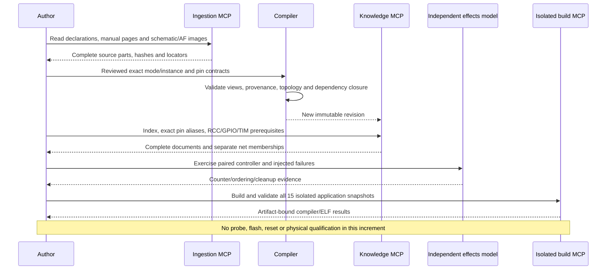

# F407 routed PWM and independent input capture

The subsequent telemetry variant has an operator-approved
[physical trial report](reports/timer-route-results.md). Its evidence binds only to
that variant's exact artifact; the earlier source/model/compiler checks below
do not inherit physical qualification automatically.

This increment adds a source-backed paired route: **PA1/TIM2_CH2 PWM output →
passive external test jumper → PA2/TIM5_CH3 rising-edge capture**. Its knowledge
contracts and firmware are model/compiler checked. The new route has not been
flashed or physically qualified. Independent review and actual PCB revision
confirmation remain open.

Use the new immutable [bundle](../bundles/stm32f407g-disc1-e01-timer-routes-v1/wiki/index.md)
and [profile](../sources/stm32f407g-disc1/profile-timer-routes-v1.json). Revision:
`2dbfa901ec294c0f8edc5e37e87d41a3aa69f169dcce18b4acf088d48f5c0167`.
Older bundles retain their exact contents. Restart a knowledge server to select
this revision; an already connected session keeps its original bundle.

The bundle retains 42 register blocks, 541 register rows and 2,152 distinct primitive
field declarations. It adds four scoped mode contracts (39 total) and one authored
workflow (23/38 knowledge-ready). These are counts within the authored scope, **not
percentages of complete MCU support**. The older CH1 external workflows remain blocked.

## Evidence and ownership

All new hardware source review used the ingestion MCP, including complete extracted
parts, pinned CMSIS declarations and the package/AF/schematic images. An implementing
author synthesized the reviewed records; the parser did not infer wiring from PDF text.
The [semantic evidence](../sources/stm32f407g-disc1/reviewed/timer-routes-v1/evidence.json),
[pin evidence](../sources/stm32f407g-disc1/reviewed/timer-routes-v1/pin-evidence.json) and
[connectivity evidence](../sources/stm32f407g-disc1/reviewed/timer-routes-v1/connectivity-evidence.json)
retain original PDF hashes, extracted-part hashes, import revisions and locators.

| Function | MCU package endpoint | Fixed board header | Alternate function | Source |
| --- | --- | --- | --- | --- |
| PWM output | PA1, U4:24 | P1:11 | AF1 TIM2_CH2 | DS8626 Rev12 pages51,64; MB997-E-01 pages2,7 |
| Rising capture | PA2, U4:25 | P1:14 | AF2 TIM5_CH3 | DS8626 Rev12 pages51,64; MB997-E-01 pages2,7 |

The fixed PA1 and PA2 board nets remain separate. `TIM2_PWM_OUT` and
`TIM5_CAPTURE_IN` are exact declared retrieval aliases, not evidence of a fitted
jumper or automatic mode selection. PA2 also retains its USART2_TX alias, so the
UART and routed-timer examples must never own that pin simultaneously. ST-LINK
U2's PA1/PA2 labels are local unconnected pins, not target VCP connections.
The board transcription remains explicitly partial.

A later physical test requires a confirmed connector orientation and passive
**PA1/P1-11 ↔ PA2/P1-14** jumper, without a PA2↔PA3 jumper, other attachments,
external drivers or competing ADC/Ethernet/USART/GPIO owners. Disconnect every
power source before changing wiring. No wiring change or physical pass is recorded
by this software increment.

## Reusable compiler change

A canonical peripheral document may describe several instances. A single shared
instance list cannot correctly express two modes reviewed for different instances.
`WorkflowRequirement.mode_instances` now explicitly binds each selected mode:

```json
{
  "instances": {"tim": ["TIM2", "TIM5"]},
  "modes": {"tim": ["pwm_ch2_pa1", "capture_ch3_pa2"]},
  "mode_instances": {
    "tim": {
      "pwm_ch2_pa1": ["TIM2"],
      "capture_ch3_pa2": ["TIM5"]
    }
  }
}
```

The schema checks complete mode coverage, exact unique nonempty instance names
and agreement with the aggregate instance union. Coverage traversal checks every
requested scope against the reviewed mode, then its explicit prerequisite edges.
It retains the mapping in Markdown and support reports. Existing workflows without
this field keep their uniform scope and byte-compatible serialization. There is
no TIM2/TIM5 or manufacturer branch in this algorithm; the selected names and
hardware facts live in the versioned profile/extension.

```text
validate workflow:
    for each entity with explicit per-mode scopes:
        require scope keys == selected modes
        require unique nonempty exact instances in each scope
        require aggregate scope, if supplied, == union(per-mode scopes)

assess workflow:
    for each selected entity/mode:
        scope = explicit per-mode scope, otherwise legacy entity scope
        require scope is within the mode's reviewed instances
        visit the mode's explicit prerequisite edges
    require all registers, semantic sources and exact topology queries
    publish readiness and the complete instance mapping
```

## Firmware and verification boundary

The [application](../examples/stm32f407g-disc1-timer/routes_application/main.c)
requires a fresh privileged Thread startup, PRIMASK=1, synchronized SystemCoreClock,
actual ready HSI selected and AHB/APB divisors1. HSI16 is nominal. Both timer gates
and resets must initially be clear. There must be no downstream consumers of their
initialization UG/TRGO pulses, even with MMS=0. Live clock/configuration/owner changes
are unsupported.

TIM2 uses PSC15, ARR999, CCR2=250, PWM1 with preloads, producing nominal 1 kHz/25%.
TIM5 uses PSC15 and full 32-bit ARR, direct TI3 rising capture without filter or
capture prescaler. Its independent free-running counter avoids hiding a wrong PWM
period behind that PWM timer's own wrap. Both counters share HSI: this measures
relative counter ticks, not calibrated seconds or duty cycle. Capture transfers
use the full 32-bit CCR3 word; generic CMSIS CCRx field masks describe the low16 bits
and must not truncate the input register value.

GPIO changes preserve all unowned bits, including SWD PA13/PA14 and USER PA0.
GPIOA is never reset. Read back gate/reset transitions, direction, electrical
settings and AF routing before enabling anything. Start capture first, then output,
then the PWM counter; verify each enable. Discard the initial enable edge, prime a
natural edge, and validate eight subsequent periods of 1000±2 local ticks.

Polls are bounded by iterations. Read CCR3 before a final SR check; reject CC3OF
before/after the read or a new CC3IF after it. Missing wire, wrong period and
ownership/configuration failures latch errors. Stop both owned timers and release
only PA1/PA2 MODER fields. Lost clocks or unsuccessful shutdown cannot claim quiet;
there is no automatic retry. IRQ/DMA and other modes are outside this example.

The independent [effect model](../tests/fixtures/f407_timer_route_model.c) covers
normal capture and 32-bit wrap, unavailable wiring, bad context/clock/ownership,
locked pins, wrong AF/direction, lost gate/reset/preload/enable writes, stale flags,
overcapture/data-read races, wrong period, inaccessible cleanup and failed pin/output
release. It executes the same controller with independently authored hardware effects.
This is neither a complete MCU emulator nor physical waveform evidence.



## Reproduce

Provision the required dependencies and both pinned Podman images first; missing
required checks fail rather than skip. Use fresh output directories.

```bash
PRAXIS_REQUIRE_EXTERNAL_TOOLS=1 .venv/bin/pytest -q
PRAXIS_REQUIRE_EXTERNAL_TOOLS=1 .venv/bin/python -m praxis compile \
  --profile sources/stm32f407g-disc1/profile-timer-routes-v1.json \
  --output /tmp/praxis-timer-routes-new
PRAXIS_REQUIRE_EXTERNAL_TOOLS=1 .venv/bin/python tools/check_target_acceptance_mcp.py \
  --bundle bundles/stm32f407g-disc1-e01-timer-routes-v1 \
  --plan examples/acceptance/stm32f407g-disc1-timer-routes.json \
  --catalog examples/capabilities/stm32f407g-disc1-timer-routes.json \
  --workspace examples --assets assets/stm32f407vg --lock toolchain-f407.lock.json \
  --inventory examples/inventory/stm32f407g-disc1/inventory-v2.json \
  --output /tmp/praxis-timer-routes-acceptance-new
```

Validation: 1,165 full-suite tests passed with zero skips and required external tools;
a 51-test focused run includes six bundle/source checks added after that suite was
collected. All 15 examples built/revalidated through 90 MCP calls; Docker passed 162
calls across four sessions. Three publications were byte-identical. Packaging,
Ruff and the offline dependency lock check passed. The release gate exits 2 for
missing independent exact-bundle and firmware-asset review.

Exact check results are recorded in [the increment evidence](timer-routes-evidence.json).
All fourteen previous application cases remain unchanged in the fifteen-case plan.

## Next

Qualify the paired route on an identified board using a reviewed wiring fixture,
a new exact-image approval and artifact-bound observations; qualify missing-wire
failure and recovery separately. Then extend source-backed timer IRQ/DMA modes,
remaining instances and acceptance cases. Boot/update, USB, Ethernet, storage,
remaining applicability/errata, physical qualification and independent review
remain explicit F407 completion work.
